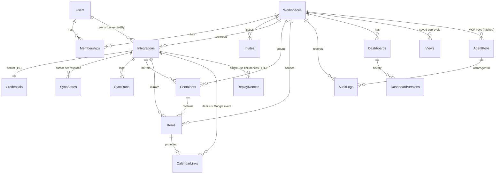

> Spec deltas since this doc was written live in [REPORT.md](REPORT.md) under "Spec deltas".

# DATA.md — Personal Management Dashboard on Elytra

Data model for Shalev's personal management dashboard, built on [shalev396/Elytra](https://github.com/shalev396/Elytra), with MongoDB added through Elytra's existing Mongoose path.

> Status: design only. Nothing has been created, migrated or deployed.
> Based on Elytra `main` @ `e382dc5` (2026-10-09 20:51 Asia/Jerusalem), read only.

---

## 0. HARD PRIVACY RULE — provider tokens

> **Provider tokens and secrets are encrypted at rest. They are never returned in any API response, UI, log, error message, analytics event or export, and that includes to their owner.**
> After a user saves a token, the only things anyone (user, UI, agent) can see again are integration metadata: provider, account label, status (`connected` | `expired` | `error`), `expiresAt` and `lastSyncAt`. **No masked hint, no last-4 characters, no prefix — tokens are never returned in any form.** To change a token, the user replaces it; there is no "reveal" button.

How the rule is enforced, with several independent layers (details in §7):
1. **Separate collection.** Tokens live in `Credentials`, never on `Integrations` or `Users`. Only one sanctioned function ever decrypts `Credentials`: `CredentialVault.decryptForSync(integrationId)` for outbound provider calls (sync jobs, "test connection", calendar pushes). No other route, MCP tool or job imports the vault.
2. **Ciphertext only.** Each token is sealed with AES-256-GCM using a per-credential data key, and that data key is wrapped by AWS KMS.
3. **Mongoose guards.** `select: false` on every secret field, a `toJSON`/`toObject` transform that deletes them, and repository `toCredentialMeta()` mappers that copy only metadata (following Elytra's `toUserData()` pattern).
4. **Response guard.** `res.success()` runs a deny-list scrubber for keys like `ciphertext`, `token`, `secret`, `apiKey`, `authTag`, `wrappedKey` and `pk_*`/`lin_api_*`/`ATATT*`/`xox*`/`ghp_*`/`github_pat_*`/`elk_*` patterns. A hit in dev/qa throws an error; a hit in prod returns a 500 response and raises an alert.
5. **Log redaction.** All logging goes through a `redact()` wrapper around `console.*` (Elytra logs with `console.error` today). Provider SDK errors are logged after headers are stripped.
6. **Tests.** Unit and Postman tests assert that no response body from any route matches the secret patterns, and that `JSON.stringify(credentialDoc)` contains no secret fields.

---

## 1. What Elytra already gives us (reuse, don't rebuild)

| Area | Elytra today (verified in repo) | How the dashboard uses it |
|---|---|---|
| Stack | React 19 + Vite + TS + Tailwind/shadcn + Redux Toolkit + React Query. Express 5 on **one AWS Lambda**, Node 24. AWS CDK with stages `dev`/`qa`/`prod` | Same stack and stages. |
| DB switch | `DATABASE_URL` scheme picks the provider: `mongodb(+srv)://` → **Mongoose 8**, `postgres://` → Sequelize (`config/environment.ts`) | Set a `mongodb+srv://` URL. Mongo is the target for the new collections. |
| Mongo connection | `config/providers/mongoose.ts`: Lambda-tuned pool (`maxPoolSize: 2`). Atlas **IAM auth (`MONGODB-AWS`)** through the role `elytra-<stage>-api`, so there's no DB password | Keep it. Grant the same role `kms:Decrypt`/`GenerateDataKey` on the dashboard KMS key. |
| Model layout | `models/definitions/X.ts` (interface + `X_TABLE_NAME`), `models/mongoose/X.ts` (schema + `XRepository`), `models/sequelize/X.ts`, `models/index.ts` (lazy `getXRepository()`) | Same pattern for every new collection. The new collections are **Mongo-only** because `Items` is polymorphic, so the Sequelize side throws `NotSupported`. |
| IDs | `_id: String`, default `randomUUID()`; the API exposes `id` | All new collections use UUID string `_id`. |
| Naming | Collections are PascalCase plural (`Users`, `Media`). `timestamps: true` gives `createdAt`/`updatedAt` | `Workspaces`, `Memberships`, `Invites`, `Integrations`, `Credentials`, `Items`, `Containers`, `SyncStates`, `SyncRuns`, `AuditLogs`, `Dashboards`, `DashboardVersions`, `Views`, `AgentKeys`, `CalendarLinks`, `ReplayNonces`. Other docs use exactly these names. |
| Users/auth | Cognito JWT → `expressAuth` → `req.user = { id, cognitoSub }`. `Users` has `{cognitoSub (unique), name, email, photoId, lastLoginAt}` | Reused as is. A workspace is created on the user's first login. |
| Responses | `res.success(data)` → `{ data }`, `res.error(msg, code)` → `{ message }` | Same, plus the secret scrubber (§0). |
| Ops | Direct-invoke `sync-db` / `reset-db` (refused on prod). `express-rate-limit` | `sync-db` for Mongo becomes "ensure indexes + JSON-schema validators" (today `syncMongo()` is a no-op). |

---

## 2. Overview

- **One-way mirror.** Providers are the sources of truth: Google Calendar for events, Jira and ClickUp for work, Linear for personal, Moodle for college. Every provider flows **one way into the app**: the dashboard reads and upserts and never writes provider data back.
- **The one sanctioned exception:** two-way sync with the user's **Google Calendar** through Google OAuth. Pushes, Google-side edits and deletes are tracked in `CalendarLinks`, and every write to Google is recorded in `AuditLogs` (`action: "gcal.write"`). Nothing else is ever written to a provider.
- **Optional sources (read-only):** GitHub (issues/PRs), Google Drive (the Notability PDF backup, read-only file tree), Notion (legacy, optional import of to-dos only). **Slack is out of scope for the app**: AI agents use Slack through their own Slack MCP; the `slack` enum value is reserved only.
- **Local items.** Items created in the dashboard (`source.provider = "local"`) are fully editable. They are the only items the dashboard owns.
- **Areas.** Every item and container has an `area` of `work` | `college` | `personal`. The integration sets the default (Jira/ClickUp → work, Moodle → college, Linear → personal). A container rule overrides it: projects whose name or key includes `shalev396` → personal.



---

## 3. Collections

Common to all collections: `_id: string (UUID)`, `createdAt` and `updatedAt` (Mongoose timestamps). Every collection except `Users` carries a `workspaceId`.

### 3.1 `Users` (existing, unchanged)
Reused from Elytra. We add one optional field: `defaultWorkspaceId: string | null`.

### 3.2 `Workspaces` (one organization per user)
| Field | Type | Notes |
|---|---|---|
| `name` | string | e.g. "Shalev". |
| `slug` | string | Unique. |
| `ownerId` | string → Users | Creator. Always has an `owner` membership. |
| `settings.timezone` | string | `Asia/Jerusalem`. |
| `settings.weekStart` | `sun`/`mon` | `sun` (Sun–Thu work week). |
| `settings.areas` | string[] | `["work","college","personal"]`. |
| `settings.areaRules` | `{match, area}[]` | e.g. `{ match: "shalev396/*", area: "personal" }`. |
| `deletedAt` | Date \| null | Soft delete. |

On a user's first login, a personal workspace and an `owner` membership are created. A user can belong to several workspaces: their own, plus any shared with them.

### 3.3 `Memberships` (roles, sharing between two people)
```json
{ "_id": "8c1e…", "workspaceId": "w-1…", "userId": "u-2…", "role": "viewer",
  "areaScope": ["college"], "invitedBy": "u-1…", "status": "active", "createdAt": "…" }
```
| Field | Type | Notes |
|---|---|---|
| `workspaceId`, `userId` | string | Unique together. |
| `role` | `owner` \| `editor` \| `viewer` | owner: everything, including integrations and credentials. editor: local items, notes and container mapping. viewer: read only. |
| `areaScope` | string[] \| null | Optional. Limits what a member sees, e.g. share only `college` with a study partner. |
| `status` | `active` \| `revoked` | |

**Invite flow** (`Invites` collection): the owner creates `{workspaceId, email, role, areaScope, tokenHash, expiresAt (7d), status}`. The invite link carries the raw token once, and only its SHA-256 hash is stored. The invitee signs in through Cognito, `POST /invites/:token/accept` checks the hash, expiry and that the email matches, and creates the membership. A TTL index removes expired invites. **No member, owner included, can ever read another member's credentials** (§0). Shared members see mirrored items, never tokens.

### 3.4 `Integrations` (many-to-one connections)
There can be many per workspace, and several accounts per provider (for example, two Jira sites or two Google accounts).
```json
{ "_id": "i-jira-1", "workspaceId": "w-1", "connectedBy": "u-1", "ownerUserId": "u-1",
  "provider": "jira", "accountId": "autods.atlassian.net", "label": "AutoDS Jira",
  "authMethod": "api_token_basic", "area": "work", "mode": "read",
  "config": { "baseUrl": "https://<site>.atlassian.net", "jql": "assignee = currentUser() AND statusCategory != Done" },
  "credentialId": "c-9…", "status": "active", "expiresAt": "2027-11-01T00:00:00Z",
  "lastSyncAt": "…", "lastError": null, "deletedAt": null }
```
| Field | Type | Notes |
|---|---|---|
| `ownerUserId` | string → Users | PERMISSIONS-V2: the member it belongs to (set from `connectedBy`). Only they see its details and manage it; other members see its items only once it is a connector on some block. |
| `provider` | enum | `google_calendar` `jira` `clickup` `linear` `moodle` `slack` `github` `notion` `google_drive` `local`. |
| `accountId` | string | Stable account key on the provider side: Jira site host, ClickUp team id, Linear org id, Moodle site URL + userid, Google email, Slack team id, GitHub login, Notion workspace id. |
| `authMethod` | enum | See §8. |
| `mode` | `read` \| `read_write` | Defaults to `read`. Work providers are pinned to `read`. |
| `config` | object | Non-secret settings only: base URL, filters, calendar ids, list ids. |
| `credentialId` | string → Credentials | Never populated into API output. |
| `status` | `active` `expiring` `expired` `error` `paused` | Internal. `expiring` when fewer than 14 days remain before `expiresAt`. The API/UI/MCP expose only `connected` (active/expiring) \| `expired` \| `error` (error/paused), §7. |

Unique on `(workspaceId, ownerUserId, provider, accountId)` among live ones: two members may each connect the same account (PERMISSIONS-V2 ruling 8). Caps: 20 per member per workspace, 100 per workspace.

### 3.5 `Credentials` (encrypted, separate)
```json
{ "_id": "c-9…", "workspaceId": "w-1", "integrationId": "i-jira-1", "ownerUserId": "u-1",
  "kind": "api_token", "scopes": ["read:jira-work"],
  "enc": { "alg": "AES-256-GCM", "keyProvider": "aws-kms", "kmsKeyArn": "arn:aws:kms:…:key/…",
           "keyVersion": 3, "wrappedDataKey": "<b64>", "iv": "<b64 12B>", "authTag": "<b64 16B>",
           "ciphertext": "<b64>", "aad": "w-1|i-jira-1|jira" },
  "expiresAt": "2027-11-01T00:00:00Z", "rotatedAt": null, "lastUsedAt": "…" }
```
- The whole `enc` field has `select: false`. `ciphertext` holds a JSON blob of every secret the provider needs (Jira `{email, token}`, service account `{clientEmail, privateKey}`). App-level OAuth client secrets are the exception: they live in Secrets Manager.
- There is **no `hint` field** (no last-4, no prefix). `aad` binds the ciphertext to its workspace, integration and provider, so a ciphertext copied into another document fails to decrypt.
- Only one function can read it:
  - `CredentialVault.decryptForSync(integrationId)`: outbound provider calls (sync jobs, "test connection", calendar pushes).
  - The plaintext lives in memory for the duration of the call and is never cached across invocations. A unit test fails if any other module imports the vault.

### 3.6 `Items` (one polymorphic collection)
To-dos, issues, tasks, events, assignments, deadlines, files and messages all share one collection, so the donut, deadlines and calendar views can each run as a single query.
```json
{ "_id": "it-…", "workspaceId": "w-1", "integrationId": "i-jira-1", "containerId": "ct-…",
  "kind": "issue", "area": "work", "title": "Fix order sync retry", "bodyPreview": "…(≤500 chars)",
  "status": "open", "statusRaw": "In Progress", "priority": 2,
  "startAt": null, "dueAt": "2026-11-15T21:59:00Z", "endAt": null, "allDay": false,
  "assignees": ["me"], "labels": ["backend"], "parentId": null,
  "source": { "provider": "jira", "accountId": "autods.atlassian.net", "externalId": "10421",
              "key": "ADS-1234", "url": "https://<site>.atlassian.net/browse/ADS-1234",
              "updatedAtSource": "…", "etag": null, "hash": "sha1:…" },
  "props": { "issueType": "Bug", "sprint": "S45", "storyPoints": 3 },
  "visibility": "workspace", "closedAt": null, "deletedAt": null, "lastSeenAt": "…" }
```
| Core field | Type | Notes |
|---|---|---|
| `kind` | enum | `todo` `issue` `task` `event` `assignment` `deadline` `file` `message` `pr`. |
| `area` | enum | Inherited from the container or integration. Can be overridden. |
| `title`, `bodyPreview` | string | Short preview only. The full body stays at the source, and the UI's "Open in <provider>" button uses `source.url`. |
| `status` | `open` `in_progress` `done` `cancelled` | Normalized. `statusRaw` keeps the provider's own value. |
| `startAt` / `dueAt` / `endAt` | Date (UTC) | Events use start/end. Tasks and assignments use `dueAt`. |
| `source` | subdoc | `{provider, accountId, externalId, key?, url, updatedAtSource, etag?, hash}`. For local items, `provider: "local"` and `externalId` = `_id`. |
| `props` | subdoc | Per-provider or per-kind fields (below). |
| `visibility` | `workspace` \| `private` | Optional. `private` items are visible only to `ownerUserId`. |
| `closedAt`, `deletedAt`, `lastSeenAt` | Date | See §4. |

**`props` per kind or provider (examples):**
| Provider/kind | `props` |
|---|---|
| google_calendar / event | `calendarId, location, meetLink, recurringEventId, attendeesCount, transparency` |
| jira / issue | `issueType, projectKey, sprint, storyPoints, epicKey` |
| clickup / task | `listId, folderId, spaceId, timeEstimateMs, customFields{}` |
| linear / issue | `teamKey, cycle, estimate, projectId, stateType` |
| moodle / assignment | `courseId, cmid, modname, submissionStatus, gradingDueAt, cutoffAt` |
| google_drive / file (Notability backup) | `mimeType, path[], driveFileId, size, modifiedAt` |
| slack / message | Reserved only. Slack is out of scope for the app (agents use Slack via MCP) |
| github / pr, issue | `repo, number, state, draft, reviewDecision` |

**Validation options.** Elytra currently uses plain Mongoose schemas, and we keep that:
- **Mongoose discriminators** on `kind` (`ItemModel.discriminator('event', eventSchema)`) type the `props` per kind in TS and validate them on write. Recommended for the app layer.
- A **MongoDB `$jsonSchema` validator** on `Items` (`validationLevel: "moderate"`, `oneOf` per `kind`) adds a DB-level guard against rogue writers. It is installed by the Mongo `sync-db` action.
- Provider-specific extras that aren't modeled go in `props.raw` (pruned, ≤4 KB) rather than at the top level.

### 3.7 `Containers` (projects, courses, lists, calendars, folders)
| Field | Notes |
|---|---|
| `workspaceId`, `integrationId`, `area` | |
| `type` | `project` `course` `list` `calendar` `folder` `repo`. |
| `name`, `parentId`, `path[]` | Tree for Moodle sections and Notability folders. |
| `source` | Same shape as items. Unique the same way. |
| `props` | course `{shortname, semester, moodleCourseId}`, project `{key, providerProjectId}`, calendar `{color, primary}`. |
| `hidden` | User preference that hides the container from views. |

### 3.8 `SyncStates` (one per integration × resource)
`{workspaceId, integrationId, resource: "calendar:<id>" | "jira:jql" | "clickup:list:<id>" | "moodle:assignments", cursor, syncToken, etag, updatedSince, lastFullSyncAt, lastIncrementalAt, backoffUntil, consecutiveErrors}`.
Unique on `(integrationId, resource)`. Example cursors: Google Calendar uses `syncToken`, and a `410 Gone` triggers a full resync. Linear uses `updatedAt` with GraphQL `after`. Jira uses `updated >= ` in JQL. ClickUp uses `date_updated_gt`. Moodle polls with no cursor.

### 3.9 `SyncRuns` (short-lived log)
`{workspaceId, integrationId, trigger: "manual"|"schedule"|"webhook", startedAt, finishedAt, status, counts:{fetched, inserted, updated, closed, deleted}, error:{code, message (redacted)}, expireAt}`. A TTL index removes runs after 30 days.

### 3.10 `AuditLogs`
`{workspaceId, actorUserId | "system", actorAgentId (→ AgentKeys, null for UI/system), action: "integration.connect" | "credential.rotate" | "member.invite" | "gcal.write" | "dashboard.update" | "mcp.<tool>" | …, targetType, targetId, ip, userAgent, meta (redacted; MCP calls store `{argsHash, resultStatus}`, never raw args), at}`. Append-only. A TTL index removes entries after 365 days. Audit entries never contain secret values; credentials are referenced by `credentialId` only.

### 3.11 `Dashboards` (builder output; schema owned by BUILDER.md)
```json
{ "_id": "d-…", "workspaceId": "w-1", "ownerUserId": "u-1",
  "scope": { "area": "college", "containerId": null }, "title": "College",
  "templateKey": "college@1", "visibility": "workspace",
  "vars": { "range": "this_week", "course": null },
  "layouts": { "lg": [{ "i": "blk_cal", "x": 0, "y": 0, "w": 8, "h": 10 }], "md": [], "sm": [] },
  "blocks": [ /* FRONTEND.md §4 block JSON */ ],
  "version": 12, "publishedVersion": 11, "updatedBy": { "userId": "u-1", "agentId": null }, "deletedAt": null }
```
- `scope.area: null` = the main dashboard. `title` (and block titles) are the only free text.
- `version` is bumped on every write (optimistic concurrency via `expectedVersion`). `publishedVersion` is what the UI shows to non-editors.

### 3.12 `DashboardVersions` (history, undo)
`{workspaceId, dashboardId, version, patch (RFC 6902), inverse (RFC 6902), snapshot (every 10th version, else null), actorUserId, actorAgentId, at}`. Keep the last 50 per dashboard (pruned by the nightly job) plus every snapshot of a published version.

### 3.13 `Views` (saved query + viz)
`{workspaceId, ownerUserId, title, query (FRONTEND.md §4 query JSON), viz, visibility}`. A block references one through `savedViewId`. `POST /workspaces/:wid/query` accepts its id (BACKEND.md §4).

### 3.14 `AgentKeys` (MCP agent credentials, hashed)
`{workspaceId, userId, name, keyHash (SHA-256 of the raw key), prefix ("elk_" + 4 chars, for the key list only), scopes[], expiresAt, lastUsedAt, revokedAt}`. The raw key (`elk_…`) is shown **once** at creation, exactly like `Invites.tokenHash`; it is never stored or returned again. These are keys *we* issue to agents, not provider tokens, so they are hashed (not encrypted) and never decryptable. Effective rights = key scopes ∩ the user's membership role (MCP.md §4).

### 3.15 `CalendarLinks` (two-way Google Calendar mapping)
`{workspaceId, integrationId, calendarId, googleEventId, itemId, direction: "to_google" | "from_google", lastEtag, lastGoogleUpdated, lastItemUpdatedAt, pushedHash, tombstonedAt, deletedBy: "google" | "dashboard" | null}`. One doc per item projected to (or mirrored from) the personal calendar. Used for diffing, echo detection (`lastEtag`) and tombstones (kept 30 days).

### 3.16 `ReplayNonces` (single-use connect links)
`{_id: nonce, workspaceId, integrationId, expireAt}`. Inserted when a connect link is used; a duplicate-key error = already used = reject. TTL 10 minutes. (The Apps Script hook envelopes that also used it were removed.)

### 3.17 `CreateQuotas` (H5: the hourly budget of creates in providers)
`{_id: "<userId>|<provider>|<hour start, epoch ms>", count, expireAt}`. One counter per user, provider and clock hour, ACROSS workspaces (the one collection without a `workspaceId`, like `Users`). Reserved atomically before a provider is called (`updateOne` with `count < PLAN_LIMITS.providerCreatesPerHour`, upsert; a duplicate key means full) and given back only on a definite refusal. TTL: removed two hours after its hour starts.

`Items` also carry, for H5: `copies[]` (`{integrationId, provider, externalId, key, url, status: pending|created|failed|unknown, requestId, at}`) on a local to-do, and `overlay.copyOf` / `copyOfOwner` / `copyOfShared` on its mirrored provider copy (the absorption rule, `copyAbsorptionFilter`).

---

## 4. Upsert, dedup and lifecycle

- **Natural key:** `(workspaceId, source.provider, source.accountId, source.externalId)`, backed by a unique index. Every sync write is a `bulkWrite` of `updateOne({key}, {$set: mapped, $setOnInsert: {_id, createdAt}}, {upsert: true})`.
- **Skip no-op writes.** When `source.hash` (a SHA-1 of the mapped fields) is unchanged, only `lastSeenAt` is updated.
- **Closed at source.** When the provider reports done, cancelled or archived, the sync sets `status` and `closedAt` and keeps the item, so deadline history and the donut "done" count still work.
- **Deleted at source.** Deletion is detected through the provider's delete signal (Google `status: "cancelled"`, webhook events) or a **sweep**: after a full sync of a resource, items in that resource with `lastSeenAt < runStartedAt` get `deletedAt = now`. This is a soft delete, and a nightly job hard-deletes rows 30 days later.
- **Disconnecting an integration** sets `Integrations.deletedAt`, deletes its `Credentials` document (a hard delete, followed by a check that it is gone), and soft-deletes its items and containers.
- **Local overlays.** User-only fields on mirrored items (`pinned`, `note`, `hidden`, `areaOverride`) live in `overlay.*`, which the sync never touches.
- **Same thing in two sources** (e.g. a Moodle deadline also imported to Google Calendar): no auto-merge. An optional `linkedItemIds[]` lets the UI collapse them.

---

## 5. Access control

1. Auth is Elytra's `expressAuth` (Cognito JWT → `req.user`).
2. New middleware `requireWorkspace(minRole)` reads `:workspaceId` from the route, loads the membership for `(workspaceId, req.user.id, status: active)`, returns 404 when none is found (so a workspace's existence isn't leaked), and sets `req.workspace = { id, role, areaScope }`.
3. **Every repository method takes `workspaceId` as its first argument** and adds it to the filter. There is no `findById(id)` without a workspace on the new models. A unit test scans the repositories for queries missing `workspaceId`.
4. `areaScope` and `visibility: private` are applied in the same base filter: `{ workspaceId, deletedAt: null, ...(areaScope && {area: {$in: areaScope}}), $or: [{visibility: "workspace"}, {ownerUserId: me}] }`.
5. Role matrix:

| Action | viewer | editor | owner |
|---|---|---|---|
| Read items and containers | ✓ | ✓ | ✓ |
| Create or edit local items and overlays | | ✓ | ✓ |
| Connect integrations of one's own (PERMISSIONS-V2) | | ✓ | ✓ |
| Manage, disconnect or stop sharing one's own integrations | ✓ | ✓ | ✓ |
| Manage members and invites | | | ✓ |
| See integration status (provider, account label, status, `expiresAt`, `lastSyncAt`) | ✓ | ✓ | ✓ |
| Create dashboards, views; edit blocks | | ✓ | ✓ |
| Publish dashboards; create/revoke agent keys | | | ✓ |
| See credential secrets | ✗ | ✗ | ✗ |

Sharing between two people: Shalev (owner) invites the other person as a `viewer` or `editor`, optionally with `areaScope`. The other person's own workspace stays separate. Their integrations never mix with Shalev's.

---

## 6. Indexes

```js
// Workspaces
{ slug: 1 }                                   unique
{ ownerId: 1 }

// Memberships
{ workspaceId: 1, userId: 1 }                 unique
{ userId: 1, status: 1 }                      // "my workspaces"

// Invites
{ tokenHash: 1 }                              unique
{ expiresAt: 1 }                              expireAfterSeconds: 0  (TTL)

// Integrations
{ workspaceId: 1, ownerUserId: 1, provider: 1, accountId: 1 } unique, partialFilterExpression: { deletedAt: null }  // PERMISSIONS-V2 ruling 8
{ status: 1, expiresAt: 1 }                   // expiry reminders

// Credentials
{ integrationId: 1 }                          unique
{ workspaceId: 1 }
{ expiresAt: 1 }  partialFilterExpression: { expiresAt: { $type: "date" } }

// Items
{ workspaceId: 1, "source.provider": 1, "source.accountId": 1, "source.externalId": 1, integrationId: 1 }  unique   // upsert key, per integration (ruling 8)
{ workspaceId: 1, status: 1, dueAt: 1 }       partialFilterExpression: { deletedAt: null }       // deadlines, donut
{ workspaceId: 1, kind: 1, startAt: 1 }       partialFilterExpression: { deletedAt: null }       // calendar week/month
{ workspaceId: 1, area: 1, status: 1 }        partialFilterExpression: { deletedAt: null }       // area filters
{ workspaceId: 1, containerId: 1, dueAt: 1 }                                                       // per course/project
{ integrationId: 1, lastSeenAt: 1 }                                                                // deletion sweep
{ deletedAt: 1 }                              partialFilterExpression: { deletedAt: { $type: "date" } }  // purge job
{ title: "text", bodyPreview: "text" }        weights: { title: 5, bodyPreview: 1 }, default_language: "none"  // Hebrew + English
// On Atlas, Atlas Search ($search, with a workspaceId filter) can replace the text index later.

// Containers
{ workspaceId: 1, "source.provider": 1, "source.accountId": 1, "source.externalId": 1, integrationId: 1 }  unique
{ workspaceId: 1, type: 1, area: 1 }

// SyncStates
{ integrationId: 1, resource: 1 }             unique
// SyncRuns
{ integrationId: 1, startedAt: -1 }
{ expireAt: 1 }                               expireAfterSeconds: 0  (TTL, 30 d)
// AuditLogs
{ workspaceId: 1, at: -1 }
{ at: 1 }                                     expireAfterSeconds: 31536000  (TTL, 365 d)
{ workspaceId: 1, actorAgentId: 1, at: -1 }   partialFilterExpression: { actorAgentId: { $type: "string" } }  // "what did agent X do"

// Dashboards
{ workspaceId: 1, "scope.area": 1, "scope.containerId": 1 }   partialFilterExpression: { deletedAt: null }
{ workspaceId: 1, ownerUserId: 1 }
{ workspaceId: 1, "blocks.connectors": 1 }              partialFilterExpression: { deletedAt: null }  // "shared" (share-on-attach)
{ workspaceId: 1, "published.blocks.connectors": 1 }    partialFilterExpression: { deletedAt: null }
// DashboardVersions
{ dashboardId: 1, version: -1 }               unique
{ workspaceId: 1, at: -1 }
// Views
{ workspaceId: 1, title: 1 }
// AgentKeys
{ keyHash: 1 }                                unique   // lookup on every MCP call
{ workspaceId: 1, userId: 1, revokedAt: 1 }
{ expiresAt: 1 }                              partialFilterExpression: { expiresAt: { $type: "date" } }  // expiry reminders (no TTL: keep for audit)
// CalendarLinks
{ integrationId: 1, calendarId: 1, googleEventId: 1 }  unique
{ integrationId: 1, itemId: 1 }               unique
{ integrationId: 1, tombstonedAt: 1 }         partialFilterExpression: { tombstonedAt: null }   // live links for diffing
// ReplayNonces
{ expireAt: 1 }                               expireAfterSeconds: 0  (TTL, 10 min)
// (_id = nonce gives uniqueness for free)
// CreateQuotas
{ expireAt: 1 }                               expireAfterSeconds: 0  (TTL, after the hour)
// (_id = user|provider|hour gives uniqueness for free)
// Items (H5)
{ workspaceId: 1, 'overlay.copyOf': 1 }       partialFilterExpression: { 'overlay.copyOf': { $type: 'string' } }   // a to-do's provider copies
```
Elytra's `syncMongo()` is a no-op today. For these collections it should call `Model.syncIndexes()` and `collMod` (validators) per model. Keep `autoIndex: false` in prod Lambdas to avoid slowing cold starts.

---

## 7. Token encryption at rest

**Envelope encryption (AWS first):**
1. `Save token` → `KMS.GenerateDataKey(KeyId = alias/elytra-<stage>-credentials, KeySpec = AES_256, EncryptionContext = {workspaceId, integrationId, provider})`.
2. Encrypt the secret JSON with **AES-256-GCM** (Node `crypto`, a random 12-byte IV, a 16-byte tag, AAD = `workspaceId|integrationId|provider`).
3. Store `wrappedDataKey` (the KMS `CiphertextBlob`), `iv`, `authTag`, `ciphertext`, `keyVersion` and `kmsKeyArn`. Zero the plaintext data key buffer.
4. Decrypt does the reverse: `KMS.Decrypt` with the same EncryptionContext, then GCM decrypt. A tampered document or the wrong context fails the check.

- **IAM:** only the Lambda role `elytra-<stage>-api` (already used for Mongo IAM auth) gets `kms:GenerateDataKey` and `kms:Decrypt` on that key, conditioned on `kms:EncryptionContextKeys`. There's one key per stage, so dev data can't be decrypted with prod's key. CloudTrail logs every decrypt.
- **Local or dev fallback:** `keyProvider: "local"` uses a 32-byte master key from `CREDENTIALS_MASTER_KEY` (base64), kept in `server/.env.dev` (git-ignored) or SSM SecureString. It is refused when `ENV=prod`.
- **Rotation:**
  - KMS automatic yearly key rotation is turned on. Old wrapped keys still decrypt, with no re-encryption needed.
  - `keyVersion` is an app-level counter. A `rewrap` job re-wraps data keys when we switch KMS keys or move off the local key, with no plaintext ever stored.
  - Provider token rotation (for example, the yearly Jira token) replaces the whole `enc` and sets `rotatedAt`. Expiry reminders run off `expiresAt`.
- **Optional stronger layer:** MongoDB **CSFLE / Queryable Encryption** with the AWS KMS provider can encrypt `Credentials.enc.ciphertext` client-side automatically. Automatic encryption needs Atlas or Enterprise plus the `mongo_crypt` shared library, which adds Lambda layer size. App-level envelope encryption is the baseline, and CSFLE is an add-on, not a replacement.
- **Atlas:** encryption at rest and TLS are on by default. Customer-managed KMS keys for Atlas storage are an option on dedicated tiers.

**Enforcement checklist (the §0 rule as code):**
- [ ] `Credentials` schema: `enc: { type: EncSchema, select: false }`. The `toJSON` transform deletes `enc`. `Credentials` is never exposed through the API at all; integration status comes from `toIntegrationStatus()` → `{id, provider, accountLabel, status: connected|expired|error, expiresAt, lastSyncAt}` (internal `active`/`expiring` → `connected`, `expired` → `expired`, `error`/`paused` → `error`).
- [ ] `Integrations` never embeds the credential. `credentialId` is never `populate()`d in routes (lint rule: no `populate('credentialId')`).
- [ ] Write-only endpoints: `PUT /workspaces/:id/integrations/:iid/credential` accepts the secret and returns `204`. No GET exists for secrets.
- [ ] The request body for that route is excluded from logs and error handlers (`errorHandler` must not echo `req.body`).
- [ ] `redact()` logger plus provider-error sanitizing (strip `Authorization`, `x-api-key`, query `token=`/`wstoken=`; Moodle passes `wstoken` in the URL).
- [ ] Response scrubber in `res.success` (§0.4).
- [ ] Tests: snapshot every route response through the secret-pattern regex. Test that `Credential.findOne()` without `+enc` has no `enc`. Test that a log line built from a provider 401 error contains no token.
- [ ] Frontend: the token input is `type="password"` with `autocomplete="off"`, never stored in Redux or React Query cache, and cleared after submit.

---

## 8. Provider mapping

| Provider | Auth method (`authMethod`) | Secret in `Credentials` | Expiry | Default mode | Item mapping |
|---|---|---|---|---|---|
| Google Calendar | **Google OAuth** (`oauth`; PKCE, refresh token sealed in the vault). Alternative: **service account** with the calendar shared to it (`service_account`) | OAuth refresh token, or `{clientEmail, privateKey}` | Refresh token: until revoked; SA key: until deleted | `read_write`: **the one sanctioned two-way sync** (every write audit-logged) | event → `kind: event`, `startAt/endAt/allDay`, `title=summary`, `source.externalId=event.id` (`+originalStartTime` for instances), `url=htmlLink`, `props.calendarId/location/meetLink` |
| Jira (Atlassian) | API token + email, basic auth (`api_token_basic`) | `{email, token}` | **≤ 365 days** (set at creation). Track `expiresAt` and remind 14 days ahead | read (work) | issue → `kind: issue`, `title=summary`, `status←statusCategory`, `dueAt=duedate`, `source.externalId=id`, `key`, `url=/browse/KEY`, `props.issueType/sprint/storyPoints` |
| ClickUp | Personal token `pk_…` (`personal_token`) | `{token}` | No expiry. Regenerating it invalidates the old one | read (work) | task → `kind: task`, `title=name`, `status←status.type`, `dueAt=due_date`, `startAt=start_date`, `url`, `props.listId/folderId/spaceId/customFields` |
| Linear | Personal API key (`personal_api_key`) | `{apiKey}` | No expiry (until revoked) | read (one-way mirror) | issue → `kind: issue`, `status←state.type`, `dueAt=dueDate`, `priority`, `key=identifier`, `url`, `props.teamKey/cycle/estimate` |
| Moodle (Braude) | Web-service token (`moodle_ws_token`): a user security key if Braude allows it, otherwise the mobile-app service token | `{token, siteUrl}` | Set by site admins (`validuntil`). Store it if known | read | `mod_assign_get_assignments` / calendar events → `kind: assignment` or `deadline`, `dueAt=duedate`, `props.courseId/cmid/cutoffAt`. Courses → `Containers{type: course}` |
| Slack | **Out of scope for the app.** AI agents use Slack through their own Slack MCP. No integration, card or block | n/a | n/a | n/a | n/a (enum value reserved) |
| GitHub (optional) | Fine-grained PAT, read-only (`fine_grained_pat`) | `{token}` | User-set expiry. Track `expiresAt` | read only | issues/PRs → `kind: issue` or `pr`, `props.repo/number/state`. `shalev396/*` → area `personal` |
| Notion (legacy, optional) | Internal integration token (`internal_integration`) | `{token}` | No expiry | read only | Optional one-way import of existing Notion to-dos as `local` seeds during migration. The app never writes to Notion |
| Google Drive (Notability backup, optional) | Same service account, folder shared as **Viewer** (`service_account`) | `{clientEmail, privateKey}` | Until key deleted | read only | files → `kind: file`, `Containers{type: folder}` tree from `path[]`, `url=webViewLink` |
| Local | none | none | n/a | read_write | Created in the dashboard. `source.provider: "local"` |

---

## 9. Open items
- Whether Braude's Moodle exposes web-service tokens to students. This decides which Moodle auth path we use.
- Which schedule returns first (nothing runs on a timer today; the `sync-dispatch` and `purge` actions run on a direct invoke), and whether to add webhooks too (Jira, ClickUp, Linear and GitHub support them; Google Calendar uses `events.watch`).
- Whether to enable CSFLE. That depends on the Atlas tier and the Lambda layer size.
- `DashboardVersions` retention: last 50 per dashboard (proposed in MCP.md/BUILDER.md); confirm.
- Whether `AgentKeys` must have an `expiresAt` (proposed default: 365 days, like Jira tokens).
