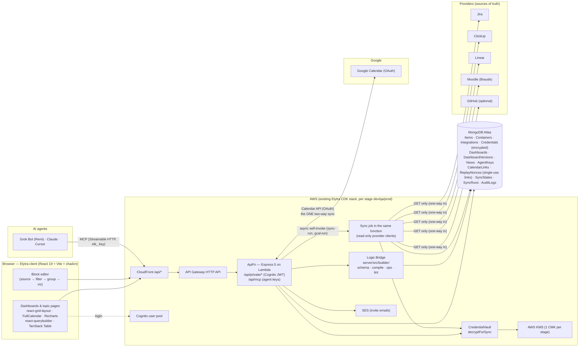
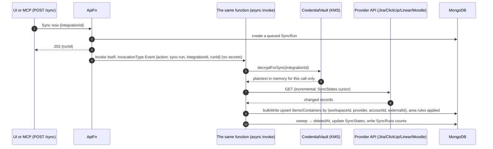
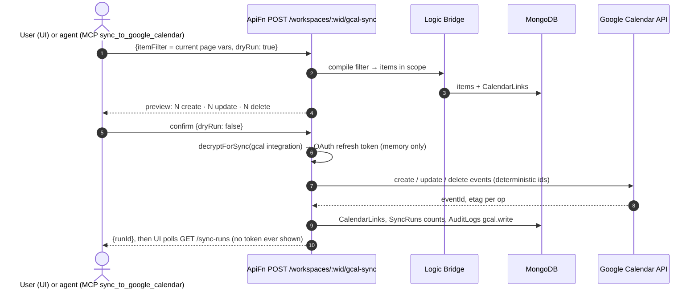

# OVERVIEW.md — Shalev's personal management dashboard (on Elytra)

Status: **design only**. Nothing is built, deployed, pushed or changed in [shalev396/Elytra](https://github.com/shalev396/Elytra) (read-only base, `main` @ `e382dc5`).
This is the map. The detail lives in the sibling docs; **on naming conflicts DATA.md wins**, on block/builder schema BUILDER.md wins, on MCP tool names MCP.md wins.

---

## 1. What it is, in one paragraph

One dashboard over Shalev's whole life — **Work** (Jira, ClickUp), **College** (Moodle, coming soon), **Personal** (Linear, `shalev396/*` GitHub repos) and **time** (personal Google Calendar). Providers stay the sources of truth and flow **one way into the app**. The app stores everything in MongoDB as one polymorphic `Items` collection, renders it through **user-built dashboards** (Mixpanel-style blocks: source → filter → group → viz), and exposes the same data and the same builder to AI agents through an **MCP server**. Google Calendar is reached through Shalev's own **Apps Script web app** (no Google OAuth consent screens), which is also the **one sanctioned two-way sync**.

---

## 2. Architecture

### How the pieces connect

| Piece | Doc | Talks to | Role |
|---|---|---|---|
| **Frontend** | FRONTEND.md | ApiFn (`/api/private/*`) | Elytra client turned into the dashboard. Renders `Dashboards` JSON; block editor; Integrations page with write-only secret fields; "Sync to Google Calendar" button. |
| **Backend** | BACKEND.md | MongoDB, KMS, SES, Google Calendar | Express 5 on one Lambda (no queues, workers or schedules; background syncs are an async self-invoke). Workspace-scoped REST, query endpoint, sync. TypeScript recommended (undecided). |
| **MongoDB** | DATA.md | — | All state: items, integrations, encrypted credentials, dashboards, sync state, audit. UUID string `_id`s, PascalCase plural collections. |
| **MCP server** | MCP.md | Backend services (in-process) | `/api/mcp` on the same Lambda. ~35 tools: read, local to-dos, sync, integrations (status only), workspace, builder. Never touches credentials. |
| **Builder (Logic Bridge)** | BUILDER.md | Called by REST routes **and** MCP tools | One TS module: zod schemas → JSON Schema, block catalog, query compiler (field whitelist), JSON-Patch ops, versions, lint. UI and agents produce the same validated JSON. |
| **Code agent** | CODE-AGENT-GUIDE.md, CLAUDE-CODE-PROMPT.md | Local machine only | How to build and run it all locally, seed fake data, test, and do the competitor UI review pass. |

---

## 3. Data flows

### 3.1 Provider sync (one way into the app)

Nothing is ever written back to these providers. Mirrored items are read-only in the UI and MCP (edit → `409` + "Open in <provider>"). Nothing runs on a schedule for now: syncs start only from "Sync now" or a direct invoke of `sync-dispatch` (TODO.md brings one schedule back before prod). Lambda retries a failed job twice; there is no dead-letter queue.

### 3.2 Google Calendar (the one two-way sync, OAuth)

Each push also pulls our own events back from Google: echoes are skipped by etag, conflicts are last-write-wins and deletions are tombstoned (`CalendarLinks`). The same push-and-pull runs as a `gcal-run` job, started by "Sync to Google Calendar" or a direct `gcal-dispatch`.

### 3.3 The "Sync to Google Calendar" button

### 3.4 A block render / builder edit
UI or agent → `POST /workspaces/:wid/query` with a **saved query id** (`savedQueryId` or `dashboardId`+`blockId`) **or** a **draft** query, plus runtime **cross-block filter `vars`** (`$page.area`, `$page.provider`, …) → Logic Bridge compiles to a Mongo pipeline with the DATA.md §5 base filter → rows/groups, each with `source.url`. Edits go through `POST …/dashboards/:id/ops` (`expectedVersion`, `dryRun`) → new `DashboardVersions` entry → `AuditLogs` (`actorUserId` or `actorAgentId`).

---

## 4. Constraints (apply to every doc and every line of code)

| # | Constraint | Where enforced |
|---|---|---|
| 1 | **Minimal hard-coded text.** The only literal text is titles and filenames (which come from data). Labels, legends, empty states, counts and filter options are computed, come from `GET /facets`, or are i18n keys (`en` + `he`). | BUILDER lint (blocks MCP writes), FRONTEND §9, CODE-AGENT-GUIDE §6.4 text check |
| 2 | **Dynamic content.** Topics, dashboards, blocks, templates and filters are data in MongoDB, never code. Adding a block type = one catalog entry + one registry entry. | BUILDER §4/§7, FRONTEND §5 |
| 3 | **Every item links to its source** with an **"Open in <provider>"** button built from `source.url` (provider data only; never a constructed link). Blocks cannot turn it off. | DATA `Items.source`, FRONTEND `SourceLink`, MCP `openIn`, BUILDER lint |
| 4 | **AutoDS is muted only in Remi's (assistant) messages.** It is **included** in all app views, data, API and MCP results. No provider/project exclusion anywhere in the app. | BACKEND §5 rule 6, MCP §6 (`muteSources` only on Remi's prompt), seed check |
| 5 | **Personal vs Work by project name:** `shalev396/*` (and the shalev396 Linear workspace) = **Personal**; Jira/ClickUp = **Work**; **College** = Moodle courses/assignments/events Rules are data in `Workspaces.settings.areaRules`. | DATA §2/§3.2, BACKEND `areaRules.ts` |
| 6 | **One-way mirror.** Every provider flows one way into the app. **One sanctioned exception:** two-way sync with Google Calendar through OAuth, audit-logged (`gcal.write`). | DATA §2, BACKEND §5, MCP §5.7 |
| 7 | **Google Calendar uses OAuth** with a separate Google app (closed beta on dev and qa, verification only for prod). The Apps Script bridge was removed; users connect only with Google sign-in. | INTEGRATIONS-SETUP §1, DATA §8 |
| 8 | **Long-lived tokens preferred:** Linear personal API key (no expiry), ClickUp `pk_` token (no expiry), Jira API token (≤ 365 days, reminder 14 days ahead), Moodle web service token (admin-set expiry; mobile-app token or calendar export as fallback). GitHub fine-grained PAT optional. | DATA §8 |
| 9 | **Tokens encrypted at rest** (KMS envelope + AES-256-GCM, AAD-bound) and **never returned** to the user, UI, logs, errors, exports or agents — **in any form** (no masked hint, last-4 or prefix). Status = provider, account label, `connected`/`expired`/`error`, `expiresAt`, `lastSyncAt`. One decrypt path only: `decryptForSync`. | DATA §0/§7, BACKEND §6, MCP §5, secret-leak test suite |
| 10 | **Slack is out of scope for the app.** No Slack integration, card or block; AI agents use Slack through their own Slack MCP. | DATA §8, FRONTEND §8, MCP §5.8 |
| 11 | **AWS first.** Reuse Elytra's CDK stack (one Lambda, API Gateway HTTP API, CloudFront, Cognito, KMS, SES; no queues or schedules). MongoDB Atlas on AWS recommended. | BACKEND §3/§11 |
| 12 | **Stage-backed.** There is no offline mode: the local API runs against a deployed stage. No deploy, no push, no PR to Elytra without Shalev's explicit approval. Never print secrets. | CODE-AGENT-GUIDE §0, CLAUDE-CODE-PROMPT |
| 13 | **UI defaults:** calendars default to **Week**; 24h clock with a now-needle; donut of open items by source; deadlines soonest first; time zone `Asia/Jerusalem`, week starts Sunday. | FRONTEND §1/§9, BUILDER §4 |

---

## 5. Doc map (read in this order)

| # | File | What it owns |
|---|---|---|
| 1 | `OVERVIEW.md` | This map, constraints, consolidated open questions |
| 2 | `DATA.md` | MongoDB collections, indexes, access control, token encryption, provider mapping. **Wins on naming.** |
| 3 | `BACKEND.md` | Lambda/AWS architecture, REST routes (incl. `/query`, `/gcal-sync`), sync jobs, token handling, rate limits |
| 4 | `FRONTEND.md` | Elytra client conversion, pages, libraries, block JSON, composition model, Sync-to-GCal UI |
| 5 | `BUILDER.md` | Logic Bridge, block catalog, query primitives, templates, versioning/dry-run, builder ops. **Wins on block schema.** |
| 6 | `MCP.md` | MCP primer, hosting, agent keys, privacy rules, tool catalog, builder tools. **Wins on tool names.** |
| 8 | `CODE-AGENT-GUIDE.md` | Stage-backed run, env vars, demo data, tests, competitor UI comparison pass |
| 9 | `CLAUDE-CODE-PROMPT.md` | The master implementation prompt for Claude Code |

---

## 6. Open questions (consolidated)

| # | Question | Raised in | Current default |
|---|---|---|---|
| 1 | Backend language: TypeScript or Python? | BACKEND §2, MCP §14 | **TypeScript** (Elytra is TS end-to-end; MCP TS SDK) until Shalev confirms |
| 2 | MongoDB Atlas vs Amazon DocumentDB | BACKEND §3 | Atlas on AWS |
| 3 | Does Braude's Moodle let students create web service tokens? | DATA §9, BACKEND, FRONTEND §14 | Unverified. Fallbacks: Moodle mobile-app token, then the Moodle calendar export URL (deadlines only, no course list) |
| 4 | Moodle course list source (token API vs calendar export) — affects College filters | FRONTEND §14 | Token API if #3 allows |
| 5 | Sync cadence (no schedule today); add provider webhooks (Jira, ClickUp, Linear, GitHub)? | DATA §9, BACKEND | Manual "Sync now" only for now; one schedule (sync dispatch + purge) returns before prod |
| 6 | On disconnect: keep or purge mirrored items? | BACKEND | Soft-delete, hard-delete after 30 days |
| 7 | Enable MongoDB CSFLE/Queryable Encryption on top of app-level envelope encryption? | DATA §7/§9 | No (app-level envelope is the baseline) |
| 8 | MCP phase-2 OAuth: does Cognito support CIMD/DCR, or pre-register one client per agent? | MCP §14 | Ship agent API keys (`elk_…`) first |
| 9 | May agents hold `builder:publish`, or does only the UI publish? | MCP §14, BUILDER §8 | Only the UI publishes |
| 10 | Retention: `DashboardVersions` (last 50?) and `AuditLogs` (365 d) | MCP §14, DATA §9 | 50 versions; 365 days |
| 11 | Should `AgentKeys` always expire (e.g. 365 d)? | DATA §9 | Yes, 365 d default |
| 12 | Calendar path: Google OAuth (two-way) vs calendar-shared service account (no guest invites/Meet links) | DATA §8 | Google OAuth (decided; the Apps Script bridge is removed) |
| 14 | Phase-2 UI ideas from the competitor pass: "Today" template, view tabs per block, auto-scheduling (out of scope) | CODE-AGENT-GUIDE §6 | Today template + view tabs in phase 2 |
