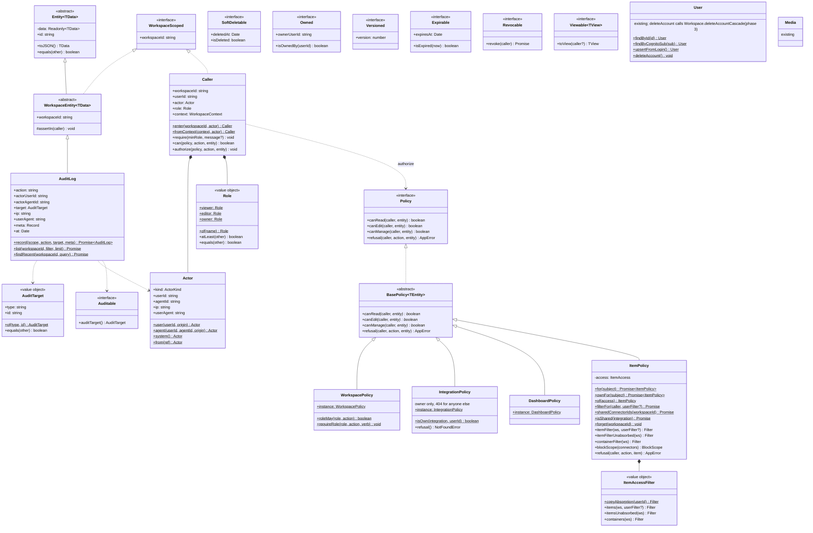
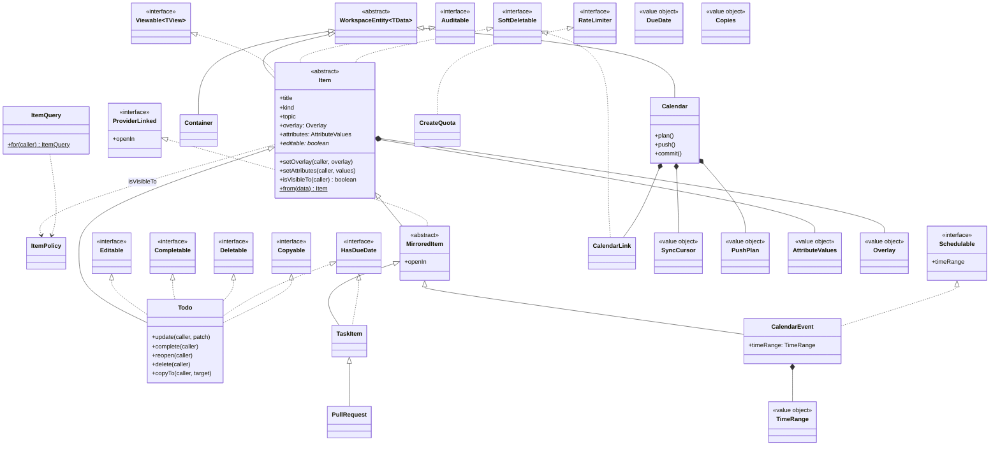
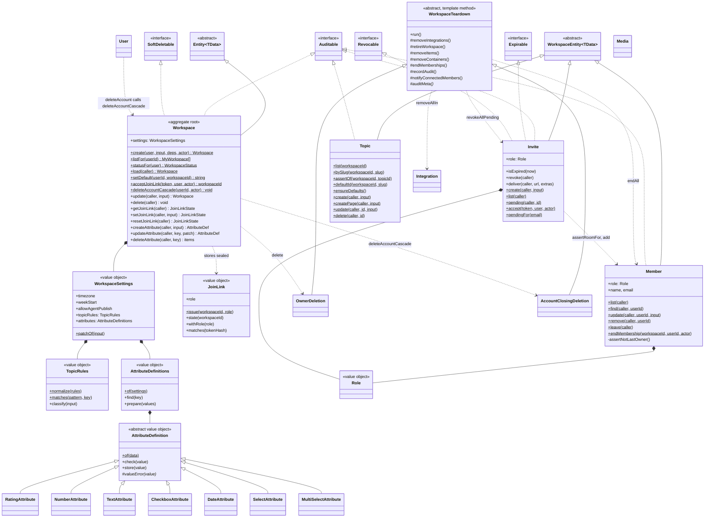
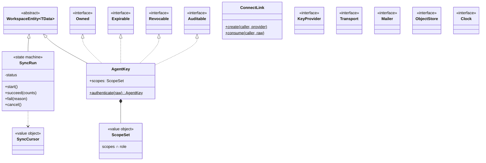

# Classes: the object model of the server

The server's domain is a set of classes (`server/src/classes/`). A class wraps 0..n models through
the `get…Repository()` getters and is the **only** code that touches the database; routes,
controllers and MCP tools stay thin functions (parse input → call a class → `toView()`), and pure
helpers (zod schemas, the builder's compiler, `gcal/diff`, the HTTP client, crypto primitives)
stay pure modules.

This page is the map of the **full target design** (plan: `.superpowers/sdd/2026-11-14-oop-redesign/plan.md`).
It is updated every phase.

- **Built** (exists in the code): green, solid border.
- **Planned**: grey, dashed border, with the phase that builds it.

| Phase | What it builds                                                                                                                                                                                                               | State     |
| ----- | ---------------------------------------------------------------------------------------------------------------------------------------------------------------------------------------------------------------------------- | --------- |
| 0     | Base layer (`Entity`, `WorkspaceEntity`, contracts), `Actor`, `Caller`, `Role`, `AuditTarget`, `Policy` + 4 policies, `AuditLog`, the error hierarchy, shared hashing; the class-boundary lint rule and test                 | **built** |
| 1     | `Integration` base, `Credential`, auth strategies, read and write sessions, the read-only gate (`Mode`); the provider subclasses wrapping today's code, `TaskProvider`/`CalendarProvider`, `IntegrationRegistry`             | **built** |
| 2a    | The one `static definition` per provider (`IntegrationDefinition`), headers from the auth strategy to the adapters, `OAuthFlow` (Google merged), `ResourcePicker`, capabilities to the client, `Integration`'s collaborators | **built** |
| 2W    | Write-back (phase 2b): `TaskProvider.updateTask` and each definition's `writableFields`, `CalendarProvider` update/delete event, create calendar, recurrence (`RecurrenceRule`); `BoardProvider` stays planned               | **built** |
| 3     | `Workspace` aggregate, `Member`, `Invite`, `Topic`, their value objects, the cascade template; `User` calls `Workspace.deleteAccountCascade`                                                                                 | **built** |
| 4     | `Item` hierarchy, `Container`, `ItemQuery`, `CreateQuota`                                                                                                                                                                    | planned   |
| 5     | `SyncRun` state machine, `Integration.sync()`, `Calendar`                                                                                                                                                                    | planned   |
| 6     | `Dashboard`, `History<T>`, the `Block` hierarchy, `View`, `AgentKey`, `ConnectLink`                                                                                                                                          | planned   |
| 7     | The legacy list emptied, dead services deleted                                                                                                                                                                               | planned   |

**How the boundary is held.** `server/legacy-db-importers.mjs` names:

- the database modules (the models' barrel, `models/mongoose/**`, `models/sequelize/**`, the
  connection `config/database.ts` and its providers `config/providers/**`) and packages
  (`mongoose`, `sequelize`, `pg`, `mongodb`);
- the places allowed to load them (classes, models, the connection, migrations, tests);
- the entry points and jobs that may open the connection and nothing else (`lambda.ts`,
  `local.ts`, `stageMaintenance.ts`);
- the test helpers production code never loads (`src/testing/**`, `__tests__/**`);
- `LEGACY_DB_IMPORTERS`, the modules that still reach the database until their phase moves them
  (20 after phase 3; 23 after phase 2a; 24 after phase 1; 35 after phase 0, down from 42).

ESLint (`@typescript-eslint/no-restricted-imports`, type imports allowed) and
`src/classes/classBoundary.test.ts` (which also resolves paths, sees dynamic imports and names
`get…Repository` getters) read that one module. The test also holds that only `AuditLog` names the
audit log's repository, and fails on a legacy entry that no longer needs to be there, so the list
only shrinks.

## 1. Base layer, people and permissions

The contracts are declared now and implemented by the entity classes of later phases (`Owned` by
`Integration`, `View`, `AgentKey`; `Versioned` by `Dashboard`; `Expirable` by `Invite` and
`AgentKey`; …).

## 2. Errors

```mermaid
classDiagram
  direction TB
  class Error
  class AppError {
    +statusCode: number
    +code: ErrorCode
    +details: Record
  }
  class NotFoundError {
    404 Not found
  }
  class ForbiddenError {
    403
    +forRole(minRole, action)$ ForbiddenError
  }
  class ValidationError {
    400
  }
  class ConflictError {
    409 version conflict
    +currentVersion: number
  }
  class ReadOnlyIntegrationError {
    409 integration_read_only
    +integrationId: string
  }
  class MirroredItemError {
    409
    +openIn: provider, url
  }
  class CapabilityError {
    400
    +capability: string
  }
  class ProviderComingSoonError {
    400 provider_coming_soon
    +provider: string
  }
  class StatusNotAvailableError {
    422 status_not_available
    +provider: string
    +status: ItemStatus
  }
  class ScopeMissingError {
    409 scope_missing
    +integrationId: string
    +scope: string
  }
  class FieldNotWritableError {
    422 field_not_writable
    +fields
    +openIn
  }
  class ProviderPartialWriteError {
    409 provider_partial_write
    +written
    +refused
  }
  class ProviderItemMissingError {
    404 provider_item_missing
  }
  class EventHasGuestsError {
    409 event_has_guests
  }
  class SecretLeakError
  Error <|-- AppError
  Error <|-- SecretLeakError
  AppError <|-- NotFoundError
  AppError <|-- ForbiddenError
  AppError <|-- ValidationError
  AppError <|-- ConflictError
  AppError <|-- ReadOnlyIntegrationError
  AppError <|-- MirroredItemError
  AppError <|-- CapabilityError
  AppError <|-- ProviderComingSoonError
  AppError <|-- StatusNotAvailableError
  AppError <|-- ScopeMissingError
  AppError <|-- FieldNotWritableError
  AppError <|-- ProviderPartialWriteError
  AppError <|-- ProviderItemMissingError
  AppError <|-- EventHasGuestsError

  classDef built fill:#d1fae5,stroke:#047857,stroke-width:2px
  class AppError:::built
  class NotFoundError:::built
  class ForbiddenError:::built
  class ValidationError:::built
  class ConflictError:::built
  class ReadOnlyIntegrationError:::built
  class MirroredItemError:::built
  class CapabilityError:::built
  class ProviderComingSoonError:::built
  class StatusNotAvailableError:::built
  class ScopeMissingError:::built
  class FieldNotWritableError:::built
  class ProviderPartialWriteError:::built
  class ProviderItemMissingError:::built
  class EventHasGuestsError:::built
  class SecretLeakError:::built
```

The 409 domain errors are siblings of `ConflictError`, not children: a `catch (ConflictError)`
answers the version-conflict body (`currentVersion`), which they are not. The error handler answers
every `AppError` by `instanceof`. Write-back adds six (phase 2b and its fix round):

- `StatusNotAvailableError`: the provider has no transition, status or state for the asked status
  on this item;
- `ScopeMissingError`: the grant predates a scope the operation needs (`calendar.app.created`);
- `FieldNotWritableError`: a changed field the provider doesn't take for the item (it lacks it,
  only reads it, the item's kind takes no write-back, or it isn't on the edit screen);
- `ProviderPartialWriteError`: a write-back of several provider calls stopped part-way; what
  landed is kept and audited;
- `ProviderItemMissingError`: the item is gone at the provider;
- `EventHasGuestsError`: an event with other guests, changed without saying whether to notify
  them.

Their extra properties (`fields`, `openIn`, `written`, `refused`) are for the Phase 4 route to
answer; the error handler answers `{message, code}` today.

## 3. Integrations (phases 1, 2a and 2W)

```mermaid
classDiagram
  direction TB
  class WorkspaceEntity~TData~ {
    <<abstract>>
  }
  class Integration~TConfig,TSecret,TWriter~ {
    <<abstract>>
    -credential: Credential~TSecret~
    #auth: AuthStrategy~TSecret~
    #adapter: ProviderAdapter
    +config: TConfig
    +mode: Mode
    +allowsWrites: boolean
    +authKind: AuthKind
    +canCreate: boolean
    +toView() IntegrationStatusView
    +readConfig(caller)
    +update(caller, input) Promise~Integration~
    +checkMode(caller, mode) Mode
    +canSwitchMode: boolean
    +setMode(caller, mode) Promise~Integration~
    +saveCredential(caller, body) Promise
    +testConnection(caller) Promise
    +requestSync(caller) Promise
    +stopSharing(caller) Promise
    +disconnect(caller) Promise
    +assertWritable(caller)
    +needsWriteConsent() Promise~boolean~
    #definition: IntegrationDefinition
    #withReadSession(fn) Promise
    #withWriteSession(caller, fn) Promise
    #handBackGrant(failure) Promise
    #lacksScopes(scopes) Promise~boolean~
    #writableFieldsFor(kind) WritableField[]
    #recordWrite(caller, meta) Promise
    #createWriter(secret)* Promise~TWriter~
    #probe(adapter, context)* Promise
    #onConnected() Promise
    #checkSelection(config) Promise
    #learnedLabel(accountLabel) string
    #revokeGrant() Promise
    +from(data)$ Integration
    +findOwn(caller, id)$ Integration
    +listOwn(caller)$ Integration[]
    +listVisible(caller)$ Integration[]
    +connectWithKey(caller, input)$ Integration
    +connectOAuth(caller, conn)$ ConnectedIntegration
    +forWorker(id)$ Integration
    +listForDispatch()$ Integration[]
    +disconnectAllOf(workspaceId, actor, member)$ number
    +withSyncSecret(id, fn)$ Promise
    +capabilitiesOf()$ ProviderCapabilities[]
  }
  WorkspaceEntity <|-- Integration
  class IntegrationDefinition~TSecret,TAuth~ {
    <<value object>>
    +provider
    +auth: AuthSet
    +connection: ConnectionRules
    +adapter: ProviderAdapter
    +create: CreateRules
    +writableFields: WritableField[]
    +writableKinds: ItemKind[]
    +reachableStatuses: ItemStatus[]
    +picker: PickerKind
    +revokePage
    +comingSoon
    +fixtures
    +authFor(method) AuthStrategy
    +parseConfig(config)
    +planConnection(input) ConnectionPlan
    +assertSameAccount(integration, config)
    +defaultLabel(config)
    +writableFieldsFor(kind) WritableField[]
    +fakeCredential(method, name)
  }
  Integration *-- IntegrationDefinition : static definition
  IntegrationDefinition *-- AuthStrategy
  class IntegrationConnector {
    <<collaborator>>
    +connectWithKey(caller, input)
    +upsertOAuth(caller, conn)
  }
  class ConnectionTester {
    <<collaborator>>
    +waitBeforeNext() Promise
    +run(timeZone) Promise
  }
  class SyncRequest {
    <<collaborator>>
    +hold() Promise
    +manualWait() Promise
    +enqueue() Promise
  }
  Integration ..> IntegrationConnector
  Integration ..> ConnectionTester
  Integration ..> SyncRequest
  class Owned {
    <<interface>>
  }
  class Auditable {
    <<interface>>
  }
  class SoftDeletable {
    <<interface>>
  }
  class Viewable~TView~ {
    <<interface>>
  }
  Owned <|.. Integration
  Auditable <|.. Integration
  SoftDeletable <|.. Integration
  Viewable <|.. Integration

  class Mode {
    <<value object>>
    +read$
    +readWrite$
    +allowsWrites: boolean
  }
  class Credential~TSecret~ {
    <<internal>>
    +seal(input, actor)$ Promise
    +of(integrationId)$ Credential
    +meta(workspaceId, id)$ Promise
    +destroy(workspaceId, id)$ Promise
    +open(fn) Promise
    +refreshIfStale(auth, workspaceId) Promise
  }
  class KeyProvider {
    <<interface>>
  }
  Credential ..> KeyProvider
  class AuthStrategy~TSecret~ {
    <<abstract>>
    +kind: AuthKind
    +methods: AuthMethod[]
    +handles(method) boolean
    +parseCredential(method, raw)
    +fakeCredential(method, name)
    +headers(secret, purpose?) Headers
    +query(secret)
    +bind(session) AdapterAuth
    +transport(inner) Transport
  }
  class OAuthAuth~TSecret~ {
    +refreshPolicy: stored | per_call
    +scopes, writeScopes, callbackPath
    +endpoints()
    +credentials() Promise
    +client(transport?) ReadOnlyClient
    +authorizeUrl(request) string
    +exchangeCode(client, grant, credentials) Promise
    +secretFromGrant(grant, scopes, now)
    +identify(client, accessToken) Promise
    +needsRefresh(secret, now) boolean
    +refresh(secret) Promise
    +revoke(secret) Promise
  }
  class ApiKeyAuth~TSecret~
  class ServiceAccountAuth~TSecret~
  class UnofferedAuth~TSecret~ {
    <<null object>>
  }
  AuthStrategy <|-- OAuthAuth
  AuthStrategy <|-- ApiKeyAuth
  AuthStrategy <|-- ServiceAccountAuth
  AuthStrategy <|-- UnofferedAuth
  Credential ..> OAuthAuth : refreshIfStale
  class SyncAdapter~TConfig,TSecret~ {
    <<strategy>>
  }
  Integration *-- Credential
  Integration *-- AuthStrategy
  Integration *-- SyncAdapter
  Integration *-- Mode

  class SupportsOAuth {
    <<interface>>
    +oauth: OAuthAuth
  }
  class SupportsApiKey {
    <<interface>>
    +apiKey: ApiKeyAuth
  }
  class ItemCopy {
    <<value object>>
    +integrationId
    +status
    +key
    +url
  }
  TaskProvider ..> ItemCopy : createTask
  class CreateFunnel {
    <<interface>>
    +createOptions(caller, query)
  }
  class TaskProvider {
    <<interface>>
    +createTask(caller, request) CreatedTask
    +updateTask(caller, item, patch) ItemData
  }
  class CalendarProvider {
    <<interface>>
    +listCalendars(caller)
    +insertEvent(caller, calendarId, event, recurrence?)
    +updateEvent(caller, item, patch, notice?) WrittenEvent
    +deleteEvent(caller, item, notice?)
    +deleteLinkedEvent(caller, link)
    +createCalendar(caller, name) GoogleCalendarEntry
    +dryRun(caller, narrowing, now)
    +push(caller, request)
  }
  class TaskEdit {
    <<value object>>
    +parse(patch)$ TaskEdit
    +fields
    +against(item, writable, timeZone) ProviderEdit
  }
  class WriteLedger {
    +confirm(fields, values) Promise
    +fields
    +values
    +isEmpty
  }
  class EventEdit {
    <<value object>>
    +parse(patch, timeZone)$ EventEdit
    +changes: EventChanges
    +fields
  }
  class RecurrenceRule {
    <<value object>>
    +parse(line)$ RecurrenceRule
    +fromLines(lines)$ RecurrenceRule
    +fits(allDay) boolean
    +toString() string
  }
  TaskProvider ..> TaskEdit : updateTask
  TrackerIntegration ..> WriteLedger : updateTask
  CalendarProvider ..> EventEdit : updateEvent
  CalendarProvider ..> RecurrenceRule : insertEvent
  CreateFunnel <|-- TaskProvider
  CreateFunnel <|-- CalendarProvider
  class ResourcePicker~K~ {
    <<interface>>
    +pickerKind: K | null
    +pickerResources(caller) PickerResources[K][]
    +choose(caller, ids)
  }
  class Revocable {
    <<interface>>
    +revoke(caller)
  }
  class BoardProvider {
    <<interface>>
    +boards(caller)
  }
  class CourseProvider {
    <<interface>>
  }

  class TrackerIntegration~TConfig,TSecret~ {
    <<abstract>>
    +createOptions(caller, query)
    +createTask(caller, request)
    +updateTask(caller, item, patch) ItemData
    #checkUpdate(item, patch)
    #applyUpdate(session, item, patch, ledger)*
    #answerOf(result) record
    #confirmedStatus(status, raw) MirroredItemPatch
    #readOptions(session, query)*
    #prepare(session, target, fields)*
    #readClient(transport)
    #writeBases()
  }
  Integration <|-- TrackerIntegration
  TaskProvider <|.. TrackerIntegration
  class JiraIntegration {
    +definition$ = JIRA
  }
  class ClickUpIntegration {
    +definition$ = CLICKUP
  }
  class LinearIntegration {
    +definition$ = LINEAR
  }
  class GitHubIntegration {
    +definition$ = GITHUB
  }
  class GoogleCalendarIntegration {
    +definition$ = GOOGLE_CALENDAR
  }
  class MoodleIntegration {
    +definition$ = MOODLE (comingSoon)
  }
  class UnlistedIntegration {
    <<null object>>
  }
  TrackerIntegration <|-- JiraIntegration
  TrackerIntegration <|-- ClickUpIntegration
  TrackerIntegration <|-- LinearIntegration
  TrackerIntegration <|-- GitHubIntegration
  Integration <|-- GoogleCalendarIntegration
  Integration <|-- MoodleIntegration
  Integration <|-- UnlistedIntegration
  ResourcePicker <|.. JiraIntegration
  SupportsOAuth <|.. JiraIntegration
  SupportsApiKey <|.. JiraIntegration
  ResourcePicker <|.. ClickUpIntegration
  SupportsOAuth <|.. ClickUpIntegration
  SupportsApiKey <|.. ClickUpIntegration
  Revocable <|.. LinearIntegration
  SupportsOAuth <|.. LinearIntegration
  SupportsApiKey <|.. LinearIntegration
  BoardProvider <|.. GitHubIntegration
  SupportsOAuth <|.. GitHubIntegration
  SupportsApiKey <|.. GitHubIntegration
  CalendarProvider <|.. GoogleCalendarIntegration
  ResourcePicker <|.. GoogleCalendarIntegration
  Revocable <|.. GoogleCalendarIntegration
  SupportsOAuth <|.. GoogleCalendarIntegration
  CourseProvider <|.. MoodleIntegration
  SupportsApiKey <|.. MoodleIntegration

  class IntegrationRegistry {
    <<registry>>
    +instance$
    +register(cls, factory)
    +registerFallback(factory)
    +classOf(provider)
    +create(data) Integration
  }
  Integration ..> IntegrationRegistry : from()
  class OAuthFlow {
    <<entity: OAuthState>>
    +start(caller, integrationClass, input)$ OAuthStart
    +consume(integrationClass, callback)$ location
    +providers(caller)$ OAuthProvidersResponse
  }
  OAuthFlow ..> OAuthAuth
  OAuthFlow ..> Integration : connectOAuth

  classDef built fill:#d1fae5,stroke:#047857,stroke-width:2px
  classDef planned fill:#f3f4f6,stroke:#9ca3af,stroke-dasharray:5 5,color:#4b5563
  class WorkspaceEntity:::built
  class Owned:::built
  class Auditable:::built
  class SoftDeletable:::built
  class Viewable:::built
  class Revocable:::built
  class Integration:::built
  class Mode:::built
  class Credential:::built
  class KeyProvider:::planned
  class AuthStrategy:::built
  class OAuthAuth:::built
  class ApiKeyAuth:::built
  class ServiceAccountAuth:::built
  class SyncAdapter:::planned
  class SupportsOAuth:::built
  class SupportsApiKey:::built
  class CreateFunnel:::built
  class TaskProvider:::built
  class CalendarProvider:::built
  class ResourcePicker:::built
  class BoardProvider:::planned
  class CourseProvider:::planned
  class TrackerIntegration:::built
  class JiraIntegration:::built
  class ClickUpIntegration:::built
  class LinearIntegration:::built
  class GitHubIntegration:::built
  class GoogleCalendarIntegration:::built
  class MoodleIntegration:::built
  class UnlistedIntegration:::built
  class IntegrationRegistry:::built
  class OAuthFlow:::built
  class IntegrationDefinition:::built
  class IntegrationConnector:::built
  class ConnectionTester:::built
  class SyncRequest:::built
  class UnofferedAuth:::built
  class TaskEdit:::built
  class WriteLedger:::built
  class EventEdit:::built
  class RecurrenceRule:::built
  class ItemCopy:::planned
```

The write gate is the `protected` `withWriteSession`: only provider subclasses reach a writer
(`classes/integration/writers/`: the tracker write client, the Calendar API writer and the push's
ops), and only inside their capability methods (`createTask`, `updateTask`, `insertEvent`,
`updateEvent`, `deleteEvent`, `createCalendar`, `push`). In order, it refuses another member (404), demo
data or a fixtures stage's tracker (`provider_writes_off`), then a read-only integration
(`ReadOnlyIntegrationError`, 409 `integration_read_only`); only then does it open the credential
and make the writer (`createWriter`, the provider's own). `assertWritable` runs the same checks so
callers refuse before they reserve or record anything. The mode is the one the integration was
loaded with: a switch made while a request runs is seen by the next one.

What the tests hold:

- `writePaths.test.ts`:
  - only `TrackerIntegration.ts`, the provider classes and the writer modules load a writer;
  - nothing outside `classes/integration/**` names the writer factories;
  - each factory has one call site, by count: `createWriteClient(` in `TrackerIntegration` and
    `calendarWriter(` in `GoogleCalendarIntegration`, each inside a `createWriter` body, and
    `applyOps(` once, in `GoogleCalendarIntegration`, inside a `withWriteSession(…)` call. A
    writer made in a read session fails;
  - the write-back hook `applyUpdate` is called once in all of `server/src`: `this.applyUpdate(`
    in `TrackerIntegration`'s template, inside a `withWriteSession(…)` call; the provider classes
    only declare it;
  - MCP code never names `setMode`, `checkMode` or `UpdateIntegrationBody`.
- The write allow-lists refuse everything else before it is sent:
  - `writers/trackerWriter.update.test.ts`: by method, exact path and **body keys** (Jira
    `PUT …/issue/{id}` with `fields.summary|duedate|priority.id` and `POST …/transitions` with
    `transition.id`, at the integration's own sites only; ClickUp `PUT /task/{id}` with its seven
    keys; GitHub `PATCH /issues/{n}` with `title|state|state_reason`; Linear only the named
    `issueUpdate` document, variables `{id, input}` with `title|stateId|dueDate|priority`). A
    trash, an archive, a body, assignees or a project move never pass.
  - `writers/calendarApi.test.ts`: `POST /calendars`, events insert, patch and delete (those two
    with `sendUpdates=all|none` only); never a calendar's delete or ACL. The URL must be exactly
    as sent: a `.`/`..` segment (`%2e%2e` too) or an empty one is refused.
- `writeBack.trackers.test.ts` and `writeBack.calendar.test.ts`, per provider:
  - the exact requests a write-back sends (lookups as reads, then the allow-listed writes) and what
    the item holds afterwards;
  - each provider call audited as it lands; a Jira edit stopped part-way keeps and audits what
    landed (`provider_partial_write`);
  - every refusal before anything is opened or written (`field_not_writable`,
    `status_not_available`, a value the provider can't hold; read-only: zero non-GET, and an
    unchanged field is no write; `scope_missing`; an invalid RRULE; `event_has_guests`);
  - an event only through this integration's item on a calendar it reads, or its own
    CalendarLink: another integration's, another workspace's, a raw event id or an unselected
    calendar is 404 with zero non-GET requests.
- `vaultImports.test.ts`: only `Integration.ts` uses `Credential`, and only `Integration.ts` and
  `sync/secrets.ts` name `Integration.withSyncSecret` (MCP code never does).
  An alias does not get round them: a factory renamed with `as`, bound to another name,
  destructured from an `await import(…)` or re-exported fails, as does a dynamic import with no
  literal target inside `classes/integration/`.
- `integration.test.ts`: for every provider class, without a database, each write it can make
  without reading an item first (`createOptions`, `createTask`, `insertEvent` with and without a
  recurrence, `createCalendar`, `push`) is refused while read-only before anything is sent. The
  writes keyed by an item read it first (the gate waits for what actually changes): the
  write-back tests hold them with a database.
- `definitions/definitions.test.ts`: the definitions name each connectable provider once, each
  its class's own; every OAuth app's token and revoke URL is on the HTTP layer's allow-list
  (`OAUTH_TOKEN_ENDPOINTS`, written out there on purpose: no definition can widen it) and its
  callback path is the one registered at the provider; the scopes and the key methods are as
  before; the strategies build the headers (a second token for GitHub boards, Moodle's query
  token, one Google token exchange per session, one per call for the service account); the
  four authorize URLs are pinned byte for byte (Google's parameters, in any order, now with
  `calendar.app.created`); each provider's `writableFields` and the kinds that take a write-back
  are pinned, a write-back is declared exactly where the class implements one; and
  `Integration.capabilitiesOf()` agrees with the contracts each class implements (with
  `canUpdate` and `writableFields`).
- `definitions/purity.test.ts`: nothing under `classes/integration/definitions/` reaches, at run
  time, the models' barrel, a model, the connection or `config/environment.ts` (the plain types
  under `models/definitions/` are fine). The builder's compiler, which validates Google's push
  filter, starts every read from `ItemAccessFilter` (pure), not from `ItemPolicy` (which resolves
  the access from the data). `config/environment.ts` reads `process.env` when a value is asked
  for, so no import order can fix a value early (`definitions/importOrder.test.ts` loads the
  definitions before its database starts).
- `sync/providers/adapterSecrets.test.ts`: the adapters never reach the secret. `AdapterContext`
  has no `secret`; nothing under `sync/providers/` names `.secret` or indexes `secret[…]`, or loads
  the credential or the sync's secret door. Google's service-account signer is the strategy's
  (`auth/googleServiceAccount.ts`), and the account it names reaches a connection test as
  `ctx.auth.account()`.
- `sync/http.test.ts` pins `OAUTH_TOKEN_ENDPOINTS` exactly, and the URLs a client takes.

**What phase 2a built:**

- **One `static definition` per provider class** (`definitions/<provider>.ts`, an
  `IntegrationDefinition`): its auth strategies (`auth.oauth`, `auth.apiKey`,
  `auth.serviceAccount`), the config schema, the connection rules (default topic, account key,
  label, which config change moves the account), the sync adapter, the create rules (funnel
  steps and reader, which links are kept, what a 403 means), the picker, the revoke page,
  `comingSoon` and the fixtures (the funnel's recorded set; each strategy's FAKE credential). It
  replaces `RULES`, `CREDENTIAL_SCHEMAS`, `OAUTH_PROVIDER_DEFS`, `OAUTH_ENDPOINTS`, the
  `fakeCredential` switch and the create switches (`safeCopyUrl`, `failureFor`).
  `definitions/index.ts` lists them for code that must not load the classes (the sync engine in
  fixtures mode, the seed); `services/integrationConfig.ts` and `seed/fakeCredentials.ts` are
  views of them.
- **Headers from the strategy.** The adapters get `ctx.auth` (`AdapterAuth`: `kind`,
  `headers(purpose?)`, `query()`), bound by the integration's strategy to the opened secret and the
  run's client; no adapter builds an auth header, and `authMethod === 'oauth'` checks became
  `auth.kind` / `authKind`, `canCreate` or polymorphism (`pickerKind`). The create path, the
  connection test and the Calendar writer take the same headers.
- **`OAuthFlow`** (an OAuthStates row's lifecycle): `start(caller, integrationClass, input)` and
  `consume(integrationClass, callback)`, the same flow for Google Calendar and the four providers;
  what differs is each provider's `OAuthAuth` (endpoints, scopes, PKCE, the secret it seals, how it
  names the account). Routes, callback URLs, scopes, codes and redirects are unchanged.
- **`ResourcePicker<R>`** (Jira sites, ClickUp workspaces, Google calendars): `pickerKind`,
  `pickerResources(caller)`, `choose(caller, ids)`; the routes pick by `isResourcePicker`.
- **Capabilities to the client**: `GET …/oauth/providers` adds `capabilities[]` from
  `Integration.capabilitiesOf()` (auth methods, picker, revoke on disconnect, revoke page, can
  create, coming soon); the Integrations page reads them instead of its lists.
- **`Integration`'s collaborators**: `IntegrationConnector`, `ConnectionTester`, `SyncRequest`.
  They get the protected members they need as functions; the credential never leaves
  `Integration.ts`. `toStatusView` is gone (`toView`).

**What phase 2W (write-back, "phase 2b", and its fix round) built:**

- **`TaskProvider.updateTask(caller, item, patch)`**, over a mirrored item's provider fields only,
  required by the compiler of every tracker, is a template method in `TrackerIntegration`:
  1. validate the edit (`TaskEdit`: provider fields only, a one-line title; 400 naming the field)
     and the item (this integration's live mirrored item, else 404);
  2. compare it with the item: an unchanged field is dropped (an edit that changes nothing is no
     write and no write gate); a changed field the provider doesn't take for the item's kind is
     422 `field_not_writable`; then `checkUpdate` (the provider's static rules: a status outside
     its `reachableStatuses`, a value it can't hold) and the write gate, all before anything is
     opened;
  3. the write session;
  4. `applyUpdate`: the provider class's lookups (reads), then its exact update requests; each
     call that goes through is confirmed to a `WriteLedger`, which audits it at once
     (`integration.write`, field names only);
  5. save what the provider confirmed (`updateMirrored`, clearing `source.hash` so the next sync
     rewrites what the provider holds).

  A later call that fails after an earlier one landed: what landed is saved and audited
  (`partial: true`), and the answer is 409 `provider_partial_write`. TodoList's own fields (the
  overlay) are not this method's: they stay on the item's overlay path, under the item policy.

- **`writableFields`, `writableKinds`, `reachableStatuses`** per definition (`write` rules):
  Jira `title, status, dueAt, priority` (issues; open, in progress, done); ClickUp `title, status,
dueAt, startAt, priority` (tasks; open, in progress, done); Linear `title, status, dueAt,
priority` (issues; all four); GitHub `title, status` (issues; open, done, cancelled); Google
  Calendar `title, startAt, endAt` (events; no status); Moodle none.
- **Status write-back** through provider lookups: Jira's transitions by status category, with
  their fields (one that needs a field filled in is skipped), ClickUp's list statuses by type,
  Linear's team workflow states by type (the registered `IssueTeamStates` query), GitHub's issue
  state with `state_reason` ("open" refused while a board column says in progress). Jira also
  reads the issue's edit metadata first: each field on its edit screen, the priority by the id it
  allows.
- **`CalendarProvider`**: `updateEvent(caller, item, patch, notice?)` and `deleteEvent(caller,
item, notice?)` by this integration's event item on a calendar it reads (never a raw id; an
  event with other guests needs `notifyGuests`, sent as `sendUpdates`); `deleteLinkedEvent(caller,
link)` by its CalendarLink on the push target (tombstoned after); `createCalendar`
  (`calendars.insert`; `scope_missing` without `calendar.app.created`); `insertEvent(…,
recurrence)` with one RRULE line parsed by `RecurrenceRule`.
- **Capabilities**: `ProviderCapabilities` gains `canUpdate`, `writableFields`, `writableKinds`
  and `reachableStatuses` (additive), so the ItemSheet can drive its fields and status choices.

**The seams left open:**

- No route calls `updateTask`, `updateEvent`, `deleteEvent`, `deleteLinkedEvent` or
  `createCalendar` yet: the item REST route, MCP (item ids only) and the ItemSheet UI arrive in
  phase 4; the primary calendar, its Share dialog and the push rule in the post-phase-3 calendar
  phase.
- A field the provider lacks (Jira's or Linear's start date, GitHub's priority) is refused by
  `updateTask`, not kept on the synced columns (the sync would rewrite them). Phase 4 keeps such
  values truly local as overlay overrides, merged on read, beside `overlay.plannedAt`.
- The sync engine reaches a credential through `Integration.withSyncSecret` (a read session) until
  phase 5 moves it behind `Integration.sync()`. Only `sync/secrets.ts` names it, by test.
- `Revocable.revoke(caller)` is its owner's (it checks), over the protected `revokeGrant()` hook,
  which the disconnect template calls whoever disconnects (the owner, or whoever ended the
  owner's membership, who has no standing of the member's own).
- `canSwitchMode` (never demo data) is in the REST view and on the create targets, so the client
  offers the switch, and the "switch to Read & write" hint, only where it can work.

## 4. Items, containers and the calendar (phases 4 and 5)

`Todo.copyTo` is polymorphic: `target.createTask()` for any `TaskProvider`, `target.insertEvent()`
for a `CalendarProvider`, so it gets the read-only gate for free. Changing a source field of a
`MirroredItem` throws `MirroredItemError`.

## 5. Workspace and people (phase 3, built)

`classes/workspace/`. Callers pass their `Caller`; its actor (user or agent key, with the request's
address and user agent) is the one recorded in the audit log, so every workspace entry now carries
the real ip and user agent. `Workspace` is the aggregate root: `Member`, `Invite` and `Topic` are
entities of their own that point at it by workspace id.

How the pieces work, in short:

- **Owner rule.** `assertOwner(caller)` (`ownerOnly.ts`) is the one owner check (`WorkspacePolicy`,
  403 "Only an owner can do this"). `Member.update`, `Member.remove` and the invite and join-link
  methods call it first, as the old services did, so a refusal still comes before any lookup.
- **Last owner.** `Member` holds the rule (409 `last_owner`): the only owner can't be demoted,
  removed or leave. Ending a membership revokes the agent keys and disconnects the member's
  integrations (`Integration.disconnectAllOf`).
- **Cascade.** `WorkspaceTeardown.run` is the template: integrations (credentials first, checked
  gone), the workspace row, items, containers, invites and members, the `workspace.delete` audit
  entry, then the emails. The two subclasses differ only in the audit meta (`{}` or
  `{reason: 'account_deleted'}`). Dashboards are not a step: they go dark with the workspace and its
  purge, as before.
- **Join link.** `JoinLink` seals the token with the stage key, bound to the workspace (the crypto
  of the old `joinLinkVault`, unchanged); only its hash is searchable.
- **Attributes and topic rules.** `AttributeDefinition` is one subclass per type (what a value may
  be and how it is stored is polymorphic); `TopicRules` classifies a container's match key and
  validates a request's rules.

## 6. Dashboards and views (phase 6)

## 7. Sync, agent keys and the outside world (phases 5 and 6)

The outside-world interfaces invert today's test seams (`set…ForTests`): production wires KMS,
SES, S3 and the real clock; tests wire the fakes. Behaviour does not change.

## Where phase 3 left the old modules

| Module                                                     | State after phase 3                                                                                                                                     |
| ---------------------------------------------------------- | ------------------------------------------------------------------------------------------------------------------------------------------------------- |
| `services/workspaces.ts`                                   | **removed**: `Workspace`, `Member`, `Invite`, `JoinLink` and the cascade (`workspace/cascade.ts`)                                                       |
| `services/attributes.ts`                                   | **removed**: `Workspace#createAttribute` / `updateAttribute` / `deleteAttribute`, `AttributeDefinitions` (`attributesOf`, `prepare`)                    |
| `services/topics.ts`, `services/topicRules.ts`             | **removed**: `Topic`, `TopicRules`                                                                                                                      |
| `services/crypto/joinLinkVault.ts`                         | **removed**: `JoinLink` seals and opens the token (the same stage key and context)                                                                      |
| `types/attributes.ts`                                      | `attributeValueError` is gone: each `AttributeDefinition` subclass holds its type's rule. The zod schemas, `numberRange`, `dayOf`, `noonOf` stay (pure) |
| `services/inviteTokens.ts`                                 | stays pure (hashing and drawing a token; no database)                                                                                                   |
| `services/inviteDelivery.ts`                               | stays: the invite email and the links; `Invite#deliver` sends it (it read the workspace and inviter, now in the class)                                  |
| `services/workspaceSchemas.ts`, `services/topicSchemas.ts` | stay (pure zod); limits come from `TopicRules` and `workspace/workspaceRules.ts`                                                                        |
| `classes/User.ts`                                          | `deleteAccount` calls `Workspace.deleteAccountCascade` (class to class, no service)                                                                     |
| `classes/integration/Integration.ts`, `Credential.ts`      | `Integration.removeAllIn` / `ownersRemovedWith` and `Credential.destroyAllIn` serve the cascade                                                         |

## Where phase 2W (write-back) left the old modules

| Module                                                  | State after phase 2W                                                                                                                                                           |
| ------------------------------------------------------- | ------------------------------------------------------------------------------------------------------------------------------------------------------------------------------ |
| `models/definitions/Item.ts`, `models/mongoose/Item.ts` | `updateMirrored(workspaceId, integrationId, id, patch, {resync})`: a write-back on a live mirrored item of that integration (never a local one); `resync` clears `source.hash` |
| `sync/http.ts`                                          | `HttpRequest.method` names `PUT` and `PATCH` too: only the write client sends them, for its allow-listed updates; the read client still sends GET and POST only                |
| `services/providerCreate/ids.ts`                        | patterns for a ClickUp task id, a GitHub issue number and a Google event id; a calendar id is never `.` or `..`                                                                |
| `types/integrations.ts`                                 | `WRITABLE_FIELDS` / `WritableField`; `ProviderCapabilities.canUpdate`, `writableFields`, `writableKinds`, `reachableStatuses` (additive)                                       |
| `types/errorCodes.ts`                                   | `status_not_available`, `scope_missing`, `field_not_writable`, `provider_partial_write`, `provider_item_missing`, `event_has_guests` (the client translates each)              |
| `sync/providers/google_calendar.ts`                     | an event's item carries `props.guestsCount` (attendees beyond the calendar's owner)                                                                                            |

## Where phase 2a left the old modules

| Module                             | State after phase 2a                                                                                                                               |
| ---------------------------------- | -------------------------------------------------------------------------------------------------------------------------------------------------- |
| `services/googleCalendarOAuth.ts`  | **removed**: `OAuthFlow` (start, callback) and `GoogleCalendarIntegration`'s definition; the picker route helper is in `services/oauth/service.ts` |
| `services/googleOAuthClient.ts`    | **removed**: `GOOGLE_CALENDAR_OAUTH` (`OAuthAuth`: credentials, token client, per-call refresh, revoke)                                            |
| `services/oauth/providers.ts`      | **removed**: each provider's `OAuthAuth` in its definition (`identify`, scopes, endpoints)                                                         |
| `services/oauth/client.ts`         | **removed**: `OAuthAuth#credentials`, `#client`, `#refresh`                                                                                        |
| `services/oauth/service.ts`        | the request bodies and the picker listings (over `ResourcePicker`); the flow is `OAuthFlow`                                                        |
| `services/oauth/common.ts`         | pure (cookie, callback URL, redirects); the state's database work is `OAuthFlow`'s; off the legacy list                                            |
| `services/oauth/transport.ts`      | the OAuth apps' transport seam only; the stand-in rewrite is `OAuthAuth#transport`                                                                 |
| `services/integrationConfig.ts`    | the request bodies, and views of the definitions                                                                                                   |
| `seed/fakeCredentials.ts`          | a view of the strategies' FAKE credentials (the pieces: `definitions/fake.ts`)                                                                     |
| `sync/providers/oauthEndpoints.ts` | the test stand-in switch only; the endpoints are the definitions'                                                                                  |
| `sync/providers/googleAuth.ts`     | moved to `classes/integration/auth/googleServiceAccount.ts`: `ServiceAccountAuth`'s signer, which reads the session's secret (adapters never do)   |

## Where phase 1 left the old modules

| Module                                                      | State after phase 1                                                                                                |
| ----------------------------------------------------------- | ------------------------------------------------------------------------------------------------------------------ |
| `services/integrations.ts`                                  | **removed**: `Integration` (connect within caps, update, disconnect template, providers by member)                 |
| `services/integrationConnect.ts`                            | **removed**: `Integration.connectOAuth`                                                                            |
| `services/integrationCredentials.ts`                        | **removed**: `Integration#saveCredential`                                                                          |
| `services/integrationOwnership.ts`                          | **removed**: `Integration.findOwn`, `findOwnIncludingDeleted`, `listOwn`, `listVisible`                            |
| `services/integrationTest.ts`                               | **removed**: `Integration#testConnection` (template over `probe`) and `classes/integration/connectionTest.ts`      |
| `services/sharing.ts`                                       | **removed**: `Integration#stopSharing`, `Integration.sharedOwnIds`                                                 |
| `services/crypto/credentialVault.ts`, `credentialWriter.ts` | **removed**: `Credential` (`open`, `seal`, `refreshIfStale`)                                                       |
| `services/providerCreate/session.ts`                        | **removed**: the tracker read and write sessions (`TrackerIntegration`)                                            |
| `services/providerCreate/writeClient.ts`                    | moved to `classes/integration/writers/trackerWriter.ts`                                                            |
| `gcal/calendarApi.ts`                                       | moved to `classes/integration/writers/calendarApi.ts` (the push's ops: `writers/calendarOps.ts`)                   |
| `gcal/oauthCalendar.ts`                                     | **removed**: `GoogleCalendarIntegration` (calendars, insert, push, pull, revoke)                                   |
| `services/oauth/grants.ts`                                  | **removed**: Jira/ClickUp `grantResources`, `LinearIntegration#revoke`, `classes/integration/grantSelection.ts`    |
| `services/gcalSync.ts`, `gcal/scheduledSync.ts`             | thin over `GoogleCalendarIntegration` (`dryRun`, `push`); off the legacy list                                      |
| `services/providerCreate/service.ts`                        | the copy bookkeeping stays (items, quota: phase 4 `Todo.copyTo`); the writes go through `createTask`/`insertEvent` |
| `services/syncRuns.ts`                                      | the run history stays (phase 5); "sync now" is `Integration#requestSync`                                           |

## Where phase 0 left the old modules

| Module                                    | State after phase 0                                                                                  |
| ----------------------------------------- | ---------------------------------------------------------------------------------------------------- |
| `services/itemAccess.ts`                  | **removed**: its rules and share facts are `ItemPolicy`                                              |
| `services/accessFilter.ts`                | thin delegation to `ItemPolicy` (the builder's compile test calls these names); re-exports the types |
| `services/workspaceContext.ts`            | thin delegation to `Caller.enter` (tests resolve a context by this name)                             |
| `services/integrationOwnership.ts`        | the loads stayed until phase 1 (`Integration.findOwn`); the rule is `IntegrationPolicy`              |
| `services/sharing.ts`                     | stop sharing orchestrated there until phase 1 (`Integration#stopSharing`)                            |
| `assertRole` (`services/integrations.ts`) | **removed**: `caller.require(minRole)`                                                               |
| `assertOwner` (`services/workspaces.ts`)  | `caller.authorize(WorkspacePolicy.instance, 'manage', …)`                                            |
| the 8 audit helpers and inline appends    | **removed**: `AuditLog.record` is the only writer                                                    |

Every audited request records its address and user agent: controllers pass `req.caller.actor`
(or, before a workspace exists and on the OAuth callbacks, the request's origin) and MCP tools pass
their caller's actor. Jobs and the sync write as the system, without an origin.

Rules that still live in a service until their phase moves them into a class:

| Rule                                                        | Where                                                                           | Moves with              |
| ----------------------------------------------------------- | ------------------------------------------------------------------------------- | ----------------------- |
| A private saved view is its owner's alone                   | `services/views.ts` (`visibleTo`), `services/workspaceQuery.ts` (the view path) | `View` (phase 6)        |
| Only your own local to-do is copied to a provider           | `services/providerCreate/service.ts` (`loadTodo`)                               | `Todo.copyTo` (phase 4) |
| Agent-key visibility and revoking (owner or the key's user) | `services/agentKeys.ts`, through `WorkspacePolicy`                              | `AgentKey` (phase 6)    |
