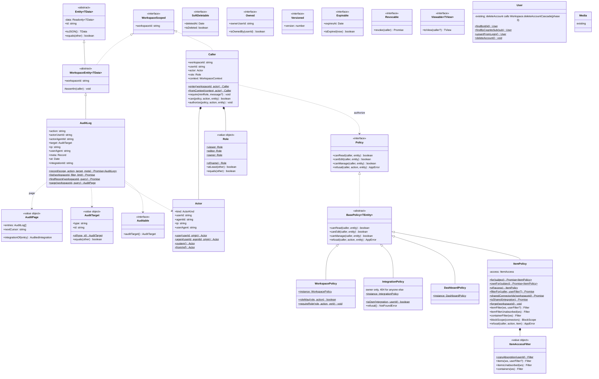
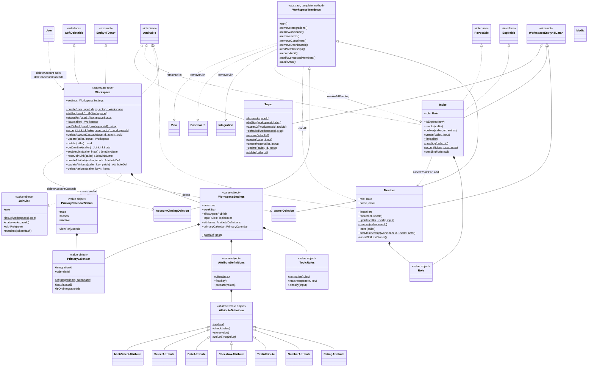
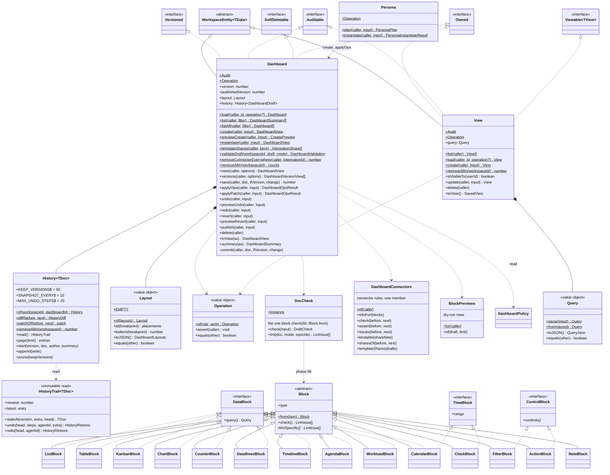
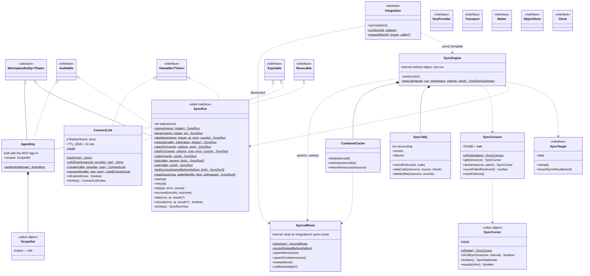

# Classes: the object model of the server

The server's domain is a set of classes (`server/src/classes/`). A class wraps 0..n models through
the `get…Repository()` getters and is the **only** code that touches the database; routes,
controllers and MCP tools stay thin functions (parse input → call a class → `toView()`), and pure
helpers (zod schemas, the builder's compiler, `gcal/diff`, the HTTP client, crypto primitives)
stay pure modules.

This page is the map of the **full target design** (plan: `.superpowers/sdd/2026-11-14-oop-redesign/plan.md`).
It is updated every phase.

- **Built** (exists in the code): green, solid border.
- **Planned**: grey, dashed border, with the phase that builds it.

| Phase | What it builds                                                                                                                                                                                                                                                                                  | State     |
| ----- | ----------------------------------------------------------------------------------------------------------------------------------------------------------------------------------------------------------------------------------------------------------------------------------------------- | --------- |
| 0     | Base layer (`Entity`, `WorkspaceEntity`, contracts), `Actor`, `Caller`, `Role`, `AuditTarget`, `Policy` + 4 policies, `AuditLog`, the error hierarchy, shared hashing; the class-boundary lint rule and test                                                                                    | **built** |
| 1     | `Integration` base, `Credential`, auth strategies, read and write sessions, the read-only gate (`Mode`); the provider subclasses wrapping today's code, `TaskProvider`/`CalendarProvider`, `IntegrationRegistry`                                                                                | **built** |
| 2a    | The one `static definition` per provider (`IntegrationDefinition`), headers from the auth strategy to the adapters, `OAuthFlow` (Google merged), `ResourcePicker`, capabilities to the client, `Integration`'s collaborators                                                                    | **built** |
| 2W    | Write-back (phase 2b): `TaskProvider.updateTask` and each definition's `writableFields`, `CalendarProvider` update/delete event, create calendar, recurrence (`RecurrenceRule`); `BoardProvider` stays planned                                                                                  | **built** |
| 3     | `Workspace` aggregate, `Member`, `Invite`, `Topic`, their value objects, the cascade template; `User` calls `Workspace.deleteAccountCascade`                                                                                                                                                    | **built** |
| PC    | The calendar phase: the workspace's `PrimaryCalendar` (value object in `WorkspaceSettings`, `PrimaryCalendarStatus`), the fixed push rule, `PlannedAt`, a pushed event deleted with its to-do, "Also remove everything TodoList added" (`AddedContentRemover`), block connector scopes          | **built** |
| 4a    | Server: the `Item` hierarchy (`Todo`, `MirroredItem`, `TaskItem`, `PullRequest`, `CalendarEvent`), `Container`, `ItemQuery`, `QueryTarget`, `ProviderFields`, `CreateQuota`, `TodoCopy`; overlay overrides and effective values; the split edit; recurring to-dos                               | **built** |
| 4b    | Client: the item sheet's editing and hints, the Repeat control, copy fixes; server: the primary calendar is always read, `ItemDetail.sourceValues`                                                                                                                                              | **built** |
| 5     | `SyncRun` state machine, `SyncCursor`/`SyncCursors`, `Integration.sync()` (template method) with `SyncEngine`, `Calendar` + `PushPlan` + `PushCommit`; the dispatcher, worker and purge on the classes                                                                                          | **built** |
| 6a    | `Dashboard` (`History<T>`, `HistoryTrail`, `Layout`, `DocCheck`, `DashboardConnectors`, `BlockPreviews`), `View` + `Query`, `Persona`, `Operation`, `ConnectLink`, `AuditLog.page`; the seed through classes; the cascade removes dashboards and views; `AgentKey` (built with the MCP sign-in) | **built** |
| 6b    | The `Block` hierarchy (14 types) behind `DocCheck`                                                                                                                                                                                                                                              | planned   |
| 7     | The legacy list emptied, dead services deleted                                                                                                                                                                                                                                                  | planned   |

**How the boundary is held.** `server/legacy-db-importers.mjs` names:

- the database modules (the models' barrel, `models/mongoose/**`, `models/sequelize/**`, the
  connection `config/database.ts` and its providers `config/providers/**`) and packages
  (`mongoose`, `sequelize`, `pg`, `mongodb`);
- the places allowed to load them (classes, models, the connection, migrations, tests);
- the entry points and jobs that may open the connection and nothing else (`lambda.ts`,
  `local.ts`, `stageMaintenance.ts`);
- the test helpers production code never loads (`src/testing/**`, `__tests__/**`);
- `LEGACY_DB_IMPORTERS`, the modules that still reach the database until their phase moves them:
  **empty since phase 6a** (6 after phase 5; 15 after phase 4a; 20 after phase 3; 23 after phase
  2a; 24 after phase 1; 35 after phase 0, down from 42). The empty list stays until phase 7
  deletes it, because ESLint and the boundary test read it.

ESLint (`@typescript-eslint/no-restricted-imports`, type imports allowed) and
`src/classes/classBoundary.test.ts` (which also resolves paths, sees dynamic imports and names
`get…Repository` getters) read that one module. The test also holds that only `AuditLog` names the
audit log's repository, and fails on a legacy entry that no longer needs to be there, so the list
only shrinks.

## 1. Base layer, people and permissions

The contracts are declared now and implemented by the entity classes of later phases (`Owned` by
`Integration`, `View`, `AgentKey`; `Versioned` by `Dashboard`; `Expirable` by `Invite` and
`AgentKey`; …).

## 2. Errors

The 409 domain errors are siblings of `ConflictError`, not children: a `catch (ConflictError)`
answers the version-conflict body (`currentVersion`), which they are not. The error handler answers
every `AppError` by `instanceof`. Write-back adds six (phase 2b and its fix round):

- `StatusNotAvailableError`: the provider has no transition, status or state for the asked status
  on this item;
- `ScopeMissingError`: the grant predates a scope the operation needs (`calendar.app.created`);
- `FieldNotWritableError`: a changed field the provider doesn't take for the item (it lacks it,
  only reads it, the item's kind takes no write-back, or it isn't on the edit screen);
- `ProviderPartialWriteError`: a write-back of several provider calls stopped part-way; what
  landed is kept and audited;
- `ProviderItemMissingError`: the item is gone at the provider;
- `EventHasGuestsError`: an event with other guests, changed without saying whether to notify
  them.

Their extra properties (`fields`, `openIn`, `written`, `refused`) are for the Phase 4 route to
answer; the error handler answers `{message, code}` today.

## 3. Integrations (phases 1, 2a and 2W)

```mermaid
classDiagram
  direction TB
  class WorkspaceEntity~TData~ {
    <<abstract>>
  }
  class Integration~TConfig,TSecret,TWriter~ {
    <<abstract>>
    -credential: Credential~TSecret~
    #auth: AuthStrategy~TSecret~
    #adapter: ProviderAdapter
    +config: TConfig
    +mode: Mode
    +allowsWrites: boolean
    +authKind: AuthKind
    +canCreate: boolean
    +toView() IntegrationStatusView
    +readConfig(caller)
    +update(caller, input) Promise~Integration~
    +checkMode(caller, mode) Mode
    +canSwitchMode: boolean
    +setMode(caller, mode) Promise~Integration~
    +saveCredential(caller, body) Promise
    +testConnection(caller) Promise
    +requestSync(caller) Promise
    +sync(options) Promise~SyncRunSummary~
    +stopSharing(caller) Promise
    +disconnect(caller) Promise
    +assertWritable(caller)
    +needsWriteConsent() Promise~boolean~
    #definition: IntegrationDefinition
    #withReadSession(fn) Promise
    #withWriteSession(caller, fn) Promise
    #handBackGrant(failure) Promise
    #lacksScopes(scopes) Promise~boolean~
    #writableFieldsFor(kind) WritableField[]
    #recordWrite(caller, meta) Promise
    #createWriter(secret)* Promise~TWriter~
    #probe(adapter, context)* Promise
    #onConnected() Promise
    #checkSelection(config) Promise
    #learnedLabel(accountLabel) string
    #revokeGrant() Promise
    +from(data)$ Integration
    +findOwn(caller, id)$ Integration
    +listOwn(caller)$ Integration[]
    +listVisible(caller)$ Integration[]
    +connectWithKey(caller, input)$ Integration
    +connectOAuth(caller, conn)$ ConnectedIntegration
    +forWorker(id)$ Integration
    +runSync(id, options)$ Promise~SyncRunSummary~
    +requestRun(id, trigger, caller?)$ SyncRun
    +isConnected(id)$ boolean
    +listForDispatch()$ Integration[]
    +disconnectAllOf(workspaceId, actor, member)$ number
    +withSyncSecret(id, fn)$ Promise
    +capabilitiesOf()$ ProviderCapabilities[]
  }
  WorkspaceEntity <|-- Integration
  class IntegrationDefinition~TSecret,TAuth~ {
    <<value object>>
    +provider
    +auth: AuthSet
    +connection: ConnectionRules
    +adapter: ProviderAdapter
    +create: CreateRules
    +writableFields: WritableField[]
    +writableKinds: ItemKind[]
    +reachableStatuses: ItemStatus[]
    +picker: PickerKind
    +revokePage
    +comingSoon
    +fixtures
    +authFor(method) AuthStrategy
    +parseConfig(config)
    +planConnection(input) ConnectionPlan
    +assertSameAccount(integration, config)
    +defaultLabel(config)
    +writableFieldsFor(kind) WritableField[]
    +fakeCredential(method, name)
  }
  Integration *-- IntegrationDefinition : static definition
  IntegrationDefinition *-- AuthStrategy
  class IntegrationConnector {
    <<collaborator>>
    +connectWithKey(caller, input)
    +upsertOAuth(caller, conn)
  }
  class ConnectionTester {
    <<collaborator>>
    +waitBeforeNext() Promise
    +run(timeZone) Promise
  }
  class SyncRequest {
    <<collaborator>>
    +hold() Promise
    +manualWait() Promise
    +enqueue() Promise
  }
  Integration ..> IntegrationConnector
  Integration ..> ConnectionTester
  Integration ..> SyncRequest
  class Owned {
    <<interface>>
  }
  class Auditable {
    <<interface>>
  }
  class SoftDeletable {
    <<interface>>
  }
  class Viewable~TView~ {
    <<interface>>
  }
  Owned <|.. Integration
  Auditable <|.. Integration
  SoftDeletable <|.. Integration
  Viewable <|.. Integration

  class Mode {
    <<value object>>
    +read$
    +readWrite$
    +allowsWrites: boolean
  }
  class Credential~TSecret~ {
    <<internal>>
    +seal(input, actor)$ Promise
    +of(integrationId)$ Credential
    +meta(workspaceId, id)$ Promise
    +destroy(workspaceId, id)$ Promise
    +open(fn) Promise
    +refreshIfStale(auth, workspaceId) Promise
  }
  class KeyProvider {
    <<interface>>
  }
  Credential ..> KeyProvider
  class AuthStrategy~TSecret~ {
    <<abstract>>
    +kind: AuthKind
    +methods: AuthMethod[]
    +handles(method) boolean
    +parseCredential(method, raw)
    +fakeCredential(method, name)
    +headers(secret, purpose?) Headers
    +query(secret)
    +bind(session) AdapterAuth
    +transport(inner) Transport
  }
  class OAuthAuth~TSecret~ {
    +refreshPolicy: stored | per_call
    +scopes, writeScopes, callbackPath
    +endpoints()
    +credentials() Promise
    +client(transport?) ReadOnlyClient
    +authorizeUrl(request) string
    +exchangeCode(client, grant, credentials) Promise
    +secretFromGrant(grant, scopes, now)
    +identify(client, accessToken) Promise
    +needsRefresh(secret, now) boolean
    +refresh(secret) Promise
    +revoke(secret) Promise
  }
  class ApiKeyAuth~TSecret~
  class ServiceAccountAuth~TSecret~
  class UnofferedAuth~TSecret~ {
    <<null object>>
  }
  AuthStrategy <|-- OAuthAuth
  AuthStrategy <|-- ApiKeyAuth
  AuthStrategy <|-- ServiceAccountAuth
  AuthStrategy <|-- UnofferedAuth
  Credential ..> OAuthAuth : refreshIfStale
  class SyncAdapter~TConfig,TSecret~ {
    <<strategy>>
  }
  Integration *-- Credential
  Integration *-- AuthStrategy
  Integration *-- SyncAdapter
  Integration *-- Mode

  class SupportsOAuth {
    <<interface>>
    +oauth: OAuthAuth
  }
  class SupportsApiKey {
    <<interface>>
    +apiKey: ApiKeyAuth
  }
  class ItemCopy {
    <<value object>>
    +integrationId
    +status
    +key
    +url
  }
  TaskProvider ..> ItemCopy : createTask
  class CreateFunnel {
    <<interface>>
    +createOptions(caller, query)
  }
  class TaskProvider {
    <<interface>>
    +createTask(caller, request) CreatedTask
    +updateTask(caller, item, patch) ItemData
  }
  class CalendarProvider {
    <<interface>>
    +listCalendars(caller)
    +insertEvent(caller, calendarId, event, recurrence?)
    +updateEvent(caller, item, patch, notice?) WrittenEvent
    +deleteEvent(caller, item, notice?)
    +deleteLinkedEvent(caller, link)
    +createCalendar(caller, name) GoogleCalendarEntry
    +primaryCandidate(caller, calendarId) GoogleCalendarEntry
    +dryRun(caller, narrowing, now)
    +push(caller, request)
  }
  class AddedContentRemover {
    <<interface>>
    +removeAdded(caller) AddedRemoval
  }
  class TaskEdit {
    <<value object>>
    +parse(patch)$ TaskEdit
    +fields
    +against(item, writable, timeZone) ProviderEdit
  }
  class WriteLedger {
    +confirm(fields, values) Promise
    +fields
    +values
    +isEmpty
  }
  class EventEdit {
    <<value object>>
    +parse(patch, timeZone)$ EventEdit
    +changes: EventChanges
    +fields
  }
  class RecurrenceRule {
    <<value object>>
    +parse(line)$ RecurrenceRule
    +fromLines(lines)$ RecurrenceRule
    +fits(allDay) boolean
    +toString() string
  }
  TaskProvider ..> TaskEdit : updateTask
  TrackerIntegration ..> WriteLedger : updateTask
  CalendarProvider ..> EventEdit : updateEvent
  CalendarProvider ..> RecurrenceRule : insertEvent
  CreateFunnel <|-- TaskProvider
  CreateFunnel <|-- CalendarProvider
  class ResourcePicker~K~ {
    <<interface>>
    +pickerKind: K | null
    +pickerResources(caller) PickerResources[K][]
    +choose(caller, ids)
  }
  class Revocable {
    <<interface>>
    +revoke(caller)
  }
  class BoardProvider {
    <<interface>>
    +boards(caller)
  }
  class CourseProvider {
    <<interface>>
  }

  class TrackerIntegration~TConfig,TSecret~ {
    <<abstract>>
    +createOptions(caller, query)
    +createTask(caller, request)
    +updateTask(caller, item, patch) ItemData
    #checkUpdate(item, patch)
    #applyUpdate(session, item, patch, ledger)*
    #answerOf(result) record
    #confirmedStatus(status, raw) MirroredItemPatch
    #readOptions(session, query)*
    #prepare(session, target, fields)*
    #readClient(transport)
    #writeBases()
  }
  Integration <|-- TrackerIntegration
  TaskProvider <|.. TrackerIntegration
  class JiraIntegration {
    +definition$ = JIRA
  }
  class ClickUpIntegration {
    +definition$ = CLICKUP
  }
  class LinearIntegration {
    +definition$ = LINEAR
  }
  class GitHubIntegration {
    +definition$ = GITHUB
  }
  class GoogleCalendarIntegration {
    +definition$ = GOOGLE_CALENDAR
  }
  class MoodleIntegration {
    +definition$ = MOODLE (comingSoon)
  }
  class UnlistedIntegration {
    <<null object>>
  }
  TrackerIntegration <|-- JiraIntegration
  TrackerIntegration <|-- ClickUpIntegration
  TrackerIntegration <|-- LinearIntegration
  TrackerIntegration <|-- GitHubIntegration
  Integration <|-- GoogleCalendarIntegration
  Integration <|-- MoodleIntegration
  Integration <|-- UnlistedIntegration
  ResourcePicker <|.. JiraIntegration
  SupportsOAuth <|.. JiraIntegration
  SupportsApiKey <|.. JiraIntegration
  ResourcePicker <|.. ClickUpIntegration
  SupportsOAuth <|.. ClickUpIntegration
  SupportsApiKey <|.. ClickUpIntegration
  Revocable <|.. LinearIntegration
  SupportsOAuth <|.. LinearIntegration
  SupportsApiKey <|.. LinearIntegration
  BoardProvider <|.. GitHubIntegration
  SupportsOAuth <|.. GitHubIntegration
  SupportsApiKey <|.. GitHubIntegration
  CalendarProvider <|.. GoogleCalendarIntegration
  ResourcePicker <|.. GoogleCalendarIntegration
  Revocable <|.. GoogleCalendarIntegration
  SupportsOAuth <|.. GoogleCalendarIntegration
  CourseProvider <|.. MoodleIntegration
  SupportsApiKey <|.. MoodleIntegration

  class IntegrationRegistry {
    <<registry>>
    +instance$
    +register(cls, factory)
    +registerFallback(factory)
    +classOf(provider)
    +create(data) Integration
  }
  Integration ..> IntegrationRegistry : from()
  class OAuthFlow {
    <<entity: OAuthState>>
    +start(caller, integrationClass, input)$ OAuthStart
    +consume(integrationClass, callback)$ location
    +providers(caller)$ OAuthProvidersResponse
  }
  OAuthFlow ..> OAuthAuth
  OAuthFlow ..> Integration : connectOAuth

  classDef built fill:#d1fae5,stroke:#047857,stroke-width:2px
  classDef planned fill:#f3f4f6,stroke:#9ca3af,stroke-dasharray:5 5,color:#4b5563
  class WorkspaceEntity:::built
  class Owned:::built
  class Auditable:::built
  class SoftDeletable:::built
  class Viewable:::built
  class Revocable:::built
  class Integration:::built
  class Mode:::built
  class Credential:::built
  class KeyProvider:::planned
  class AuthStrategy:::built
  class OAuthAuth:::built
  class ApiKeyAuth:::built
  class ServiceAccountAuth:::built
  class SyncAdapter:::planned
  class SupportsOAuth:::built
  class SupportsApiKey:::built
  class CreateFunnel:::built
  class TaskProvider:::built
  class CalendarProvider:::built
  class ResourcePicker:::built
  class BoardProvider:::planned
  class CourseProvider:::planned
  class TrackerIntegration:::built
  class JiraIntegration:::built
  class ClickUpIntegration:::built
  class LinearIntegration:::built
  class GitHubIntegration:::built
  class GoogleCalendarIntegration:::built
  class MoodleIntegration:::built
  class UnlistedIntegration:::built
  class IntegrationRegistry:::built
  class OAuthFlow:::built
  class IntegrationDefinition:::built
  class IntegrationConnector:::built
  class ConnectionTester:::built
  class SyncRequest:::built
  class UnofferedAuth:::built
  class TaskEdit:::built
  class WriteLedger:::built
  class EventEdit:::built
  class RecurrenceRule:::built
  class ItemCopy:::planned
```

The write gate is the `protected` `withWriteSession`: only provider subclasses reach a writer
(`classes/integration/writers/`: the tracker write client, the Calendar API writer and the push's
ops), and only inside their capability methods (`createTask`, `updateTask`, `insertEvent`,
`updateEvent`, `deleteEvent`, `createCalendar`, `push`). In order, it refuses another member (404), demo
data or a fixtures stage's tracker (`provider_writes_off`), then a read-only integration
(`ReadOnlyIntegrationError`, 409 `integration_read_only`); only then does it open the credential
and make the writer (`createWriter`, the provider's own). `assertWritable` runs the same checks so
callers refuse before they reserve or record anything. The mode is the one the integration was
loaded with: a switch made while a request runs is seen by the next one.

What the tests hold:

- `writePaths.test.ts`:
  - only `TrackerIntegration.ts`, the provider classes and the writer modules load a writer;
  - nothing outside `classes/integration/**` names the writer factories;
  - each factory has one call site, by count: `createWriteClient(` in `TrackerIntegration` and
    `calendarWriter(` in `GoogleCalendarIntegration`, each inside a `createWriter` body, and
    `applyOps(` once, in `GoogleCalendarIntegration`, inside a `withWriteSession(…)` call. A
    writer made in a read session fails;
  - the write-back hook `applyUpdate` is called once in all of `server/src`: `this.applyUpdate(`
    in `TrackerIntegration`'s template, inside a `withWriteSession(…)` call; the provider classes
    only declare it;
  - MCP code never names `setMode`, `checkMode` or `UpdateIntegrationBody`.
- The write allow-lists refuse everything else before it is sent:
  - `writers/trackerWriter.update.test.ts`: by method, exact path and **body keys** (Jira
    `PUT …/issue/{id}` with `fields.summary|duedate|priority.id` and `POST …/transitions` with
    `transition.id`, at the integration's own sites only; ClickUp `PUT /task/{id}` with its seven
    keys; GitHub `PATCH /issues/{n}` with `title|state|state_reason`; Linear only the named
    `issueUpdate` document, variables `{id, input}` with `title|stateId|dueDate|priority`). A
    trash, an archive, a body, assignees or a project move never pass.
  - `writers/calendarApi.test.ts`: `POST /calendars`, events insert, patch and delete (those two
    with `sendUpdates=all|none` only); never a calendar's delete or ACL. The URL must be exactly
    as sent: a `.`/`..` segment (`%2e%2e` too) or an empty one is refused.
- `writeBack.trackers.test.ts` and `writeBack.calendar.test.ts`, per provider:
  - the exact requests a write-back sends (lookups as reads, then the allow-listed writes) and what
    the item holds afterwards;
  - each provider call audited as it lands; a Jira edit stopped part-way keeps and audits what
    landed (`provider_partial_write`);
  - every refusal before anything is opened or written (`field_not_writable`,
    `status_not_available`, a value the provider can't hold; read-only: zero non-GET, and an
    unchanged field is no write; `scope_missing`; an invalid RRULE; `event_has_guests`);
  - an event only through this integration's item on a calendar it reads, or its own
    CalendarLink: another integration's, another workspace's, a raw event id or an unselected
    calendar is 404 with zero non-GET requests.
- `vaultImports.test.ts`: only `Integration.ts` uses `Credential`, and only `Integration.ts` and
  `sync/secrets.ts` name `Integration.withSyncSecret` (MCP code never does).
  An alias does not get round them: a factory renamed with `as`, bound to another name,
  destructured from an `await import(…)` or re-exported fails, as does a dynamic import with no
  literal target inside `classes/integration/`.
- `integration.test.ts`: for every provider class, without a database, each write it can make
  without reading an item first (`createOptions`, `createTask`, `insertEvent` with and without a
  recurrence, `createCalendar`, `push`) is refused while read-only before anything is sent. The
  writes keyed by an item read it first (the gate waits for what actually changes): the
  write-back tests hold them with a database.
- `definitions/definitions.test.ts`: the definitions name each connectable provider once, each
  its class's own; every OAuth app's token and revoke URL is on the HTTP layer's allow-list
  (`OAUTH_TOKEN_ENDPOINTS`, written out there on purpose: no definition can widen it) and its
  callback path is the one registered at the provider; the scopes and the key methods are as
  before; the strategies build the headers (a second token for GitHub boards, Moodle's query
  token, one Google token exchange per session, one per call for the service account); the
  four authorize URLs are pinned byte for byte (Google's parameters, in any order, now with
  `calendar.app.created`); each provider's `writableFields` and the kinds that take a write-back
  are pinned, a write-back is declared exactly where the class implements one; and
  `Integration.capabilitiesOf()` agrees with the contracts each class implements (with
  `canUpdate` and `writableFields`).
- `definitions/purity.test.ts`: nothing under `classes/integration/definitions/` reaches, at run
  time, the models' barrel, a model, the connection or `config/environment.ts` (the plain types
  under `models/definitions/` are fine). The builder's compiler, which validates Google's push
  filter, starts every read from `ItemAccessFilter` (pure), not from `ItemPolicy` (which resolves
  the access from the data). `config/environment.ts` reads `process.env` when a value is asked
  for, so no import order can fix a value early (`definitions/importOrder.test.ts` loads the
  definitions before its database starts).
- `sync/providers/adapterSecrets.test.ts`: the adapters never reach the secret. `AdapterContext`
  has no `secret`; nothing under `sync/providers/` names `.secret` or indexes `secret[…]`, or loads
  the credential or the sync's secret door. Google's service-account signer is the strategy's
  (`auth/googleServiceAccount.ts`), and the account it names reaches a connection test as
  `ctx.auth.account()`.
- `sync/http.test.ts` pins `OAUTH_TOKEN_ENDPOINTS` exactly, and the URLs a client takes.

**What phase 2a built:**

- **One `static definition` per provider class** (`definitions/<provider>.ts`, an
  `IntegrationDefinition`): its auth strategies (`auth.oauth`, `auth.apiKey`,
  `auth.serviceAccount`), the config schema, the connection rules (default topic, account key,
  label, which config change moves the account), the sync adapter, the create rules (funnel
  steps and reader, which links are kept, what a 403 means), the picker, the revoke page,
  `comingSoon` and the fixtures (the funnel's recorded set; each strategy's FAKE credential). It
  replaces `RULES`, `CREDENTIAL_SCHEMAS`, `OAUTH_PROVIDER_DEFS`, `OAUTH_ENDPOINTS`, the
  `fakeCredential` switch and the create switches (`safeCopyUrl`, `failureFor`).
  `definitions/index.ts` lists them for code that must not load the classes (the sync engine in
  fixtures mode, the seed); `services/integrationConfig.ts` and `seed/fakeCredentials.ts` are
  views of them.
- **Headers from the strategy.** The adapters get `ctx.auth` (`AdapterAuth`: `kind`,
  `headers(purpose?)`, `query()`), bound by the integration's strategy to the opened secret and the
  run's client; no adapter builds an auth header, and `authMethod === 'oauth'` checks became
  `auth.kind` / `authKind`, `canCreate` or polymorphism (`pickerKind`). The create path, the
  connection test and the Calendar writer take the same headers.
- **`OAuthFlow`** (an OAuthStates row's lifecycle): `start(caller, integrationClass, input)` and
  `consume(integrationClass, callback)`, the same flow for Google Calendar and the four providers;
  what differs is each provider's `OAuthAuth` (endpoints, scopes, PKCE, the secret it seals, how it
  names the account). Routes, callback URLs, scopes, codes and redirects are unchanged.
- **`ResourcePicker<R>`** (Jira sites, ClickUp workspaces, Google calendars): `pickerKind`,
  `pickerResources(caller)`, `choose(caller, ids)`; the routes pick by `isResourcePicker`.
- **Capabilities to the client**: `GET …/oauth/providers` adds `capabilities[]` from
  `Integration.capabilitiesOf()` (auth methods, picker, revoke on disconnect, revoke page, can
  create, coming soon); the Integrations page reads them instead of its lists.
- **`Integration`'s collaborators**: `IntegrationConnector`, `ConnectionTester`, `SyncRequest`,
  and (phase 5) `SyncEngine`, the body of `Integration#sync`.
  They get the protected members they need as functions; the credential never leaves
  `Integration.ts`. `toStatusView` is gone (`toView`).

**What phase 2W (write-back, "phase 2b", and its fix round) built:**

- **`TaskProvider.updateTask(caller, item, patch)`**, over a mirrored item's provider fields only,
  required by the compiler of every tracker, is a template method in `TrackerIntegration`:
  1. validate the edit (`TaskEdit`: provider fields only, a one-line title; 400 naming the field)
     and the item (this integration's live mirrored item, else 404);
  2. compare it with the item: an unchanged field is dropped (an edit that changes nothing is no
     write and no write gate); a changed field the provider doesn't take for the item's kind is
     422 `field_not_writable`; then `checkUpdate` (the provider's static rules: a status outside
     its `reachableStatuses`, a value it can't hold) and the write gate, all before anything is
     opened;
  3. the write session;
  4. `applyUpdate`: the provider class's lookups (reads), then its exact update requests; each
     call that goes through is confirmed to a `WriteLedger`, which audits it at once
     (`integration.write`, field names only);
  5. save what the provider confirmed (`updateMirrored`, clearing `source.hash` so the next sync
     rewrites what the provider holds).

  A later call that fails after an earlier one landed: what landed is saved and audited
  (`partial: true`), and the answer is 409 `provider_partial_write`. TodoList's own fields (the
  overlay) are not this method's: they stay on the item's overlay path, under the item policy.

- **`writableFields`, `writableKinds`, `reachableStatuses`** per definition (`write` rules):
  Jira `title, status, dueAt, priority` (issues; open, in progress, done); ClickUp `title, status,
dueAt, startAt, priority` (tasks; open, in progress, done); Linear `title, status, dueAt,
priority` (issues; all four); GitHub `title, status` (issues; open, done, cancelled); Google
  Calendar `title, startAt, endAt` (events; no status); Moodle none.
- **Status write-back** through provider lookups: Jira's transitions by status category, with
  their fields (one that needs a field filled in is skipped), ClickUp's list statuses by type,
  Linear's team workflow states by type (the registered `IssueTeamStates` query), GitHub's issue
  state with `state_reason` ("open" refused while a board column says in progress). Jira also
  reads the issue's edit metadata first: each field on its edit screen, the priority by the id it
  allows.
- **`CalendarProvider`**: `updateEvent(caller, item, patch, notice?)` and `deleteEvent(caller,
item, notice?)` by this integration's event item on a calendar it reads (never a raw id; an
  event with other guests needs `notifyGuests`, sent as `sendUpdates`); `deleteLinkedEvent(caller,
link)` by its own live CalendarLink, on whichever calendar it was pushed to (tombstoned after; the calendar phase dropped the push-target check); `createCalendar`
  (`calendars.insert`; `scope_missing` without `calendar.app.created`); `insertEvent(…,
recurrence)` with one RRULE line parsed by `RecurrenceRule`.
- **Capabilities**: `ProviderCapabilities` gains `canUpdate`, `writableFields`, `writableKinds`
  and `reachableStatuses` (additive), so the ItemSheet can drive its fields and status choices.

**The seams left open:**

- No route calls `updateTask`, `updateEvent` or `deleteEvent` yet: the item REST route, MCP
  (item ids only) and the ItemSheet UI arrive in phase 4. (`deleteLinkedEvent` and
  `createCalendar` are wired by the calendar phase: an item's delete, the primary calendar, the
  disconnect clean-up.)
- A field the provider lacks (Jira's or Linear's start date, GitHub's priority) is refused by
  `updateTask`, not kept on the synced columns (the sync would rewrite them). Phase 4 keeps such
  values truly local as overlay overrides, merged on read, beside `overlay.plannedAt`.
- The sync engine reaches a credential through `Integration.withSyncSecret` (a read session) until
  phase 5 moves it behind `Integration.sync()`. Only `sync/secrets.ts` names it, by test.
- `Revocable.revoke(caller)` is its owner's (it checks), over the protected `revokeGrant()` hook,
  which the disconnect template calls whoever disconnects (the owner, or whoever ended the
  owner's membership, who has no standing of the member's own).
- `canSwitchMode` (never demo data) is in the REST view and on the create targets, so the client
  offers the switch, and the "switch to Read & write" hint, only where it can work.

## 4. Items, containers and the calendar (phases 4 and 5)

```mermaid
classDiagram
  direction TB
  class WorkspaceEntity~TData~ {
    <<abstract>>
  }
  class Item {
    <<abstract>>
    +isLocal: boolean*
    +title / status / dueAt / startAt / priority (effective)
    +overlay: Overlay
    +copies: Copies
    +facts: ItemFacts
    +from(data)$ Item
    +fromDoc(row)$ Item
    +find(caller, id)$ Item
    +unsetTopicIn(workspaceId, topicId)$
    +edit(caller, edit)* Item
    +setOverlay(caller, edit) Item
    +editing(caller)* ItemEditing
    +isVisibleTo(caller, policy) boolean
    +toSummary(context) ItemSummary
    +toView(caller, context) ItemDetail
  }
  WorkspaceEntity <|-- Item
  class Viewable~TView~ {
    <<interface>>
  }
  class Auditable {
    <<interface>>
  }
  class SoftDeletable {
    <<interface>>
  }
  Viewable <|.. Item
  Auditable <|.. Item
  SoftDeletable <|.. Item
  class ItemPolicy
  Item ..> ItemPolicy : isVisibleTo, edit

  class Todo {
    +create(caller, input)$
    +findOwn(caller, id)$ Todo
    +update(caller, edit)
    +complete(caller, done)
    +delete(caller)
    +copyTo(caller, request)
  }
  class MirroredItem {
    <<abstract>>
    +openIn
    +providerFields
    +overridableFields
    +edit(caller, edit) template
    #changedFields(half)
    #writeBack(caller, integration, half)*
    +store(integration, mapped)$
    +markAsCopyOf(todo)
  }
  class TaskItem {
    #writeBack() updateTask
  }
  class PullRequest {
    +merged
    +reviewDecision
  }
  class CalendarEvent {
    +timeRange: TimeRange
    +recurrence
    #writeBack() updateEvent
    +createRecurring(caller, input)$
  }
  Item <|-- Todo
  Item <|-- MirroredItem
  MirroredItem <|-- TaskItem
  TaskItem <|-- PullRequest
  MirroredItem <|-- CalendarEvent

  class Editable {
    <<interface>>
  }
  class Completable {
    <<interface>>
  }
  class Deletable {
    <<interface>>
  }
  class HasDueDate {
    <<interface>>
  }
  class Copyable {
    <<interface>>
  }
  class ProviderLinked {
    <<interface>>
    +openIn
  }
  class Schedulable {
    <<interface>>
    +timeRange
  }
  Editable <|.. Todo
  Completable <|.. Todo
  Deletable <|.. Todo
  HasDueDate <|.. Todo
  Copyable <|.. Todo
  ProviderLinked <|.. MirroredItem
  HasDueDate <|.. TaskItem
  Schedulable <|.. CalendarEvent

  class TodoCopy {
    +run() CreateCopyOutcome
  }
  class CopyTarget {
    <<abstract>>
    +for(integration, target)$
    +check(todo)*
    +send(send)*
  }
  class TaskCopyTarget
  class EventCopyTarget
  CopyTarget <|-- TaskCopyTarget
  CopyTarget <|-- EventCopyTarget
  Todo ..> TodoCopy : copyTo
  TodoCopy ..> CopyTarget
  TaskCopyTarget ..> TaskProvider : createTask
  EventCopyTarget ..> CalendarProvider : insertEvent
  TaskItem ..> TaskProvider : updateTask
  CalendarEvent ..> CalendarProvider : updateEvent, insertEvent(recurrence)
  class TaskProvider {
    <<interface>>
  }
  class CalendarProvider {
    <<interface>>
  }

  class Container {
    +assertVisible(caller, policy, id)$
    +listVisible(caller, policy, ids)$
    +findByExternalId(...)$
    +unsetTopicIn(workspaceId, topicId)$
    +toView() FacetContainer
  }
  WorkspaceEntity <|-- Container
  class ItemQuery {
    +for(caller)$ ItemQuery
    +effectiveStage()$
    +list(query)
    +get(id)
    +detail(item)
    +summaries(ids)
    +facets(connectors)
    +aggregates() RunQueryDeps
    +run(query, ctx)
  }
  ItemQuery ..> ItemPolicy
  class QueryTarget {
    <<value object>>
    +resolve(caller, request)$
  }
  class ProviderFields {
    +of(ws, userId)$
    +list(now)
  }
  class CreateQuota {
    +forHour(userId, provider, now)$
    +reserve()
    +release()
  }
  class RateLimiter {
    <<interface>>
  }
  RateLimiter <|.. CreateQuota
  TodoCopy ..> CreateQuota
  CalendarEvent ..> CreateQuota

  class Calendar {
    one target Google calendar
    +primaryFor(integration)$ PushCalendar
    +of(integration, calendarId)$ Calendar
    +cursor() SyncCursor
    +commit(input, now) CommitCounts
  }
  WorkspaceEntity <|-- Calendar
  class PushCalendar {
    the primary, as its integration pushes
    -owner: Caller
    +plan(now, narrowing?, budget?) PushPlan
  }
  Calendar <|-- PushCalendar
  class EventClaim {
    internal: claim before delete
    +take(link)$ EventClaim
    +stands(link, runCreatedAt)$ boolean
    +stuck(owner)$ CalendarLinkData[]
    +reconcile(stuck, read, canGoOn)$ SweepCounts
    +settle()
    +release()
    +resolve(read) settled | kept
  }
  PushCommit ..> EventClaim : a claim drops an adopt
  class CalendarLink {
    +isOwnLive(link)$ boolean
    +isPushedByTodoList: boolean
  }
  SoftDeletable <|.. CalendarLink
  Calendar *-- CalendarLink
  class CalendarLinks {
    +in(workspaceId)$ CalendarLinks
    +onItemDeleted(itemId) number
  }
  class SyncCursor {
    <<value object>>
  }
  class PushPlan {
    <<value object>>
    +ops
    +calendarId
    +dailyCapReached
    +toDryRun()
  }
  class PushCommit {
    method object
    +apply(integration, input, now, pushedTo?)$ CommitCounts
  }
  Calendar *-- SyncCursor
  Calendar *-- PushPlan
  Calendar ..> PushCommit : commit
  PushCommit ..> SyncRun : succeed
  class AttributeValues {
    <<value object>>
  }
  class Overlay {
    <<value object>>
    +overrides: Overrides
    +patch(edit, settings)$
  }
  class Overrides {
    <<value object>>
    +effective(source)
    +projection()$
    +clearing(fields)$
  }
  class ItemEdit {
    <<value object>>
    +localPatch()
    +split(writable) EditSplit
  }
  class ItemEditing {
    <<value object>>
    +local()$
    +mirrored(input)$
  }
  class TimeRange {
    <<value object>>
    +changedBy(change)
  }
  class Copies {
    <<value object>>
  }
  class PlannedAt {
    <<value object>>
  }
  Item *-- Overlay
  Overlay *-- Overrides
  Overlay ..> PlannedAt
  Item *-- Copies
  CalendarEvent *-- TimeRange
  Item ..> ItemEdit : edit
  Item ..> ItemEditing : editing

  classDef built fill:#d1fae5,stroke:#047857,stroke-width:2px
  classDef planned fill:#f3f4f6,stroke:#9ca3af,stroke-dasharray:5 5,color:#4b5563
  class WorkspaceEntity:::built
  class Viewable:::built
  class Auditable:::built
  class SoftDeletable:::built
  class ItemPolicy:::built
  class Item:::built
  class Todo:::built
  class MirroredItem:::built
  class TaskItem:::built
  class PullRequest:::built
  class CalendarEvent:::built
  class Editable:::built
  class Completable:::built
  class Deletable:::built
  class HasDueDate:::built
  class Copyable:::built
  class ProviderLinked:::built
  class Schedulable:::built
  class TodoCopy:::built
  class CopyTarget:::built
  class TaskCopyTarget:::built
  class EventCopyTarget:::built
  class TaskProvider:::built
  class CalendarProvider:::built
  class Container:::built
  class ItemQuery:::built
  class QueryTarget:::built
  class ProviderFields:::built
  class CreateQuota:::built
  class RateLimiter:::built
  class Overlay:::built
  class Overrides:::built
  class ItemEdit:::built
  class ItemEditing:::built
  class TimeRange:::built
  class Copies:::built
  class PlannedAt:::built
  class CalendarLink:::built
  class CalendarLinks:::built
  class Calendar:::built
  class PushCalendar:::built
  class EventClaim:::built
  class SyncCursor:::built
  class PushPlan:::built
  class PushCommit:::built
  class SyncRun:::built
  class AttributeValues:::planned
```

- **`Item.from(data)`** is the polymorphic factory: a local to-do is a `Todo`; a mirrored item is a
  `CalendarEvent` (kind `event`), a `PullRequest` (kind `pr`) or a `TaskItem` (the rest). Each
  subclass registers itself; `classes/item/index.ts` loads them all, so import the item classes
  from there.
- **Effective values.** What an item reads as is `override ?? source` (`Overrides`): its getters,
  its views, MCP's summaries, every `ItemQuery` read (an `$addFields` right after the access
  filter's `$match`), the builder's compiled pipeline (the same stage, second, before the filters,
  sorts and groups), the facets and the workspace calendar's push (`gcal/plan.ts` projects it before
  its date window).
- **One edit, split** (`Item#edit`, polymorphic): a `Todo` changes its own columns (ItemPolicy:
  editors who see it); a `MirroredItem` splits the edit (`ItemEdit#split`) against its provider's
  writable fields for its kind: the provider half goes through its integration (`TaskProvider
.updateTask`, `CalendarProvider.updateEvent`), its owner's only (`integration_not_owner`) and only
  while read & write (`integration_read_only`, the write gate); the fields its provider lacks are
  kept as overrides by any editor who sees it; anything else is the mirrored 409 with `openIn`.
- **`Todo.copyTo`** is polymorphic over the target (`CopyTarget.for`: a `TaskProvider` creates a
  task, a `CalendarProvider` inserts an event), through the integration's write gate; `TodoCopy` is
  the attempt (the hourly `CreateQuota`, the audit, the read-back stored by `MirroredItem.store`).
- **`CalendarEvent.createRecurring`** makes a recurring to-do: a recurring event in the workspace's
  primary calendar only, by its integration's owner, stored at once as its event item.

## 5. Workspace and people (phase 3, built)

`classes/workspace/`. Callers pass their `Caller`; its actor (user or agent key, with the request's
address and user agent) is the one recorded in the audit log (the REST entries already carried them;
the first-page dashboard entry and the former-member disconnect are newly filled). `Workspace` is the aggregate root: `Member`, `Invite` and `Topic` are
entities of their own that point at it by workspace id.

How the pieces work, in short:

- **Owner rule.** `assertOwner(caller)` (`ownerOnly.ts`) is the one owner check (`WorkspacePolicy`,
  403 "Only an owner can do this"). `Member.update`, `Member.remove` and the invite and join-link
  methods call it first, as the old services did, so a refusal still comes before any lookup.
- **Last owner.** `Member` holds the rule (409 `last_owner`): the only owner can't be demoted,
  removed or leave. Ending a membership revokes the agent keys and disconnects the member's
  integrations (`Integration.disconnectAllOf`).
- **Cascade.** `WorkspaceTeardown.run` is the template: integrations (credentials first, checked
  gone), the workspace row, items, containers, the dashboards with their histories and the saved
  views (`Dashboard.removeAllIn`, `View.removeAllIn`: hard deletes, phase 6a), invites and members,
  the `workspace.delete` audit entry, then the emails. The two subclasses differ only in the audit
  meta (`{}` or `{reason: 'account_deleted'}`), so an account's end removes them too. The
  `2026-11-15-orphaned-dashboards` migration removes, once, what workspaces deleted before phase 6a
  left behind.
- **Registry.** `Member` and the cascade import `Integration` from `integration/index.js`, which
  registers every provider class; `IntegrationRegistry.create` throws for a connectable provider
  without a class instead of using the fallback. `registry.test.ts` holds it in fresh processes.
- **Statics over ids.** `Member.update/remove/leave` and `Topic.update/delete` are statics so the
  role check (403) still comes before any lookup (404), as in the old services. `Invite` loads a
  pending invite after the owner check, then acts on it.
- **Topic delete.** It unsets the topic through `Integration.unsetTopicIn`; the item and container
  halves still use their repositories until Phase 4 gives them classes.
- **Join link.** `JoinLink` seals the token with the stage key, bound to the workspace (the crypto
  of the old `joinLinkVault`, unchanged); only its hash is searchable.
- **Attributes and topic rules.** `AttributeDefinition` is one subclass per type (what a value may
  be and how it is stored is polymorphic); `TopicRules` classifies a container's match key and
  validates a request's rules.

## 6. Dashboards and views (phase 6a built; the Block classes are phase 6b)

`classes/dashboard/`. A dashboard's blocks are still plain JSON: `DocCheck` is the one place they
are checked (`checkDraft`) and linted (`lintDashboard`), and phase 6b replaces its two bodies with
the `Block` hierarchy (`Block.from(json).check()`) without changing a caller.

## 7. Sync, agent keys and the outside world (phases 5 and 6)

The outside-world interfaces invert today's test seams (`set…ForTests`): production wires KMS,
SES, S3 and the real clock; tests wire the fakes. Behaviour does not change.

## What phase 6a built (dashboards, views, connect links, the audit page; the list emptied)

- **`Dashboard`** (`classes/dashboard/Dashboard.ts`) `extends WorkspaceEntity<DashboardData>
implements Versioned, Auditable, SoftDeletable, Owned`: the only code that reads or writes
  Dashboards (the old `services/dashboards.ts`, moved behind it). Each operation's role is an
  `Operation` value object (`Dashboard.Operation.edit`, `.undo`, `.publish`…) checked by
  `Dashboard.load(caller, id, operation)` before the read, so the 403 still comes before any 404;
  every instance method checks it again (and the `DashboardPolicy` read), so it is safe on any
  loaded dashboard. `save(caller, doc, ifVersion, change)` is the old `commit` (the
  `replaceIfVersion` compare-and-set, the connector check and audit, the history append and prune,
  the `dashboard.update` audit) moved verbatim; a change without a patch is diffed from the draft
  (the old `commitState`). "Stop sharing" writes through the private `#commit` (it strips the
  owner's connector from pages they may not open, as before). Audit names in `Dashboard.Audit`.
- **`History<TDoc>`** (generic, over DashboardVersions): `diff` (patch and inverse from plain JSON),
  `start`, `append` (a snapshot every 10th version), `prune` (the last 50 plus the published one),
  `read` → **`HistoryTrail<TDoc>`** (an immutable read: `stateAt`, `undo`, `redo`, the old undo
  loop and redo check, verbatim). The pure `builder/history.ts` is unchanged.
- **`Layout`** (value object: the stored grid, `bottom(breakpoint)`), **`DocCheck`** (the one
  place a document's blocks are checked and linted; the phase 6b seam), **`DashboardConnectors`**
  (the connector rules for one member, ruling 3, 16, 23d), **`BlockPreviews`** (a dry run's rows).
- **`View`** (`classes/dashboard/View.ts`) `extends WorkspaceEntity<ViewData> implements Owned,
Auditable, Viewable<SavedView>`, composing a **`Query`** value object (parsed and compiled against
  the whitelist, `/query…` pointers). `View.load(caller, id, View.Operation.edit)` keeps the role
  before the read; `view.*` audit names in `View.Audit`.
- **`Persona`** (`classes/dashboard/Persona.ts`): `plan` / `instantiate` (role, then the key, then
  topics, pages through `Dashboard.create`, views through `applyOps`), idempotent per topic slug as
  before; a page is found with `Dashboard.listAll` (every live dashboard, as the old repository
  read).
- **`ConnectLink`** (`classes/ConnectLink.ts`) `implements Expirable, Viewable<ConnectLinkView>`:
  `create` (an editor; the id's sha256 in the `integration.connect_link` entry) and `consume` (the
  member it was made for, once through ReplayNonces: 404 unknown or expired, 403 another member,
  410 used), 10 minutes, unchanged.
- **`AuditLog.page(workspaceId, query)`** → **`AuditPage`** (value object: entries newest first,
  the opaque cursor, the integrations its entries are about); `AuditLog#integrationId`.
  `audit_log_query` keeps only its output shape and the visibility rule (ruling 15).
- **The seed** (`seed/seedWorkspace.ts`) goes through classes only: `Workspace.ownerOf`,
  `Integration.listOwn` / `connectWithKey` / `#pinAccount` / `#hasCredential`, `Todo.existsWithKey`
  / `countLiveWithKeys`, `Item.countLiveOf`, `Container.countLiveOf`, `Dashboard.listAll` /
  `instantiate` / `applyOps` / `publish` / `delete`. Its suites pass unchanged.
- **The cascade** (`WorkspaceTeardown`) gains `removeDashboards` after the containers: the
  dashboards (deleted ones too), their versions and the saved views, hard-deleted, for an owner's
  deletion and an account's end alike (the owner's ruling). The `2026-11-15-orphaned-dashboards`
  migration (sync-db) removes, once, those of workspaces that are gone or soft-deleted; it answers
  counts only.
- **Legacy list: 6 → 0.** `LEGACY_DB_IMPORTERS` is an empty array (ESLint and the boundary test
  still read it; phase 7 deletes it).

## Where phase 6a left the old modules

| Module                                                                                   | Now                                                                                                     |
| ---------------------------------------------------------------------------------------- | ------------------------------------------------------------------------------------------------------- |
| `services/dashboards.ts`                                                                 | **removed**: `Dashboard`, `History`, `HistoryTrail`, `DocCheck`, `DashboardConnectors`, `BlockPreviews` |
| `services/views.ts`                                                                      | **removed**: `View`, `Query`                                                                            |
| `services/personas.ts`                                                                   | **removed**: `Persona`                                                                                  |
| `services/connectLinks.ts`                                                               | **removed**: `ConnectLink`                                                                              |
| `mcp/tools/workspace/auditLogQuery.ts`                                                   | thin over `AuditLog.page`; off the legacy list                                                          |
| `seed/seedWorkspace.ts`                                                                  | through classes only; off the legacy list                                                               |
| controllers (dashboards, builder, views, connect links), MCP builder tools and resources | `Dashboard.load(caller, id, operation)` then the method; `View`, `Persona`, `ConnectLink`               |
| `services/dashboardSchemas.ts`                                                           | `History.MAX_UNDO_STEPS`                                                                                |

Tests that called the removed modules import the same call shapes from `src/testing/dashboardCalls.ts`
(one line each over the classes); their assertions are unchanged.

## What phase 5 built (sync, the dispatchers and the calendar push)

- **`SyncRun`** (`classes/sync/SyncRun.ts`) is the only code that reads or writes runs, and a
  state machine. Its status changes only through its transitions and a private `#status` setter
  that refuses any edge the machine doesn't have (`IllegalSyncRunTransitionError`):

  | Transition                               | From                                    | To                        |
  | ---------------------------------------- | --------------------------------------- | ------------------------- |
  | `queue` / `begin` / `skipNew` (created)  | —                                       | queued / running / failed |
  | `start`                                  | queued                                  | running                   |
  | `retry` (its job run again by Lambda)    | running, succeeded, partial, failed     | running                   |
  | `skip` (a paused or expired integration) | any                                     | failed                    |
  | `succeed`                                | running                                 | succeeded, partial        |
  | `fail`                                   | queued (its job never started), running | failed                    |
  | `cancel` (one conditional write)         | queued, running (as stored)             | failed                    |

  Statics: `request(caller, integration, trigger)` (queue + start the job; `enqueue_failed`),
  `list`, `get`, `claim`, `listFor`, `listRunningStartedBefore` and the reaper `reapStuck`.
  `toView()` is the sanitized run view (named counts, a code with its fixed message).

- **`SyncCursor`** (value object, a SyncStates row; adapters still read the row as it is) and
  **`SyncCursors`** (SyncStates' only reader and writer, `__run__` included).
- **`Integration#sync(options)`** is the template method (its own workspace read → held → open
  the run, `SyncRun.openFor`/`skipFor` → read session → `adapter.resources()` → fetch and map →
  container and item upserts → sweep → the run finishes → status → `sync.run` audit).
  **`SyncEngine`** (an internal method object, one run; a private constructor behind
  `SyncEngine.execute`, which only `Integration` loads) is its collaborator: the old
  `sync/runSync.ts` moved behind it verbatim, then (fix round 1) split into `SyncTally` (run
  accounting), `ContainerCache` and `syncRecords.ts` (pure record rules). It resolves the adapter
  from the provider itself and takes a live test transport only under node:test.
  `Integration.runSync(id, options)` is the worker's and the seed's entry (a gone integration's run
  ended); `Integration.requestRun(id, trigger, caller?)` queues one (read again by id). The
  adapters stay strategies; the read session still goes through `sync/secrets.ts` (the tests'
  vault seam).
- **What a sync writes** (fix round 1): `SyncedRows`, internal to `classes/sync/` (no barrel):
  upserts, deletes by id, sweeps, `softDeleteAll`, and the purge's global `purgeDeletedBefore`.
  `syncInternals.test.ts` holds that only the engine, its container cache, `Integration` and the
  purge load it, and only the purge names `purgeDeletedBefore` (and `reapStuck`). The `Item` /
  `Container` pass-through statics of the first round are gone.
- **Dispatcher, worker, purge:** thin entry functions over the classes (`Integration.listForDispatch`,
  `Member.userIdsIn`, `Integration.requestRun`, `Integration.runSync`, `SyncRun.reapStuck` (one run
  at a time: reap, then clean up, then the next), `SyncedRows.purgeDeletedBefore`).
  `services/syncJobs.ts` only starts jobs;
  `services/syncRuns.ts` is thin functions over `Integration` and `SyncRun`.
- **`Calendar`** (`classes/calendar/Calendar.ts`): one target Google calendar; **`PushCalendar`**
  (its subclass, the primary as its integration pushes, holding the owner's caller) alone plans.
  `primaryFor` (409 `calendar_not_primary`, 409 member gone), `plan` → **`PushPlan`** (a deeply
  frozen value object: `ops`,
  `calendarId`, `dailyCapReached`, `toDryRun`), `cursor` (`gcal:<id>`), `commit` → **`PushCommit`**
  (a method object; closes its `SyncRun` with `succeed`). `gcal/plan.ts` and `gcal/commit.ts` are
  gone; `gcal/diff.ts` and `calendarApi.ts` stay pure. `GoogleCalendarIntegration` keeps `push`,
  `dryRun` and `insertEvent`.
- **Carried fixes:** a clean-up racing another integration's push (fix rounds 1 and 2: every
  TodoList delete of a pushed event claims its own link first, `EventClaim`, so its tombstone exists
  while the DELETE is in flight, and settles the claim with the time Google answered,
  `deleteAnsweredAt`; a DELETE with no answer is read once (a push's and a clean-up's reads within the request's
  budget; a to-do's delete is one op with no budget), settled when gone and kept otherwise (a live
  reading may precede a slow delete), and a claim still standing and unanswered for 10 minutes is
  reconciled by the integration's next push (its workspace calendar's integration only), clean-up
  or look at its pushed events (a small sweep: 3 claims, reads starting within about 2 s), the
  last two primary or not, least recently swept first (`lastSweptAt`); a move's claim is erased by
  its own commit, so a move whose DELETE half got no answer or a 429 leaves the old event in
  Google, untracked (PERMISSIONS-V2 ruling 12); a missing field, a claim stored before it existed, reads as answered at
  its tombstone, and the `2026-11-15-calendar-link-delete-answered` migration stores that; "Also
  remove" keeps the claims of the last 10 minutes; a push whose write is committed while another
  integration's claim stands for its run, answered after the run was created or unanswered and
  claimed at most a minute before it, drops its own link, so none of its pulls reads that delete as
  the user's, and its next push, created after the answer, makes the event again and tracks it;
  an integration's own claim is never revived by its own push. Until that next push the event is
  untracked: a user's delete of it is undone, and an item that leaves the push set meanwhile can
  leave the event in Google; PERMISSIONS-V2 ruling 12 says exactly this); a 403 without a
  permission reason in a clean-up says it will be retried; the
  `CalendarLinks (workspaceId, calendarId, googleEventId)` index; MCP names `provider_no_answer`
  ("may have been made at …") and `provider_unreachable` ("nothing was changed"); a partial write's
  `details.kept` names only the edit's own local fields.
- **Legacy list: 13 → 6** (`gcal/commit.ts`, `gcal/plan.ts`, `jobs/purge.ts`,
  `services/syncJobs.ts`, `services/syncRuns.ts`, `sync/dispatcher.ts`, `sync/runSync.ts` off).
  Left: `mcp/tools/workspace/auditLogQuery.ts`, `seed/seedWorkspace.ts`, `services/connectLinks.ts`,
  `services/dashboards.ts`, `services/personas.ts`, `services/views.ts` (phases 6 and 7).

## What phase 4a built (server)

- **The item classes** (`classes/item/`): abstract `Item` (`Viewable`, `Auditable`,
  `SoftDeletable`), `Todo` (`Editable`, `Completable`, `Deletable`, `HasDueDate`, `Copyable`),
  abstract `MirroredItem` (`ProviderLinked`), `TaskItem` (`HasDueDate`), `PullRequest`,
  `CalendarEvent` (`Schedulable`); value objects `Overlay`, `Overrides`, `Copies`, `TimeRange`,
  `ItemEdit`, `ItemEditing`; `Container`; `ItemQuery` (lists, items, summaries, facets, and the
  builder's injected aggregates behind the caller's access filter); `QueryTarget` (which query a
  `/query` request runs: a view's, a block's, a draft); `ProviderFields` (the access-scoped,
  cached sample); `CreateQuota implements RateLimiter`; `TodoCopy` with its `CopyTarget`
  strategies.
- **Overlay overrides** (`ItemOverlay.overrides`: title, status, due date with its all-day flag,
  start, priority): a mirrored item's local stand-ins for fields its provider lacks for its kind.
  The sync never writes them (`syncedItemFields` leaves the overlay alone); an override equal to the
  provider's value, or null, clears it; a write-back of a field clears its override.
- **The split edit** (`PATCH …/items/:id`, MCP `update_todo`) and `ItemDetail.editing` (the
  provider fields, the overridable ones, the reachable statuses, whether the caller owns the
  integration, its mode for its owner only, whether they can write now, whether an event needs a
  guest notice).
- **Recurring to-dos** (`POST …/items` with `recurrence`, MCP `create_todo` with `recurrence`):
  `CalendarEvent.createRecurring`.
- **Provider refusal details** reach REST callers as `details` (`fields`, `openIn`, `written`,
  `refused`, `uncertain`), next to `message` and `code`.
- **Codes** `integration_not_owner` (403) and `primary_calendar_unset` (409).
- **Linear** asks for `write` (not `issues:create`) when its owner turns writes on;
  `TaskProvider.updateTask` refuses an OAuth grant without its provider's write scope (409
  `scope_missing`) before anything is opened.
- **`Topic.delete`** unsets the topic through `Item.unsetTopicIn`, `Container.unsetTopicIn` and
  `Integration.unsetTopicIn`.

### Phase 4a, fix round 1

- **`ItemPolicy#canOverride` / `assertCanOverride`**: TodoList's own fields (the overlay, a mirrored
  item's overrides) belong to editors who see the item (404, else 403); `Item#setOverlay` and the
  local half of `MirroredItem#edit` ask it.
- **`Item#providerChanges(caller, edit)`** (abstract; a `Todo` has none): what an edit would write
  at the provider, checked, nothing written. MCP `update_todo` asks it first: a provider half needs
  `providers:create` and `confirm: true` (nothing sent otherwise); local changes need neither.
- **`allDay` override**: only a due date's, for an item without a start (`Overrides.effective` and
  the projection's `$cond`); a `CalendarEvent` (`keepsOwnTime`) or any item with a start refuses
  one (400).
- **`Overrides.prefilter(filter, skip)`**: a wider filter on stored fields, run before the
  projection so the indexes narrow (the compiler, `ItemQuery#list`, the push plan); the exact
  filter still runs after it.
- **`gcal/commit.ts`** builds its `PushItem` from the effective values, as the plan does.
- **A stale override** of a provider field clears when the provider's value is sent (no write).
- **Text search** covers `overlay.overrides.title` (the items text index; sync-db swaps the old one).
- **`Integration#needsCreateConsent`** (a create: the write scopes, or one of the definition's
  `createScopes`, Linear's `issues:create`) beside `needsWriteConsent` (a write-back: `write`);
  `ItemEditing` adds `needsReconnect` and `canWriteProvider` is false without the write scope.
- **Recurring create**: `CalendarProvider#ensureReads` (the workspace calendar is read from then
  on), a retry with the same key answers the stored event (200, nothing sent, no quota; Google's
  409 reads as `existed`), a store failure is 409 `created_not_stored` with `details.written`.
- **Copy flow**: `Todo.copyOwn` → `TodoCopy.start` (each check once); `providerIds.ts` and
  `createFields.ts` live in `classes/integration/`, the field discovery in `builder/`.

## What phase 4b built (client, and a few server fixes)

- **The primary calendar is always a read calendar** (owner ruling R1). One audited helper,
  `GoogleCalendarIntegration#ensureReads` (`integration.update`, `reason: primary_calendar_read`,
  no Google call), runs when the owner sets an existing calendar as the primary
  (`Workspace#setPrimaryCalendar`, before the setting is stored) and when a recurring to-do is
  created (it only restores the invariant, never adds a calendar the owner wasn't told about); a
  calendar TodoList creates is read already. The owner's own config update keeps the primary in
  the read list (`checkSelection` → `#keepPrimaryRead`). Migration
  `2026-11-15-primary-calendar-read` reads every existing primary. The pickers say so: "Events in
  this calendar will also show in TodoList", and the calendar list keeps its box ticked.
- **Recurring create** applies the request's topic and priority on Google's `existed` path too, and
  a read-helper failure after Google made the event is 409 `created_not_stored`.
- **`ItemDetail.sourceValues`** (additive, REST only): a mirrored item's values at its provider
  under its overrides (title redacted), so "Use <provider>'s value" can send the provider's own
  title or status (a date or the priority clears with null).
- **The pull-back** in `gcal/commit.ts` redacts the title like the plan; MCP `create_todo` is
  `openWorldHint: true`.
- **Client.** `features/items/editing/`: `editPlan.ts` (which fields show, provider or "Only in
  TodoList", the one `ProviderLock` reason, the draft and the one PATCH), `saveProblem.ts` (each
  refusal code to its copy; `provider_partial_write` lists what was written and not),
  `MirroredEditor.tsx` (the form, the guests dialog, `SaveStatus`); `features/items/create/`:
  `recurrence.ts` (the RRULE line the server's `RecurrenceRule` takes), `RepeatControl.tsx`,
  `RepeatTarget.tsx`; `plannedAt.ts#createCommitPolicy` (Chromium's date and time inputs).

### Phase 4b, fix round 1

- **Codes for provider write failures**: `provider_no_answer` (`ProviderNoAnswerError`, and
  `GoogleCalendarIntegration#calendarFailure` on a write that got no answer) and
  `provider_refused` (a write refused for the connection's account: its auth, or a permission).
  The error handler keeps the one 5xx code `provider_no_answer` (its message stays generic), so a
  client can say "it may have been made". Read paths keep their code-less errors.
- **`CalendarReader.get`** and **`CalendarProvider#readEvent`** (a read session): a recurring
  create whose event Google already had (`existed`) stores Google's version, never the request's;
  a failed read-back is 409 `created_not_stored`.
- **`MirroredItem#edit`** keeps the local half (the overrides) when the provider half is a
  `ProviderPartialWriteError`; a refusal or no answer still keeps nothing.
- **`title: null` / `status: null`** clear an override (400 on a provider field or a to-do);
  MCP `update_todo`'s input is unchanged.
- **Read calendars**: `ensureReads` and `#keepPrimaryRead` match legacy string entries and refuse
  (400) past the 50-calendar limit; the migration skips deleted rows and full lists.

### Phase 4b, fix round 2

- **`OAuthFlow.start`** ignores `includeWrite` for a provider without write scopes (GitHub,
  ClickUp), so their Reconnect never answers 400.
- **More codes kept on a 5xx**: `provider_unreachable` (502: nothing was sent, a tracker
  `unreachable` write or a failed lookup) beside `provider_no_answer`.
- **`WrittenNotStoredError`** (409 `provider_written_not_stored`, `details.written`): the provider
  took the write and the store after it failed (a tracker save, the local half after a provider
  half, Google's refreshed item). A partial write whose store fails still answers the partial
  write; its `details.kept` names the overrides stored (a cleared one included).
- **`createRecurring`** applies topic and priority on every path (a retry completes a failed
  store); a series deleted at Google between tries is 404 `provider_item_missing`.
  `GoogleCalendarIntegration#readEvent` asks for the owner.
- **MCP `update_todo`** takes `null` to clear a title or status override, as REST does.

## Where phase 4a left the old modules

| Module                               | Now                                                                                                                                                  |
| ------------------------------------ | ---------------------------------------------------------------------------------------------------------------------------------------------------- |
| `services/items.ts`                  | **deleted**: `Item`, `Todo`, `ItemQuery`, `Container` (controllers and MCP tools call them)                                                          |
| `services/providerCreate/mirror.ts`  | **deleted**: `MirroredItem.store`, `MirroredItem#markAsCopyOf`                                                                                       |
| `services/providerCreate/service.ts` | no database: the chips and the funnel steps; `createCopy` is `Todo.findOwn` + `Todo#copyTo` (`TodoCopy`)                                             |
| `services/providerFields.ts`         | moved to `builder/providerFields.ts` (pure discovery); the sample and its cache are `ProviderFields`                                                 |
| `services/workspaceQuery.ts`         | no database: request parsing and the compile context; `QueryTarget` reads views and blocks, `ItemQuery#run` runs the query (the 503 on a time limit) |
| `gcal/plan.ts`                       | still on the legacy list (phase 5); projects the effective values before its date window                                                             |
| `testing/itemCalls.ts`               | tests only: the old call shapes, one line each over the classes                                                                                      |

## What the calendar phase (PC) built

The rulings are in `.superpowers/sdd/2026-11-14-oop-redesign/progress.md` (the calendar phase).

- **The primary calendar.** `WorkspaceSettings.primaryCalendar` is a `PrimaryCalendar` value
  object (`{integrationId, calendarId}`), changed only by `Workspace#setPrimaryCalendar` /
  `clearPrimaryCalendar` (workspace owner only; never a settings patch, never MCP). The integration
  must be the caller's own (`Integration.findOwn`: 404 for another member's), read & write, and
  the calendar one its account can write (`GoogleCalendarIntegration#primaryCandidate`), or a new
  one (`createCalendar`, which now reads it and records it in `config.appCreatedCalendars`).
  `PrimaryCalendarStatus` is unset, active, or suspended (`read_only`, `disconnected`), read from
  the integration as it is now; `viewFor(userId)` shows the ids to the integration's owner only.
  Routes: `GET/PUT/DELETE …/primary-calendar`; audited as `workspace.primary_calendar`
  (`{integrationId, created}` or `{cleared}`, never a calendar's id or name).
- **The push** (`gcal/plan.ts`, `commit.ts`, `scheduledSync.ts`): only the integration the primary
  calendar is on is planned (`CalendarNotPrimaryError`, 409 `calendar_not_primary`), into that
  calendar, with a fixed rule: every item with a planned, start or due date that the
  integration's owner may see (`ItemPolicy.for`), Google Calendar's own items and
  `calendarSync === false` aside. The scheduled run takes only an active primary. A link on
  another calendar (the primary moved) is deleted there and created in the primary, in one run
  (never one without the other); the link keeps its row (`ICalendarLinkRepository.upsert` keys
  on the item now).
- **`PlannedAt`** (`classes/item/PlannedAt.ts`): `overlay.plannedAt`, a local date or date and
  time, validated, never synced or written to a provider; a builder field
  (`overlay.plannedAt`); the push places the event there (a day: all-day; a time: 15 minutes, the
  same as every projected event without an end).
- **A deleted to-do's events** go at once: `GoogleCalendarIntegration.deleteEventsOfDeletedItem`
  runs each live `to_google` link's `deleteLinkedEvent` as that integration's owner, through the
  write session; read-only, gone or a Google failure leaves the link for the next push.
  `deleteLinkedEvent` takes a link only when it is live, `to_google` and carries the event id
  TodoList gives that item (`eventIdFor`), on whichever calendar; an item id that is not a string
  is 404.
- **"Also remove everything TodoList added"**: `Integration#disconnect(caller, {removeAdded})`
  asks an `AddedContentRemover` (Google Calendar; 400 for others) first. `removeAdded` needs read &
  write, deletes every own live link's event, then each `appCreatedCalendars` calendar that holds no
  event TodoList did not add (a read first), then the links; audited as `integration.cleanup`
  (counts only), each Google write as `integration.write`. A failure stops before anything is
  disconnected.
- **The calendar writer** deletes a calendar (`DELETE /calendars/{id}`) only for an exact id it
  was made with (`deletableCalendars`: the integration's `appCreatedCalendars`, kept by the server:
  a settings change can't set them); a segment that decodes to `/`, `\` or a control character is
  refused. `writePaths` pins `.removeCalendar(` to one call inside `withWriteSession`, and MCP
  names none of `setPrimaryCalendar`, `clearPrimaryCalendar`, `removeAdded`.
- **Block connector scopes**: `connectorScopes?: Record<integrationId, containerExternalId[]>`
  beside `connectors`; `ItemPolicy#scopeOf` resolves the containers, `compile.ts`'s
  `connectorFilter` applies them (Google events by `props.calendarId`, any other provider's items
  by their container).
- **Minors from the 2W re-review**: an older event's guests fall back to `attendeesCount >= 1`;
  a write with no answer is audited with `outcome: 'unknown'` (`ProviderNoAnswerError` for
  trackers); a partial write whose last step got no answer reads "may or may not have taken"
  (`uncertain`).

### Calendar phase, fix round 1

- **`CalendarLink`** (`classes/calendar/CalendarLink.ts`): the one rule every delete path shares
  (`isOwnLive`: live, `to_google`, the event id TodoList gives the item). The push's deletes and
  moves (`gcal/plan.ts`), `deleteLinkedEvent`, the clean-ups and an item's delete all use it.
- **`CalendarLinks.in(workspaceId).onItemDeleted(itemId)`** (`classes/calendar/CalendarLinks.ts`):
  replaces `GoogleCalendarIntegration.deleteEventsOfDeletedItem`; it goes through each
  integration's public `deleteLinkedEvent` as its owner and never fails the delete.
- **`AppCreatedCalendars`** (value object): the record of the calendars TodoList created (only
  `createCalendar` adds, `without` forgets a deleted one, `keptIn` is the settings-change rule, `ids`
  is the writer's `deletableCalendars`).
- **`TimeBudget`** (value object, `WRITE_BUDGET_MS` = 20 s) and **`CalendarCleanup`** (template
  method): `PushedEventsRemoval` ("Remove", `POST …/integrations/:iid/remove-pushed`) and
  `AddedContentRemoval` (disconnect with removeAdded), over a `CleanupSubject` of the integration's
  own writes. At least one step per call; out of time, `CleanupIncompleteError` (409
  `cleanup_incomplete`, `{progress}`), and the disconnect does not go on.
- **A calendar TodoList created is deleted** only when every live event in it is this
  integration's own push (`todolistWs` of this workspace, TodoList's event id, an item it has a
  link for); another workspace's push keeps it.
- **The pull after a push** turns a move made in Google into the item's `overlay.plannedAt` (never
  a due or start date), and changes only the integration owner's own items (I6).
- **The push plan** reads one MongoDB filter (the owner's access, dated within the window, not
  Google's own, not turned off): every live link's item, then the rest page by page within
  `PLAN_BUDGET_MS`; deletes and moves never depend on a cut-off.

### Calendar phase, fix round 2

- **The current workspace calendar is never cleaned:** `CleanupSubject.isProtected` (the primary
  calendar read once per run) skips its events (`skipped`) and keeps it, except for the
  disconnect of the integration it is on; `pushedEventCount` leaves its events out.
- **A step Google refuses for good** (400, 403, 412, 422) is audited (`outcome: 'refused'`),
  dropped from tracking and counted (`failed`), so later calls move on; a clean-up runs in one
  write session.
- **One `TimeBudget` per request:** a call starts only while `STEP_CEILING_MS` (8 s, the calendar
  client's timeout) is left; the push's plan (`WRITE_RESERVE_MS`), ops and pull share it.
- **`google_kept`:** another member's item deleted in Google stays unsent until edited (its
  tombstone never ages out); a move's create follows its delete in the ops.

### Calendar phase, fix round 3

- **One tracker per event:** after a create or adopt, the commit removes the other integrations'
  live link rows to the same calendar and event (`ICalendarLinkRepository.removeOthersForEvent`,
  rows only), so one integration's move or clean-up is never read as a Google-side delete by
  another.
- **Google's error reason** (`CalendarApiError.reason`, a one-word token): a 403 is a refusal for
  good only for a permission reason; a rate-limit reason is retried like a 429.
- **Each clean-up delete re-reads** the primary calendar and its link (`skipped` when it moved,
  went, or is now on the current calendar); a tombstone after a delete holds only while the link
  is on that calendar.
- **The disconnect answers its clean-up's counts** (200; 204 without one); Google's OAuth
  transport and `#contentsOf`'s paging fit the request's `TimeBudget`; `applyOps` always runs a
  first op.

## Where the calendar phase left the old modules

| Module                                        | State after PC                                                                                                                        |
| --------------------------------------------- | ------------------------------------------------------------------------------------------------------------------------------------- |
| `gcal/plan.ts`                                | no `targetCalendarId` / `pushFilter`: the primary calendar from the workspace, the fixed push rule, `ItemPolicy.for` as the owner     |
| `gcal/commit.ts`                              | a create goes to the primary calendar (from the workspace), an update to its link's calendar                                          |
| `gcal/diff.ts`                                | `PushItem.plannedAt`; a link on another calendar moves (delete + create); skip reason `not_moved`                                     |
| `gcal/scheduledSync.ts`                       | eligible = stored rules + the workspace's active primary calendar is on the integration (`Workspace.primaryCalendarStatusOf`)         |
| `services/items.ts`                           | `deleteItem` deletes the to-do's pushed events at once; facets' containers name their integration and external id; `plannedAt`        |
| `services/workspaceQuery.ts`, `dashboards.ts` | a block's (or draft's) `connectorScopes` through `ItemPolicy#scopeOf`                                                                 |
| `models/*/CalendarLink.ts`                    | `upsert` keyed on the item; `listLiveForItem`, `removeForIntegration`                                                                 |
| `models/*/Workspace.ts`                       | `settings.primaryCalendar`; `setPrimaryCalendar` (never through `update`)                                                             |
| `migrations/primaryCalendar.ts`               | a stored push target becomes the primary calendar when the owner rules allow it; every config loses `targetCalendarId` / `pushFilter` |

## Where phase 3 left the old modules

| Module                                                     | State after phase 3                                                                                                                                     |
| ---------------------------------------------------------- | ------------------------------------------------------------------------------------------------------------------------------------------------------- |
| `services/workspaces.ts`                                   | **removed**: `Workspace`, `Member`, `Invite`, `JoinLink` and the cascade (`workspace/cascade.ts`)                                                       |
| `services/attributes.ts`                                   | **removed**: `Workspace#createAttribute` / `updateAttribute` / `deleteAttribute`, `AttributeDefinitions` (`attributesOf`, `prepare`)                    |
| `services/topics.ts`, `services/topicRules.ts`             | **removed**: `Topic`, `TopicRules`                                                                                                                      |
| `services/crypto/joinLinkVault.ts`                         | **removed**: `JoinLink` seals and opens the token (the same stage key and context)                                                                      |
| `types/attributes.ts`                                      | `attributeValueError` is gone: each `AttributeDefinition` subclass holds its type's rule. The zod schemas, `numberRange`, `dayOf`, `noonOf` stay (pure) |
| `services/inviteTokens.ts`                                 | stays pure (hashing and drawing a token; no database)                                                                                                   |
| `services/inviteDelivery.ts`                               | stays: the invite email and the links; `Invite#deliver` sends it (it read the workspace and inviter, now in the class)                                  |
| `services/workspaceSchemas.ts`, `services/topicSchemas.ts` | stay (pure zod); limits come from `TopicRules` and `workspace/workspaceRules.ts`                                                                        |
| `classes/User.ts`                                          | `deleteAccount` calls `Workspace.deleteAccountCascade` (class to class, no service)                                                                     |
| `classes/integration/Integration.ts`, `Credential.ts`      | `Integration.removeAllIn` / `ownersRemovedWith` and `Credential.destroyAllIn` serve the cascade                                                         |

## Where phase 2W (write-back) left the old modules

| Module                                                  | State after phase 2W                                                                                                                                                           |
| ------------------------------------------------------- | ------------------------------------------------------------------------------------------------------------------------------------------------------------------------------ |
| `models/definitions/Item.ts`, `models/mongoose/Item.ts` | `updateMirrored(workspaceId, integrationId, id, patch, {resync})`: a write-back on a live mirrored item of that integration (never a local one); `resync` clears `source.hash` |
| `sync/http.ts`                                          | `HttpRequest.method` names `PUT` and `PATCH` too: only the write client sends them, for its allow-listed updates; the read client still sends GET and POST only                |
| `services/providerCreate/ids.ts`                        | patterns for a ClickUp task id, a GitHub issue number and a Google event id; a calendar id is never `.` or `..`                                                                |
| `types/integrations.ts`                                 | `WRITABLE_FIELDS` / `WritableField`; `ProviderCapabilities.canUpdate`, `writableFields`, `writableKinds`, `reachableStatuses` (additive)                                       |
| `types/errorCodes.ts`                                   | `status_not_available`, `scope_missing`, `field_not_writable`, `provider_partial_write`, `provider_item_missing`, `event_has_guests` (the client translates each)              |
| `sync/providers/google_calendar.ts`                     | an event's item carries `props.guestsCount` (attendees beyond the calendar's owner)                                                                                            |

## Where phase 2a left the old modules

| Module                             | State after phase 2a                                                                                                                               |
| ---------------------------------- | -------------------------------------------------------------------------------------------------------------------------------------------------- |
| `services/googleCalendarOAuth.ts`  | **removed**: `OAuthFlow` (start, callback) and `GoogleCalendarIntegration`'s definition; the picker route helper is in `services/oauth/service.ts` |
| `services/googleOAuthClient.ts`    | **removed**: `GOOGLE_CALENDAR_OAUTH` (`OAuthAuth`: credentials, token client, per-call refresh, revoke)                                            |
| `services/oauth/providers.ts`      | **removed**: each provider's `OAuthAuth` in its definition (`identify`, scopes, endpoints)                                                         |
| `services/oauth/client.ts`         | **removed**: `OAuthAuth#credentials`, `#client`, `#refresh`                                                                                        |
| `services/oauth/service.ts`        | the request bodies and the picker listings (over `ResourcePicker`); the flow is `OAuthFlow`                                                        |
| `services/oauth/common.ts`         | pure (cookie, callback URL, redirects); the state's database work is `OAuthFlow`'s; off the legacy list                                            |
| `services/oauth/transport.ts`      | the OAuth apps' transport seam only; the stand-in rewrite is `OAuthAuth#transport`                                                                 |
| `services/integrationConfig.ts`    | the request bodies, and views of the definitions                                                                                                   |
| `seed/fakeCredentials.ts`          | a view of the strategies' FAKE credentials (the pieces: `definitions/fake.ts`)                                                                     |
| `sync/providers/oauthEndpoints.ts` | the test stand-in switch only; the endpoints are the definitions'                                                                                  |
| `sync/providers/googleAuth.ts`     | moved to `classes/integration/auth/googleServiceAccount.ts`: `ServiceAccountAuth`'s signer, which reads the session's secret (adapters never do)   |

## Where phase 1 left the old modules

| Module                                                      | State after phase 1                                                                                                |
| ----------------------------------------------------------- | ------------------------------------------------------------------------------------------------------------------ |
| `services/integrations.ts`                                  | **removed**: `Integration` (connect within caps, update, disconnect template, providers by member)                 |
| `services/integrationConnect.ts`                            | **removed**: `Integration.connectOAuth`                                                                            |
| `services/integrationCredentials.ts`                        | **removed**: `Integration#saveCredential`                                                                          |
| `services/integrationOwnership.ts`                          | **removed**: `Integration.findOwn`, `findOwnIncludingDeleted`, `listOwn`, `listVisible`                            |
| `services/integrationTest.ts`                               | **removed**: `Integration#testConnection` (template over `probe`) and `classes/integration/connectionTest.ts`      |
| `services/sharing.ts`                                       | **removed**: `Integration#stopSharing`, `Integration.sharedOwnIds`                                                 |
| `services/crypto/credentialVault.ts`, `credentialWriter.ts` | **removed**: `Credential` (`open`, `seal`, `refreshIfStale`)                                                       |
| `services/providerCreate/session.ts`                        | **removed**: the tracker read and write sessions (`TrackerIntegration`)                                            |
| `services/providerCreate/writeClient.ts`                    | moved to `classes/integration/writers/trackerWriter.ts`                                                            |
| `gcal/calendarApi.ts`                                       | moved to `classes/integration/writers/calendarApi.ts` (the push's ops: `writers/calendarOps.ts`)                   |
| `gcal/oauthCalendar.ts`                                     | **removed**: `GoogleCalendarIntegration` (calendars, insert, push, pull, revoke)                                   |
| `services/oauth/grants.ts`                                  | **removed**: Jira/ClickUp `grantResources`, `LinearIntegration#revoke`, `classes/integration/grantSelection.ts`    |
| `services/gcalSync.ts`, `gcal/scheduledSync.ts`             | thin over `GoogleCalendarIntegration` (`dryRun`, `push`); off the legacy list                                      |
| `services/providerCreate/service.ts`                        | the copy bookkeeping stays (items, quota: phase 4 `Todo.copyTo`); the writes go through `createTask`/`insertEvent` |
| `services/syncRuns.ts`                                      | the run history stays (phase 5); "sync now" is `Integration#requestSync`                                           |

## Where phase 0 left the old modules

| Module                                    | State after phase 0                                                                                  |
| ----------------------------------------- | ---------------------------------------------------------------------------------------------------- |
| `services/itemAccess.ts`                  | **removed**: its rules and share facts are `ItemPolicy`                                              |
| `services/accessFilter.ts`                | thin delegation to `ItemPolicy` (the builder's compile test calls these names); re-exports the types |
| `services/workspaceContext.ts`            | thin delegation to `Caller.enter` (tests resolve a context by this name)                             |
| `services/integrationOwnership.ts`        | the loads stayed until phase 1 (`Integration.findOwn`); the rule is `IntegrationPolicy`              |
| `services/sharing.ts`                     | stop sharing orchestrated there until phase 1 (`Integration#stopSharing`)                            |
| `assertRole` (`services/integrations.ts`) | **removed**: `caller.require(minRole)`                                                               |
| `assertOwner` (`services/workspaces.ts`)  | `caller.authorize(WorkspacePolicy.instance, 'manage', …)`                                            |
| the 8 audit helpers and inline appends    | **removed**: `AuditLog.record` is the only writer                                                    |

Every audited request records its address and user agent: controllers pass `req.caller.actor`
(or, before a workspace exists and on the OAuth callbacks, the request's origin) and MCP tools pass
their caller's actor. Jobs and the sync write as the system, without an origin.

Rules that still live in a service until their phase moves them into a class:

| Rule                                                        | Where                                                                   | Moves with              |
| ----------------------------------------------------------- | ----------------------------------------------------------------------- | ----------------------- |
| A private saved view is its owner's alone                   | `View#isVisibleTo` (phase 6a); `QueryTarget` (the view path) repeats it | done (phase 6a)         |
| Only your own local to-do is copied to a provider           | `services/providerCreate/service.ts` (`loadTodo`)                       | `Todo.copyTo` (phase 4) |
| Agent-key visibility and revoking (owner or the key's user) | `services/agentKeys.ts`, through `WorkspacePolicy`                      | `AgentKey` (phase 6)    |
