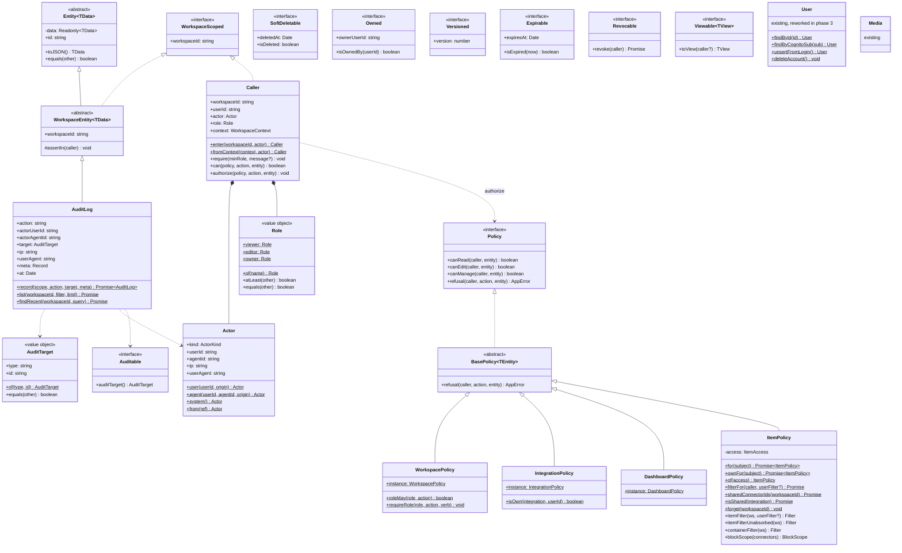
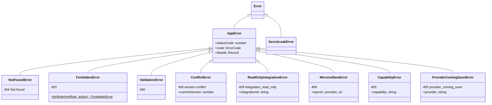
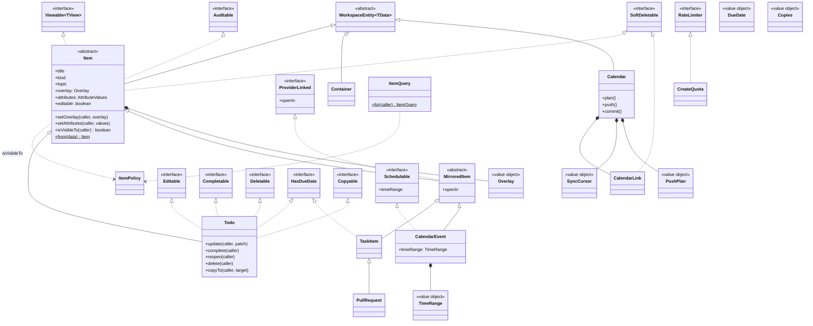
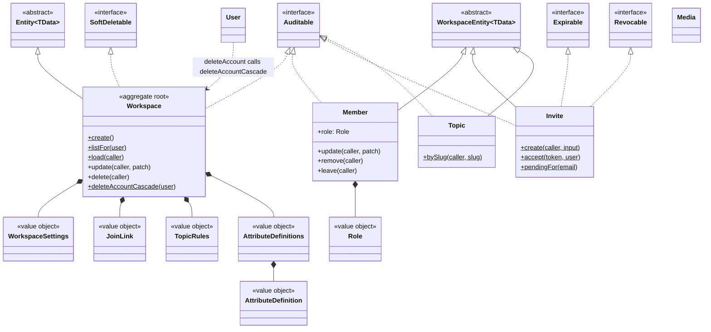

# Classes: the object model of the server

The server's domain is a set of classes (`server/src/classes/`). A class wraps 0..n models through
the `get…Repository()` getters and is the **only** code that touches the database; routes,
controllers and MCP tools stay thin functions (parse input → call a class → `toView()`), and pure
helpers (zod schemas, the builder's compiler, `gcal/diff`, the HTTP client, crypto primitives)
stay pure modules.

This page is the map of the **full target design** (plan: `.superpowers/sdd/2026-11-14-oop-redesign/plan.md`).
It is updated every phase.

- **Built** (exists in the code): green, solid border.
- **Planned**: grey, dashed border, with the phase that builds it.

| Phase | What it builds                                                                                                                                                                                               | State     |
| ----- | ------------------------------------------------------------------------------------------------------------------------------------------------------------------------------------------------------------ | --------- |
| 0     | Base layer (`Entity`, `WorkspaceEntity`, contracts), `Actor`, `Caller`, `Role`, `AuditTarget`, `Policy` + 4 policies, `AuditLog`, the error hierarchy, shared hashing; the class-boundary lint rule and test | **built** |
| 1     | `Integration` base, `Credential`, auth strategies, read and write sessions, the read-only gate (`Mode`)                                                                                                      | planned   |
| 2     | Provider subclasses and capability interfaces, `IntegrationRegistry`, `OAuthFlow`                                                                                                                            | planned   |
| 3     | `Workspace` aggregate, `Member`, `Invite`, `Topic`, their value objects; `User` reworked                                                                                                                     | planned   |
| 4     | `Item` hierarchy, `Container`, `ItemQuery`, `CreateQuota`                                                                                                                                                    | planned   |
| 5     | `SyncRun` state machine, `Integration.sync()`, `Calendar`                                                                                                                                                    | planned   |
| 6     | `Dashboard`, `History<T>`, the `Block` hierarchy, `View`, `AgentKey`, `ConnectLink`                                                                                                                          | planned   |
| 7     | The legacy list emptied, dead services deleted                                                                                                                                                               | planned   |

**How the boundary is held.** `server/legacy-db-importers.mjs` holds the places allowed to reach the
database (classes, models, the connection, migrations, tests) and `LEGACY_DB_IMPORTERS`, the modules
that still do until their phase moves them (36 after phase 0, down from 42). ESLint
(`@typescript-eslint/no-restricted-imports`, type imports allowed) and
`src/classes/classBoundary.test.ts` (which also sees dynamic imports and names) read that one list;
the test fails on an entry that no longer needs to be there, so the list only shrinks.

## 1. Base layer, people and permissions

The contracts are declared now and implemented by the entity classes of later phases (`Owned` by
`Integration`, `View`, `AgentKey`; `Versioned` by `Dashboard`; `Expirable` by `Invite` and
`AgentKey`; …).

## 2. Errors

The 409 domain errors are siblings of `ConflictError`, not children: a `catch (ConflictError)`
answers the version-conflict body (`currentVersion`), which they are not. The error handler answers
every `AppError` by `instanceof`.

## 3. Integrations (phases 1 and 2)

```mermaid
classDiagram
  direction TB
  class WorkspaceEntity~TData~ {
    <<abstract>>
  }
  class Integration~TConfig,TSecret~ {
    <<abstract>>
    -credential: Credential~TSecret~
    #auth: AuthStrategy~TSecret~
    #adapter: SyncAdapter~TConfig, TSecret~
    +config: TConfig
    +mode: Mode
    +setMode(caller, mode) Promise
    +saveCredential(caller, secret) Promise
    +stopSharing(caller) Promise
    +requestSync(caller) Promise
    +toView() IntegrationStatus
    +sync(run) Promise
    +testConnection() Promise
    +disconnect(caller) Promise
    #probe()* Promise
    #withWriteSession(caller, fn) Promise
    #withReadSession(fn) Promise
    +from(data)$ Integration
    +findOwn(caller, id)$ Integration
    +listVisible(caller)$ Integration[]
    +connect(caller, provider, input)$ Integration
    +connectOAuth()$ Integration
    +forWorker()$ Integration
    +listForDispatch()$ Integration[]
    +capabilitiesOf(provider)$ Capability[]
  }
  WorkspaceEntity <|-- Integration
  class Owned {
    <<interface>>
  }
  class Auditable {
    <<interface>>
  }
  class SoftDeletable {
    <<interface>>
  }
  class Viewable~TView~ {
    <<interface>>
  }
  Owned <|.. Integration
  Auditable <|.. Integration
  SoftDeletable <|.. Integration
  Viewable <|.. Integration

  class Mode {
    <<value object>>
    +allowsWrites: boolean
  }
  class Credential~TSecret~ {
    <<internal>>
    +seal(integration, secret)$ Credential
    +open(fn) Promise
    +refreshIfStale(auth) Promise
  }
  class KeyProvider {
    <<interface>>
  }
  Credential ..> KeyProvider
  class AuthStrategy~TSecret~ {
    <<abstract>>
    +kind: string
    +parseCredential(raw) TSecret
    +headers(secret, purpose?) Headers
    +refresh?(secret) Promise
    +revoke?(secret) Promise
  }
  class OAuthAuth~TSecret~
  class ApiKeyAuth~TSecret~
  class ServiceAccountAuth
  AuthStrategy <|-- OAuthAuth
  AuthStrategy <|-- ApiKeyAuth
  AuthStrategy <|-- ServiceAccountAuth
  class SyncAdapter~TConfig,TSecret~ {
    <<strategy>>
  }
  Integration *-- Credential
  Integration *-- AuthStrategy
  Integration *-- SyncAdapter
  Integration *-- Mode

  class SupportsOAuth {
    <<interface>>
    +oauth: OAuthAuth
  }
  class SupportsApiKey {
    <<interface>>
    +apiKey: ApiKeyAuth
  }
  class TaskProvider {
    <<interface>>
    +taskKinds
    +createOptions(caller, query)
    +createTask(caller, todo, target) ItemCopy
  }
  class CalendarProvider {
    <<interface>>
    +listCalendars(caller)
    +insertEvent(caller, todo, calendarId)
    +push(caller, opts)
    +dryRun(caller, narrowing)
  }
  class ResourcePicker~R~ {
    <<interface>>
    +pickerResources(caller) R[]
    +choose(caller, ids)
  }
  class Revocable {
    <<interface>>
    +revoke(caller)
  }
  class BoardProvider {
    <<interface>>
    +boards(caller)
  }
  class CourseProvider {
    <<interface>>
  }

  class JiraIntegration
  class ClickUpIntegration
  class LinearIntegration
  class GitHubIntegration
  class GoogleCalendarIntegration
  class MoodleIntegration {
    comingSoon = true
  }
  Integration <|-- JiraIntegration
  Integration <|-- ClickUpIntegration
  Integration <|-- LinearIntegration
  Integration <|-- GitHubIntegration
  Integration <|-- GoogleCalendarIntegration
  Integration <|-- MoodleIntegration
  TaskProvider <|.. JiraIntegration
  ResourcePicker <|.. JiraIntegration
  SupportsOAuth <|.. JiraIntegration
  SupportsApiKey <|.. JiraIntegration
  TaskProvider <|.. ClickUpIntegration
  ResourcePicker <|.. ClickUpIntegration
  SupportsOAuth <|.. ClickUpIntegration
  SupportsApiKey <|.. ClickUpIntegration
  TaskProvider <|.. LinearIntegration
  Revocable <|.. LinearIntegration
  SupportsOAuth <|.. LinearIntegration
  SupportsApiKey <|.. LinearIntegration
  TaskProvider <|.. GitHubIntegration
  BoardProvider <|.. GitHubIntegration
  SupportsOAuth <|.. GitHubIntegration
  SupportsApiKey <|.. GitHubIntegration
  CalendarProvider <|.. GoogleCalendarIntegration
  ResourcePicker <|.. GoogleCalendarIntegration
  Revocable <|.. GoogleCalendarIntegration
  SupportsOAuth <|.. GoogleCalendarIntegration
  CourseProvider <|.. MoodleIntegration
  SupportsApiKey <|.. MoodleIntegration

  class IntegrationRegistry {
    <<registry>>
  }
  Integration ..> IntegrationRegistry : from()
  class OAuthFlow {
    +start(caller, integrationClass)
    +consume(state)
  }

  classDef built fill:#d1fae5,stroke:#047857,stroke-width:2px
  classDef planned fill:#f3f4f6,stroke:#9ca3af,stroke-dasharray:5 5,color:#4b5563
  class WorkspaceEntity:::built
  class Owned:::built
  class Auditable:::built
  class SoftDeletable:::built
  class Viewable:::built
  class Revocable:::built
  class Integration:::planned
  class Mode:::planned
  class Credential:::planned
  class KeyProvider:::planned
  class AuthStrategy:::planned
  class OAuthAuth:::planned
  class ApiKeyAuth:::planned
  class ServiceAccountAuth:::planned
  class SyncAdapter:::planned
  class SupportsOAuth:::planned
  class SupportsApiKey:::planned
  class TaskProvider:::planned
  class CalendarProvider:::planned
  class ResourcePicker:::planned
  class BoardProvider:::planned
  class CourseProvider:::planned
  class JiraIntegration:::planned
  class ClickUpIntegration:::planned
  class LinearIntegration:::planned
  class GitHubIntegration:::planned
  class GoogleCalendarIntegration:::planned
  class MoodleIntegration:::planned
  class IntegrationRegistry:::planned
  class OAuthFlow:::planned
```

The write gate is the `protected` `withWriteSession`: only provider subclasses reach a writer, and
only inside their interface methods. It refuses demo data first (`provider_writes_off`), then a
read-only integration (`ReadOnlyIntegrationError`).

## 4. Items, containers and the calendar (phases 4 and 5)

`Todo.copyTo` is polymorphic: `target.createTask()` for any `TaskProvider`, `target.insertEvent()`
for a `CalendarProvider`, so it gets the read-only gate for free. Changing a source field of a
`MirroredItem` throws `MirroredItemError`.

## 5. Workspace and people (phase 3)

## 6. Dashboards and views (phase 6)

```mermaid
classDiagram
  direction TB
  class WorkspaceEntity~TData~ {
    <<abstract>>
  }
  class Dashboard {
    +save(caller, doc, ifVersion)
    +undo(caller)
    +redo(caller)
    +revert(caller, version)
    +publish(caller)
    +delete(caller)
  }
  WorkspaceEntity <|-- Dashboard
  class Versioned {
    <<interface>>
  }
  class Auditable {
    <<interface>>
  }
  class SoftDeletable {
    <<interface>>
  }
  class Owned {
    <<interface>>
  }
  Versioned <|.. Dashboard
  Auditable <|.. Dashboard
  SoftDeletable <|.. Dashboard
  class History~TDoc~ {
    +patch()
    +inverse()
    +snapshots()
    +prune()
  }
  class Layout {
    <<value object>>
  }
  Dashboard *-- History
  Dashboard *-- Layout
  Dashboard *-- Block
  class DashboardPolicy
  Dashboard ..> DashboardPolicy

  class Block {
    <<abstract>>
    +type*
    +from(json)$ Block
    +check() LintIssue[]
    #lintSpecific()* LintIssue[]
  }
  class DataBlock {
    <<interface>>
    +query() Query
  }
  class TimeBlock {
    <<interface>>
    +range
  }
  class ControlBlock {
    <<interface>>
    +controls()
  }
  class ListBlock
  class TableBlock
  class KanbanBlock
  class ChartBlock
  class CounterBlock
  class DeadlinesBlock
  class TimelineBlock
  class AgendaBlock
  class WorkloadBlock
  class CalendarBlock
  class ClockBlock
  class FilterBlock
  class ActionBlock
  class NoteBlock
  Block <|-- ListBlock
  Block <|-- TableBlock
  Block <|-- KanbanBlock
  Block <|-- ChartBlock
  Block <|-- CounterBlock
  Block <|-- DeadlinesBlock
  Block <|-- TimelineBlock
  Block <|-- AgendaBlock
  Block <|-- WorkloadBlock
  Block <|-- CalendarBlock
  Block <|-- ClockBlock
  Block <|-- FilterBlock
  Block <|-- ActionBlock
  Block <|-- NoteBlock
  DataBlock <|.. ListBlock
  DataBlock <|.. TableBlock
  DataBlock <|.. KanbanBlock
  DataBlock <|.. ChartBlock
  DataBlock <|.. CounterBlock
  DataBlock <|.. DeadlinesBlock
  DataBlock <|.. TimelineBlock
  DataBlock <|.. AgendaBlock
  DataBlock <|.. WorkloadBlock
  DataBlock <|.. CalendarBlock
  TimeBlock <|.. CalendarBlock
  TimeBlock <|.. ClockBlock
  ControlBlock <|.. FilterBlock
  ControlBlock <|.. ActionBlock

  class View
  WorkspaceEntity <|-- View
  Owned <|.. View
  Auditable <|.. View
  class Query {
    <<value object>>
  }
  View *-- Query

  classDef built fill:#d1fae5,stroke:#047857,stroke-width:2px
  classDef planned fill:#f3f4f6,stroke:#9ca3af,stroke-dasharray:5 5,color:#4b5563
  class WorkspaceEntity:::built
  class Versioned:::built
  class Auditable:::built
  class SoftDeletable:::built
  class Owned:::built
  class DashboardPolicy:::built
  class Dashboard:::planned
  class History:::planned
  class Layout:::planned
  class Block:::planned
  class DataBlock:::planned
  class TimeBlock:::planned
  class ControlBlock:::planned
  class ListBlock:::planned
  class TableBlock:::planned
  class KanbanBlock:::planned
  class ChartBlock:::planned
  class CounterBlock:::planned
  class DeadlinesBlock:::planned
  class TimelineBlock:::planned
  class AgendaBlock:::planned
  class WorkloadBlock:::planned
  class CalendarBlock:::planned
  class ClockBlock:::planned
  class FilterBlock:::planned
  class ActionBlock:::planned
  class NoteBlock:::planned
  class View:::planned
  class Query:::planned
```

## 7. Sync, agent keys and the outside world (phases 5 and 6)

The outside-world interfaces invert today's test seams (`set…ForTests`): production wires KMS,
SES, S3 and the real clock; tests wire the fakes. Behaviour does not change.

## Where phase 0 left the old modules

| Module                                    | State after phase 0                                                                                  |
| ----------------------------------------- | ---------------------------------------------------------------------------------------------------- |
| `services/itemAccess.ts`                  | **removed**: its rules and share facts are `ItemPolicy`                                              |
| `services/accessFilter.ts`                | thin delegation to `ItemPolicy` (the builder's compile test calls these names); re-exports the types |
| `services/workspaceContext.ts`            | thin delegation to `Caller.enter` (tests resolve a context by this name)                             |
| `services/integrationOwnership.ts`        | the loads stay (phase 1 moves them to `Integration.findOwn`); the rule is `IntegrationPolicy`        |
| `services/sharing.ts`                     | stop sharing still orchestrates there; the share facts are `ItemPolicy`                              |
| `assertRole` (`services/integrations.ts`) | **removed**: `caller.require(minRole)`                                                               |
| `assertOwner` (`services/workspaces.ts`)  | `caller.authorize(WorkspacePolicy.instance, 'manage', …)`                                            |
| the 8 audit helpers and inline appends    | **removed**: `AuditLog.record` is the only writer                                                    |
