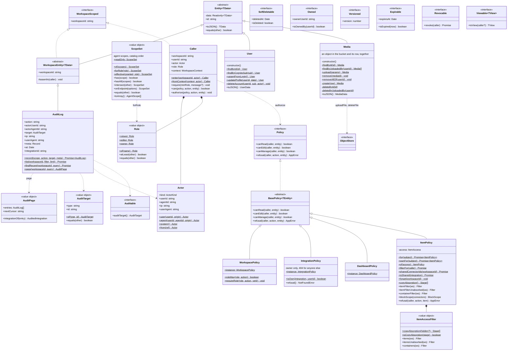
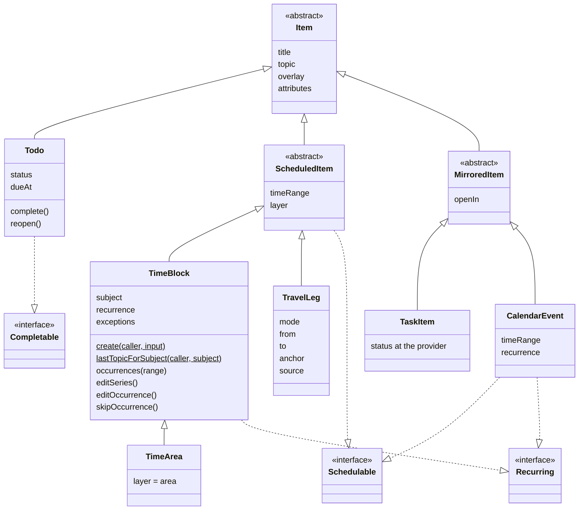
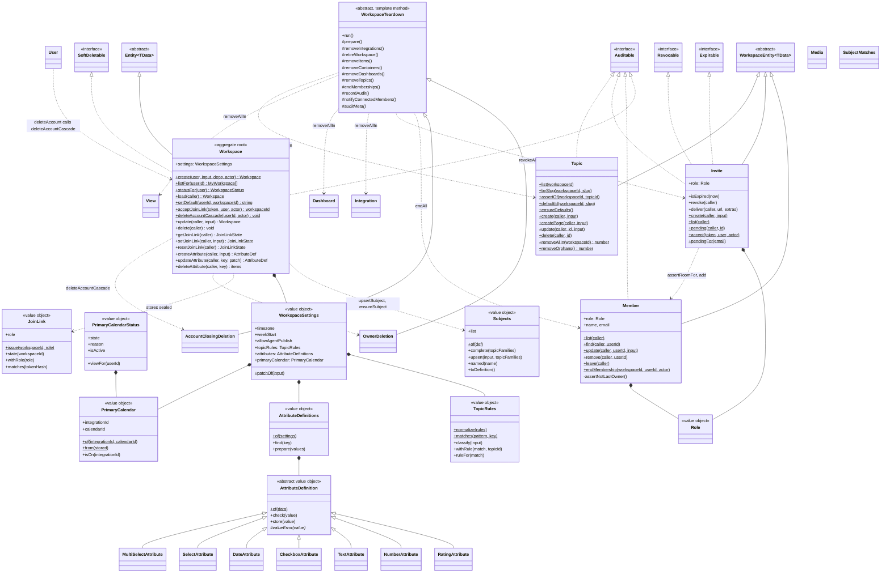
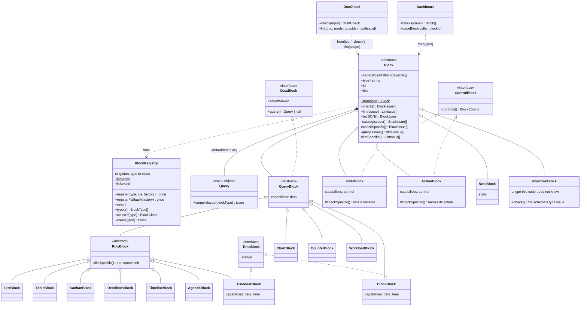
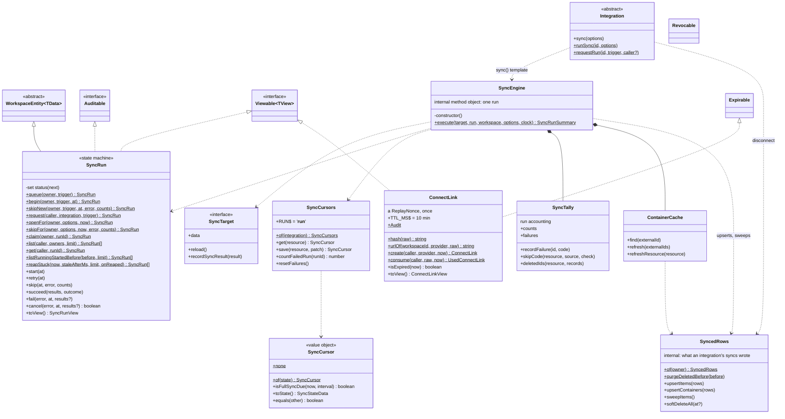
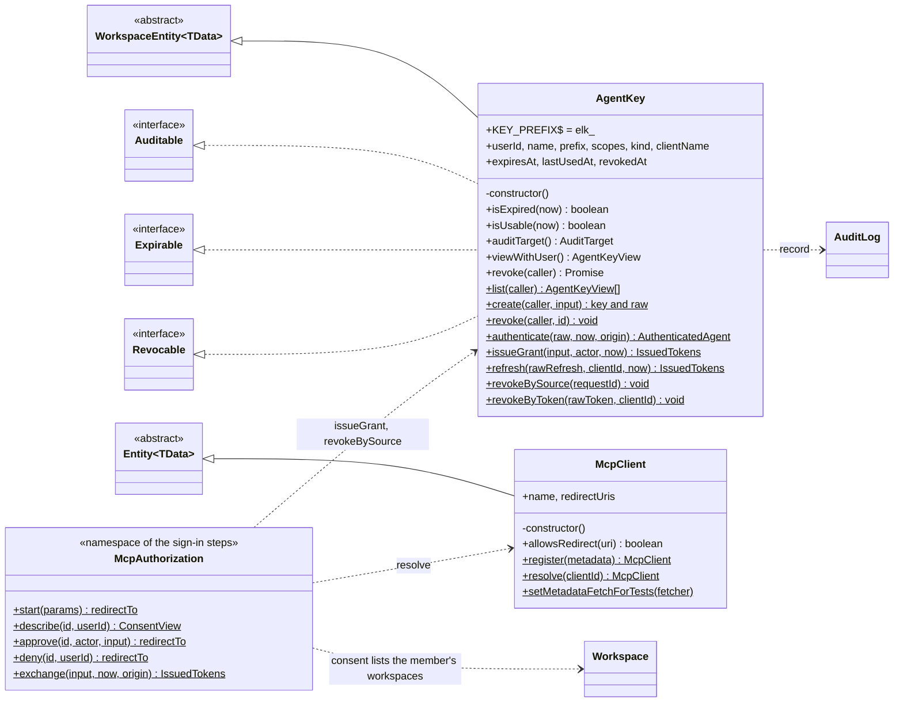

# Classes: the object model of the server

The server's domain is a set of classes (`server/src/classes/`). A class wraps 0..n models through
the `get…Repository()` getters and is the **only** code that touches the database; routes,
controllers and MCP tools stay thin functions (parse input → call a class → `toView()`), and pure
helpers (zod schemas, the builder's compiler, `gcal/diff`, the HTTP client, crypto primitives)
stay pure modules.

This page is the class reference of the server **as built** (the OOP redesign, plan:
`.superpowers/sdd/2026-11-14-oop-redesign/plan.md`, finished in phase 7). Every class, interface
and `implements` shown exists in `server/src`; in the diagrams green is built, and nothing is
drawn that is not. Sections 1 to 8 are the reference; section 9 lists the gate
tests that keep it true; the "What phase … built" sections after it are the build notes, kept for
the reasons behind a rule.

**History.** The redesign moved the old `services/*`, `sync/runSync.ts`, `gcal/plan.ts` and
`gcal/commit.ts` behind classes, phase by phase: 0 base layer, policies and `AuditLog`; 1 to 2W
`Integration`, `Credential`, auth strategies, the read-only gate, write-back; 3 `Workspace`; PC the
primary calendar; 4 the `Item` hierarchy; 5 sync and the calendar push; 6 `Dashboard`, `View` and
the `Block` classes, with `AgentKey` and the MCP sign-in built by another session in parallel; 7
the legacy list deleted, the docs final. What is left outside `classes/` is thin by design:
routes, controllers and MCP tool definitions (parse, call a class, `toView()`), the dispatcher and
worker (`sync/dispatcher.ts`, `sync/worker.ts`, `jobs/purge.ts`, which only start jobs and call
classes), pure helpers (zod schemas, the builder's compiler and ops, `gcal/diff.ts`, the HTTP
client, crypto primitives) and migrations (frozen raw scripts, exempt from the boundary).

**How the boundary is held.** `server/class-boundary.mjs` names:

- the database modules (the models' barrel, `models/mongoose/**`, `models/sequelize/**`, the
  connection `config/database.ts` and its providers `config/providers/**`) and packages
  (`mongoose`, `sequelize`, `pg`, `mongodb`);
- the places allowed to load them (classes, models, the connection, migrations, tests);
- the entry points and jobs that may open the connection and nothing else (`lambda.ts`,
  `local.ts`, `stageMaintenance.ts`);
- the test helpers production code never loads (`src/testing/**`, `__tests__/**`).

There are no exceptions. The list of modules still reaching the database directly
(`LEGACY_DB_IMPORTERS`, 42 at the start, shrinking every phase, empty since phase 6a) is gone, and
with it `server/legacy-db-importers.mjs` (phase 7a).

ESLint (`@typescript-eslint/no-restricted-imports`, type imports allowed) and
`src/classes/classBoundary.test.ts` (which also resolves paths, sees dynamic imports and names
`get…Repository` getters) read that one module. The test also holds that only `AuditLog` names the
audit log's repository, and runs the plan's end check as `git grep` would, on the raw text: outside
the allowed places, no file of `server/src`, `scripts/` or `infra/` names a `get…Repository`
getter or imports a database package, not even for its types. `dashboardInternals.test.ts` pins
each dashboard collection to its class (Dashboards to `Dashboard` and `NewDashboard`,
DashboardVersions to `History`, Views to `View`).

## 1. Base layer, people and permissions



The contracts are implemented by the entity classes (`Owned` by `Integration`, `View` and
`Dashboard`; `Versioned` by `Dashboard`; `Expirable` by `Invite`, `ConnectLink` and `AgentKey`;
`Revocable` by `Invite`, `AgentKey` and the providers that can revoke a grant; …).

**`ScopeSet`** (`classes/base/ScopeSet.ts`, value object): a set of agent scopes, always in catalog
order (`AGENT_SCOPES`) without repeats, compared by value. `forRole(role)` is `ROLE_SCOPES`,
`effective(granted, role)` an agent's scopes (its grant's ∩ its role's, so a key never exceeds its
user), `onEndpoint({readonly})` what `/api/mcp/readonly` honours (∩ `ScopeSet.readOnly`). `AgentKey.create`,
`McpAuthorization` (the consent page's allowed and preselected scopes, approve, the code exchange) and
the MCP principal (`mcp/auth/principal.ts`, `scopes.ts`: `effectiveScopes`, `endpointScopes`,
`canCall`) all compute scopes with it; their outputs are unchanged.

**`Caller.fromContext`** mints a caller from a resolved `WorkspaceContext` without a read: it is a
door, pinned by `classes/base/callerDoors.test.ts` to the MCP side (the principal and the
`toolCaller`, `userCaller`, `itemCaller`, `itemReads` and `builderCaller` helpers, themselves pinned
to `mcp/**`) and `runWorkspaceQuery` (`services/workspaceQuery.ts`, `controllers/query.ts`). The
other REST services take `req.caller`, set by `Caller.enter`, so their audit entries carry the
request's ip and user agent. A pin, not a check inside it: those contexts are legitimately copied on the way
(`caller.context` hands out a copy; a read tool narrows `{...workspace, onlyTopics}`), so an
identity or brand check would refuse them or be cast away.

**`User`** and **`Media`** (`classes/User.ts`, `classes/Media.ts`) extend `Entity` (a user and an
uploaded file belong to no workspace), with private constructors. `Media` keeps an upload's object
in the bucket and its row together: `upload` strips the image metadata, stores the object and
creates the row (taking the object back when the row can't be made); `remove` and `removeAllOf`
delete the objects, then the rows. Its row writes are private, and its file doors are named only by
the account controller (`classes/mediaDoors.test.ts`). `services/mediaManager.ts` is gone.

Every audited request records its address and user agent: controllers pass `req.caller.actor`
(or, before a workspace exists and on the OAuth callbacks, the request's origin) and MCP tools pass
their caller's actor. Jobs and the sync write as the system, without an origin. `AuditLog.record` is
the only writer of the audit log.

## 2. Errors

```mermaid
classDiagram
  direction TB
  class Error
  class AppError {
    +statusCode: number
    +code: ErrorCode
    +details: Record
  }
  class NotFoundError {
    404 Not found
  }
  class ForbiddenError {
    403
    +forRole(minRole, action)$ ForbiddenError
  }
  class ValidationError {
    400
  }
  class ConflictError {
    409 version conflict
    +currentVersion: number
  }
  class ReadOnlyIntegrationError {
    409 integration_read_only
    +integrationId: string
  }
  class MirroredItemError {
    409
    +openIn: provider, url
  }
  class CapabilityError {
    400
    +capability: string
  }
  class ProviderComingSoonError {
    400 provider_coming_soon
    +provider: string
  }
  class StatusNotAvailableError {
    422 status_not_available
    +provider: string
    +status: ItemStatus
  }
  class ScopeMissingError {
    409 scope_missing
    +integrationId: string
    +scope: string
  }
  class FieldNotWritableError {
    422 field_not_writable
    +fields
    +openIn
  }
  class ProviderPartialWriteError {
    409 provider_partial_write
    +written
    +refused
  }
  class ProviderItemMissingError {
    404 provider_item_missing
  }
  class EventHasGuestsError {
    409 event_has_guests
  }
  class SecretLeakError
  Error <|-- AppError
  Error <|-- SecretLeakError
  AppError <|-- NotFoundError
  AppError <|-- ForbiddenError
  AppError <|-- ValidationError
  AppError <|-- ConflictError
  AppError <|-- ReadOnlyIntegrationError
  AppError <|-- MirroredItemError
  AppError <|-- CapabilityError
  AppError <|-- ProviderComingSoonError
  AppError <|-- StatusNotAvailableError
  AppError <|-- ScopeMissingError
  AppError <|-- FieldNotWritableError
  AppError <|-- ProviderPartialWriteError
  AppError <|-- ProviderItemMissingError
  AppError <|-- EventHasGuestsError
  AppError <|-- CalendarNotPrimaryError
  AppError <|-- CleanupIncompleteError
  AppError <|-- CreatedNotStoredError
  AppError <|-- OAuthError
  AppError <|-- PrimaryCalendarUnsetError
  AppError <|-- ProviderNoAnswerError
  AppError <|-- ProviderUnreachableError
  AppError <|-- WrittenNotStoredError
  ForbiddenError <|-- IntegrationNotOwnerError

  classDef built fill:#d1fae5,stroke:#047857,stroke-width:2px
  class AppError:::built
  class NotFoundError:::built
  class ForbiddenError:::built
  class ValidationError:::built
  class ConflictError:::built
  class ReadOnlyIntegrationError:::built
  class MirroredItemError:::built
  class CapabilityError:::built
  class ProviderComingSoonError:::built
  class StatusNotAvailableError:::built
  class ScopeMissingError:::built
  class FieldNotWritableError:::built
  class ProviderPartialWriteError:::built
  class ProviderItemMissingError:::built
  class EventHasGuestsError:::built
  class CalendarNotPrimaryError:::built
  class CleanupIncompleteError:::built
  class CreatedNotStoredError:::built
  class OAuthError:::built
  class PrimaryCalendarUnsetError:::built
  class ProviderNoAnswerError:::built
  class ProviderUnreachableError:::built
  class WrittenNotStoredError:::built
  class IntegrationNotOwnerError:::built
  class SecretLeakError:::built
```



The 409 domain errors are siblings of `ConflictError`, not children: a `catch (ConflictError)`
answers the version-conflict body (`currentVersion`), which they are not. The error handler answers
every `AppError` by `instanceof`. Write-back adds six (phase 2b and its fix round):

- `StatusNotAvailableError`: the provider has no transition, status or state for the asked status
  on this item;
- `ScopeMissingError`: the grant predates a scope the operation needs (`calendar.app.created`);
- `FieldNotWritableError`: a changed field the provider doesn't take for the item (it lacks it,
  only reads it, the item's kind takes no write-back, or it isn't on the edit screen);
- `ProviderPartialWriteError`: a write-back of several provider calls stopped part-way; what
  landed is kept and audited;
- `ProviderItemMissingError`: the item is gone at the provider;
- `EventHasGuestsError`: an event with other guests, changed without saying whether to notify
  them.

Their extra properties (`fields`, `openIn`, `written`, `refused`) are for the Phase 4 route to
answer; the error handler answers `{message, code}` today.

## 3. Integrations (phases 1, 2a and 2W)

```mermaid
classDiagram
  direction TB
  class WorkspaceEntity~TData~ {
    <<abstract>>
  }
  class Integration~TConfig,TSecret,TWriter~ {
    <<abstract>>
    -credential: Credential~TSecret~
    #auth: AuthStrategy~TSecret~
    #adapter: ProviderAdapter
    +config: TConfig
    +mode: Mode
    +allowsWrites: boolean
    +authKind: AuthKind
    +canCreate: boolean
    +toView() IntegrationStatusBase
    +toStatusView() Promise~IntegrationStatusView~
    +needsReconnect() Promise~boolean~
    +readConfig(caller)
    +update(caller, input) Promise~Integration~
    +checkMode(caller, mode) Mode
    +canSwitchMode: boolean
    +setMode(caller, mode) Promise~Integration~
    +saveCredential(caller, body) Promise
    +testConnection(caller) Promise
    +requestSync(caller) Promise
    +sync(options) Promise~SyncRunSummary~
    +stopSharing(caller) Promise
    +disconnect(caller) Promise
    +assertWritable(caller)
    +needsWriteConsent() Promise~boolean~
    #definition: IntegrationDefinition
    #withReadSession(fn) Promise
    #withWriteSession(caller, fn) Promise
    #handBackGrant(failure) Promise
    #lacksScopes(scopes) Promise~boolean~
    #writableFieldsFor(kind) WritableField[]
    #recordWrite(caller, meta) Promise
    #createWriter(secret)* Promise~TWriter~
    #probe(adapter, context)* Promise
    #onConnected() Promise
    #checkSelection(config) Promise
    #learnedLabel(accountLabel) string
    #revokeGrant() Promise
    +from(data)$ Integration
    +findOwn(caller, id)$ Integration
    +listOwn(caller)$ Integration[]
    +listVisible(caller)$ Integration[]
    +connectWithKey(caller, input)$ Integration
    +connectOAuth(caller, conn)$ ConnectedIntegration
    +forWorker(id)$ Integration
    +runSync(id, options)$ Promise~SyncRunSummary~
    +requestRun(id, trigger, caller?)$ SyncRun
    +isConnected(id)$ boolean
    +listForDispatch()$ Integration[]
    +disconnectAllOf(workspaceId, actor, member)$ number
    +withSyncSecret(id, fn)$ Promise
    +capabilitiesOf()$ ProviderCapabilities[]
  }
  WorkspaceEntity <|-- Integration
  class IntegrationDefinition~TSecret,TAuth~ {
    <<value object>>
    +provider
    +auth: AuthSet
    +connection: ConnectionRules
    +adapter: ProviderAdapter
    +create: CreateRules
    +writableFields: WritableField[]
    +writableKinds: ItemKind[]
    +reachableStatuses: ItemStatus[]
    +picker: PickerKind
    +revokePage
    +comingSoon
    +fixtures
    +authFor(method) AuthStrategy
    +parseConfig(config)
    +planConnection(input) ConnectionPlan
    +assertSameAccount(integration, config)
    +defaultLabel(config)
    +writableFieldsFor(kind) WritableField[]
    +fakeCredential(method, name)
  }
  Integration *-- IntegrationDefinition : static definition
  IntegrationDefinition *-- AuthStrategy
  class IntegrationConnector {
    <<collaborator>>
    +connectWithKey(caller, input)
    +upsertOAuth(caller, conn)
  }
  class ConnectionTester {
    <<collaborator>>
    +waitBeforeNext() Promise
    +run(timeZone) Promise
  }
  class SyncRequest {
    <<collaborator>>
    +requestAll(caller, subjects)$ runIds
    +hold() Promise
    +manualWait() Promise
    +enqueue() Promise
  }
  Integration ..> IntegrationConnector
  Integration ..> ConnectionTester
  Integration ..> SyncRequest
  class Owned {
    <<interface>>
  }
  class Auditable {
    <<interface>>
  }
  class SoftDeletable {
    <<interface>>
  }
  class Viewable~TView~ {
    <<interface>>
  }
  Owned <|.. Integration
  Auditable <|.. Integration
  SoftDeletable <|.. Integration
  Viewable <|.. Integration

  class Mode {
    <<value object>>
    +read$
    +readWrite$
    +allowsWrites: boolean
  }
  class Credential~TSecret~ {
    <<internal>>
    +seal(input, actor)$ Promise
    +of(integrationId)$ Credential
    +meta(workspaceId, id)$ Promise
    +destroy(workspaceId, id)$ Promise
    +open(fn) Promise
    +refreshIfStale(auth, workspaceId) Promise
  }
  class KeyProvider {
    <<interface>>
  }
  Credential ..> KeyProvider
  class AuthStrategy~TSecret~ {
    <<abstract>>
    +kind: AuthKind
    +methods: AuthMethod[]
    +handles(method) boolean
    +parseCredential(method, raw)
    +fakeCredential(method, name)
    +headers(secret, purpose?) Headers
    +query(secret)
    +bind(session) AdapterAuth
    +transport(inner) Transport
  }
  class OAuthAuth~TSecret~ {
    +refreshPolicy: stored | per_call
    +scopes, writeScopes, callbackPath
    +endpoints()
    +credentials() Promise
    +client(transport?) ReadOnlyClient
    +authorizeUrl(request) string
    +exchangeCode(client, grant, credentials) Promise
    +secretFromGrant(grant, scopes, now)
    +identify(client, accessToken) Promise
    +needsRefresh(secret, now) boolean
    +refresh(secret) Promise
    +revoke(secret) Promise
  }
  class ApiKeyAuth~TSecret~
  class ServiceAccountAuth~TSecret~
  class UnofferedAuth~TSecret~ {
    <<null object>>
  }
  AuthStrategy <|-- OAuthAuth
  AuthStrategy <|-- ApiKeyAuth
  AuthStrategy <|-- ServiceAccountAuth
  AuthStrategy <|-- UnofferedAuth
  Credential ..> OAuthAuth : refreshIfStale
  class ProviderAdapter {
    <<interface: the sync's read strategy>>
  }
  Integration *-- Credential
  Integration *-- AuthStrategy
  Integration *-- ProviderAdapter : definition.adapter
  Integration *-- Mode

  class SupportsOAuth {
    <<interface>>
    +oauth: OAuthAuth
  }
  class SupportsApiKey {
    <<interface>>
    +apiKey: ApiKeyAuth
  }
  class ItemCopy {
    <<value object>>
    +integrationId
    +status
    +key
    +url
  }
  TaskProvider ..> ItemCopy : createTask
  class CreateFunnel {
    <<interface>>
    +createOptions(caller, query)
  }
  class TaskProvider {
    <<interface>>
    +createTask(caller, request) CreatedTask
    +updateTask(caller, item, patch) ItemData
  }
  class CalendarProvider {
    <<interface>>
    +listCalendars(caller)
    +insertEvent(caller, calendarId, event, recurrence?)
    +updateEvent(caller, item, patch, notice?) WrittenEvent
    +deleteEvent(caller, item, notice?)
    +deleteLinkedEvent(caller, link, deletedBy?)
    +createCalendar(caller, name) GoogleCalendarEntry
    +primaryCandidate(caller, calendarId) GoogleCalendarEntry
    +dryRun(caller, narrowing, now)
    +push(caller, request)
  }
  class AddedContentRemover {
    <<interface>>
    +removeAdded(caller) AddedRemoval
  }
  class TaskEdit {
    <<value object>>
    +parse(patch)$ TaskEdit
    +fields
    +against(item, writable, timeZone) ProviderEdit
  }
  class WriteLedger {
    +confirm(fields, values) Promise
    +fields
    +values
    +isEmpty
  }
  class EventEdit {
    <<value object>>
    +parse(patch, timeZone)$ EventEdit
    +changes: EventChanges
    +fields
  }
  class RecurrenceRule {
    <<value object>>
    +parse(line)$ RecurrenceRule
    +fromLines(lines)$ RecurrenceRule
    +fits(allDay) boolean
    +toString() string
  }
  TaskProvider ..> TaskEdit : updateTask
  TrackerIntegration ..> WriteLedger : updateTask
  CalendarProvider ..> EventEdit : updateEvent
  CalendarProvider ..> RecurrenceRule : insertEvent
  CreateFunnel <|-- TaskProvider
  CreateFunnel <|-- CalendarProvider
  class ResourcePicker~K~ {
    <<interface>>
    +pickerKind: K | null
    +pickerResources(caller) PickerResources[K][]
    +choose(caller, ids)
  }
  class Revocable {
    <<interface>>
    +revoke(caller)
  }

  class TrackerIntegration~TConfig,TSecret~ {
    <<abstract>>
    +createOptions(caller, query)
    +createTask(caller, request)
    +updateTask(caller, item, patch) ItemData
    #checkUpdate(item, patch)
    #applyUpdate(session, item, patch, ledger)*
    #answerOf(result) record
    #confirmedStatus(status, raw) MirroredItemPatch
    #readOptions(session, query)*
    #prepare(session, target, fields)*
    #readClient(transport)
    #writeBases()
  }
  Integration <|-- TrackerIntegration
  TaskProvider <|.. TrackerIntegration
  class JiraIntegration {
    +definition$ = JIRA
  }
  class ClickUpIntegration {
    +definition$ = CLICKUP
  }
  class LinearIntegration {
    +definition$ = LINEAR
  }
  class GitHubIntegration {
    +definition$ = GITHUB
  }
  class GoogleCalendarIntegration {
    +definition$ = GOOGLE_CALENDAR
  }
  class MoodleIntegration {
    +definition$ = MOODLE (comingSoon)
  }
  class UnlistedIntegration {
    <<null object>>
  }
  TrackerIntegration <|-- JiraIntegration
  TrackerIntegration <|-- ClickUpIntegration
  TrackerIntegration <|-- LinearIntegration
  TrackerIntegration <|-- GitHubIntegration
  Integration <|-- GoogleCalendarIntegration
  Integration <|-- MoodleIntegration
  Integration <|-- UnlistedIntegration
  ResourcePicker <|.. JiraIntegration
  SupportsOAuth <|.. JiraIntegration
  SupportsApiKey <|.. JiraIntegration
  ResourcePicker <|.. ClickUpIntegration
  SupportsOAuth <|.. ClickUpIntegration
  SupportsApiKey <|.. ClickUpIntegration
  Revocable <|.. LinearIntegration
  SupportsOAuth <|.. LinearIntegration
  SupportsApiKey <|.. LinearIntegration
  SupportsOAuth <|.. GitHubIntegration
  SupportsApiKey <|.. GitHubIntegration
  CalendarProvider <|.. GoogleCalendarIntegration
  ResourcePicker <|.. GoogleCalendarIntegration
  Revocable <|.. GoogleCalendarIntegration
  SupportsOAuth <|.. GoogleCalendarIntegration
  SupportsApiKey <|.. MoodleIntegration
  class CourseProvider {
    <<interface>>
    +courses(caller)
    +assignments(caller, courseId)
    +deadlines(caller)
  }
  CourseProvider <|.. MoodleIntegration

  class IntegrationRegistry {
    <<registry>>
    +instance$
    +register(cls, factory)
    +registerFallback(factory)
    +classOf(provider)
    +create(data) Integration
    +capabilities() ProviderCapabilities[]
  }
  Integration ..> IntegrationRegistry : from()
  class OAuthFlow {
    <<entity: OAuthState>>
    +start(caller, integrationClass, input)$ OAuthStart
    +consume(integrationClass, callback)$ location
    +providers(caller)$ OAuthProvidersResponse
  }
  OAuthFlow ..> OAuthAuth
  OAuthFlow ..> Integration : connectOAuth

  classDef built fill:#d1fae5,stroke:#047857,stroke-width:2px
  class WorkspaceEntity:::built
  class Owned:::built
  class Auditable:::built
  class SoftDeletable:::built
  class Viewable:::built
  class Revocable:::built
  class Integration:::built
  class Mode:::built
  class Credential:::built
  class KeyProvider:::built
  class AuthStrategy:::built
  class OAuthAuth:::built
  class ApiKeyAuth:::built
  class ServiceAccountAuth:::built
  class ProviderAdapter:::built
  class SupportsOAuth:::built
  class SupportsApiKey:::built
  class CreateFunnel:::built
  class TaskProvider:::built
  class CalendarProvider:::built
  class ResourcePicker:::built
  class TrackerIntegration:::built
  class JiraIntegration:::built
  class ClickUpIntegration:::built
  class LinearIntegration:::built
  class GitHubIntegration:::built
  class GoogleCalendarIntegration:::built
  class MoodleIntegration:::built
  class UnlistedIntegration:::built
  class IntegrationRegistry:::built
  class CourseProvider:::built
  class OAuthFlow:::built
  class IntegrationDefinition:::built
  class IntegrationConnector:::built
  class ConnectionTester:::built
  class SyncRequest:::built
  class UnofferedAuth:::built
  class TaskEdit:::built
  class WriteLedger:::built
  class EventEdit:::built
  class RecurrenceRule:::built
  class ItemCopy:::built
```



The write gate is the `protected` `withWriteSession`: only provider subclasses reach a writer
(`classes/integration/writers/`: the tracker write client, the Calendar API writer and the push's
ops), and only inside their capability methods (`createTask`, `updateTask`, `insertEvent`,
`updateEvent`, `deleteEvent`, `createCalendar`, `push`). In order, it refuses another member (404), demo
data or a fixtures stage's tracker (`provider_writes_off`), then a read-only integration
(`ReadOnlyIntegrationError`, 409 `integration_read_only`); only then does it open the credential
and make the writer (`createWriter`, the provider's own). `assertWritable` runs the same checks so
callers refuse before they reserve or record anything. The mode is the one the integration was
loaded with: a switch made while a request runs is seen by the next one.

What the tests hold:

- `writePaths.test.ts`:
  - only `TrackerIntegration.ts`, the provider classes and the writer modules load a writer;
  - nothing outside `classes/integration/**` names the writer factories;
  - each factory has one call site, by count: `createWriteClient(` in `TrackerIntegration` and
    `calendarWriter(` in `GoogleCalendarIntegration`, each inside a `createWriter` body, and
    `applyOps(` once, in `GoogleCalendarIntegration`, inside a `withWriteSession(…)` call. A
    writer made in a read session fails;
  - the write-back hook `applyUpdate` is called once in all of `server/src`: `this.applyUpdate(`
    in `TrackerIntegration`'s template, inside a `withWriteSession(…)` call; the provider classes
    only declare it;
  - MCP code never names `setMode`, `checkMode` or `UpdateIntegrationBody`.
- The write allow-lists refuse everything else before it is sent:
  - `writers/trackerWriter.update.test.ts`: by method, exact path and **body keys** (Jira
    `PUT …/issue/{id}` with `fields.summary|duedate|priority.id` and `POST …/transitions` with
    `transition.id`, at the integration's own sites only; ClickUp `PUT /task/{id}` with its seven
    keys; GitHub `PATCH /issues/{n}` with `title|state|state_reason`; Linear only the named
    `issueUpdate` document, variables `{id, input}` with `title|stateId|dueDate|priority`). A
    trash, an archive, a body, assignees or a project move never pass.
  - `writers/calendarApi.test.ts`: `POST /calendars`, events insert, patch and delete (those two
    with `sendUpdates=all|none` only); never a calendar's delete or ACL. The URL must be exactly
    as sent: a `.`/`..` segment (`%2e%2e` too) or an empty one is refused.
- `writeBack.trackers.test.ts` and `writeBack.calendar.test.ts`, per provider:
  - the exact requests a write-back sends (lookups as reads, then the allow-listed writes) and what
    the item holds afterwards;
  - each provider call audited as it lands; a Jira edit stopped part-way keeps and audits what
    landed (`provider_partial_write`);
  - every refusal before anything is opened or written (`field_not_writable`,
    `status_not_available`, a value the provider can't hold; read-only: zero non-GET, and an
    unchanged field is no write; `scope_missing`; an invalid RRULE; `event_has_guests`);
  - an event only through this integration's item on a calendar it reads, or its own
    CalendarLink: another integration's, another workspace's, a raw event id or an unselected
    calendar is 404 with zero non-GET requests.
- `vaultImports.test.ts`: only `Integration.ts` uses `Credential`, and only `Integration.ts` and
  `sync/secrets.ts` name `Integration.withSyncSecret` (MCP code never does).
  An alias does not get round them: a factory renamed with `as`, bound to another name,
  destructured from an `await import(…)` or re-exported fails, as does a dynamic import with no
  literal target inside `classes/integration/`.
- `integration.test.ts`: for every provider class, without a database, each write it can make
  without reading an item first (`createOptions`, `createTask`, `insertEvent` with and without a
  recurrence, `createCalendar`, `push`) is refused while read-only before anything is sent. The
  writes keyed by an item read it first (the gate waits for what actually changes): the
  write-back tests hold them with a database.
- `definitions/definitions.test.ts`: the definitions name each connectable provider once, each
  its class's own; every OAuth app's token and revoke URL is on the HTTP layer's allow-list
  (`OAUTH_TOKEN_ENDPOINTS`, written out there on purpose: no definition can widen it) and its
  callback path is the one registered at the provider; the scopes and the key methods are as
  before; the strategies build the headers (a second token for GitHub boards, Moodle's query
  token, one Google token exchange per session, one per call for the service account); the
  four authorize URLs are pinned byte for byte (Google's parameters, in any order, now with
  `calendar.app.created`); each provider's `writableFields` and the kinds that take a write-back
  are pinned, a write-back is declared exactly where the class implements one; and
  `Integration.capabilitiesOf()` agrees with the contracts each class implements (with
  `canUpdate` and `writableFields`).
- `definitions/purity.test.ts`: nothing under `classes/integration/definitions/` reaches, at run
  time, the models' barrel, a model, the connection or `config/environment.ts` (the plain types
  under `models/definitions/` are fine). The builder's compiler, which validates Google's push
  filter, starts every read from `ItemAccessFilter` (pure), not from `ItemPolicy` (which resolves
  the access from the data). `config/environment.ts` reads `process.env` when a value is asked
  for, so no import order can fix a value early (`definitions/importOrder.test.ts` loads the
  definitions before its database starts).
- `sync/providers/adapterSecrets.test.ts`: the adapters never reach the secret. `AdapterContext`
  has no `secret`; nothing under `sync/providers/` names `.secret` or indexes `secret[…]`, or loads
  the credential or the sync's secret door. Google's service-account signer is the strategy's
  (`auth/googleServiceAccount.ts`), and the account it names reaches a connection test as
  `ctx.auth.account()`.
- `sync/http.test.ts` pins `OAUTH_TOKEN_ENDPOINTS` exactly, and the URLs a client takes.

**What phase 2a built:**

- **One `static definition` per provider class** (`definitions/<provider>.ts`, an
  `IntegrationDefinition`): its auth strategies (`auth.oauth`, `auth.apiKey`,
  `auth.serviceAccount`), the config schema, the connection rules (default topic, account key,
  label, which config change moves the account), the sync adapter, the create rules (funnel
  steps and reader, which links are kept, what a 403 means), the picker, the revoke page,
  `comingSoon` and the fixtures (the funnel's recorded set; each strategy's FAKE credential). It
  replaces `RULES`, `CREDENTIAL_SCHEMAS`, `OAUTH_PROVIDER_DEFS`, `OAUTH_ENDPOINTS`, the
  `fakeCredential` switch and the create switches (`safeCopyUrl`, `failureFor`).
  `definitions/index.ts` lists them for code that must not load the classes (the sync engine in
  fixtures mode, the seed); `services/integrationConfig.ts` and `seed/fakeCredentials.ts` are
  views of them.
- **Headers from the strategy.** The adapters get `ctx.auth` (`AdapterAuth`: `kind`,
  `headers(purpose?)`, `query()`), bound by the integration's strategy to the opened secret and the
  run's client; no adapter builds an auth header, and `authMethod === 'oauth'` checks became
  `auth.kind` / `authKind`, `canCreate` or polymorphism (`pickerKind`). The create path, the
  connection test and the Calendar writer take the same headers.
- **`OAuthFlow`** (an OAuthStates row's lifecycle): `start(caller, integrationClass, input)` and
  `consume(integrationClass, callback)`, the same flow for Google Calendar and the four providers;
  what differs is each provider's `OAuthAuth` (endpoints, scopes, PKCE, the secret it seals, how it
  names the account). Routes, callback URLs, scopes, codes and redirects are unchanged.
- **`ResourcePicker<R>`** (Jira sites, ClickUp workspaces, Google calendars): `pickerKind`,
  `pickerResources(caller)`, `choose(caller, ids)`; the routes pick by `isResourcePicker`.
- **Capabilities to the client**: `GET …/oauth/providers` adds `capabilities[]` from
  `Integration.capabilitiesOf()` (auth methods, picker, revoke on disconnect, revoke page, can
  create, coming soon); the Integrations page reads them instead of its lists.
- **Phase 7c.** `ProviderCapabilities` also says `needsWriteScope` (the definition's OAuth
  `writeScopes`: Jira, Linear), and the client reads it, and `picker`, instead of naming providers
  (`reconnectAsksWrite(caps, mode)`, `resourcePickerOf(caps)`; `OAuthResourcePicker` takes the
  picker kind). `Integration.capabilitiesOf()` reads them through
  `IntegrationRegistry#capabilities()`. **`CourseProvider`** (`courses`, `assignments`,
  `deadlines`; guard `isCourseProvider`) is implemented by `MoodleIntegration`, whose methods
  refuse with 400 `provider_coming_soon`; the capability tests hold that only Moodle is one and
  that a CourseProvider is declared `comingSoon` (the client shows it with that badge, never as
  usable). The plan's **`BoardProvider`** (`boards(caller)` for GitHub Projects) is not built:
  boards are read only inside the sync (`sync/providers/github.ts`'s `listBoards`, for the
  `boards` resource, chosen by `config.boards` numbers or title globs), and no route, MCP tool or
  client asks for a list of boards, so `boards(caller)` would have no caller.
- **`Integration`'s collaborators**: `IntegrationConnector`, `ConnectionTester`, `SyncRequest`,
  and (phase 5) `SyncEngine`, the body of `Integration#sync`.
  They get the protected members they need as functions; the credential never leaves
  `Integration.ts`. `toStatusView` is gone (`toView`).

**What phase 2W (write-back, "phase 2b", and its fix round) built:**

- **`TaskProvider.updateTask(caller, item, patch)`**, over a mirrored item's provider fields only,
  required by the compiler of every tracker, is a template method in `TrackerIntegration`:
  1. validate the edit (`TaskEdit`: provider fields only, a one-line title; 400 naming the field)
     and the item (this integration's live mirrored item, else 404);
  2. compare it with the item: an unchanged field is dropped (an edit that changes nothing is no
     write and no write gate); a changed field the provider doesn't take for the item's kind is
     422 `field_not_writable`; then `checkUpdate` (the provider's static rules: a status outside
     its `reachableStatuses`, a value it can't hold) and the write gate, all before anything is
     opened;
  3. the write session;
  4. `applyUpdate`: the provider class's lookups (reads), then its exact update requests; each
     call that goes through is confirmed to a `WriteLedger`, which audits it at once
     (`integration.write`, field names only);
  5. save what the provider confirmed (`updateMirrored`, clearing `source.hash` so the next sync
     rewrites what the provider holds).

  A later call that fails after an earlier one landed: what landed is saved and audited
  (`partial: true`), and the answer is 409 `provider_partial_write`. TodoList's own fields (the
  overlay) are not this method's: they stay on the item's overlay path, under the item policy.

- **`writableFields`, `writableKinds`, `reachableStatuses`** per definition (`write` rules):
  Jira `title, status, dueAt, priority` (issues; open, in progress, done); ClickUp `title, status,
dueAt, startAt, priority` (tasks; open, in progress, done); Linear `title, status, dueAt,
priority` (issues; all four); GitHub `title, status` (issues; open, done, cancelled); Google
  Calendar `title, startAt, endAt` (events; no status); Moodle none.
- **Status write-back** through provider lookups: Jira's transitions by status category, with
  their fields (one that needs a field filled in is skipped), ClickUp's list statuses by type,
  Linear's team workflow states by type (the registered `IssueTeamStates` query), GitHub's issue
  state with `state_reason` ("open" refused while a board column says in progress). Jira also
  reads the issue's edit metadata first: each field on its edit screen, the priority by the id it
  allows.
- **`CalendarProvider`**: `updateEvent(caller, item, patch, notice?)` and `deleteEvent(caller,
item, notice?)` by this integration's event item on a calendar it reads (never a raw id; an
  event with other guests needs `notifyGuests`, sent as `sendUpdates`); `deleteLinkedEvent(caller,
link)` by its own live CalendarLink, on whichever calendar it was pushed to (tombstoned after; the calendar phase dropped the push-target check); `createCalendar`
  (`calendars.insert`; `scope_missing` without `calendar.app.created`); `insertEvent(…,
recurrence)` with one RRULE line parsed by `RecurrenceRule`.
- **Capabilities**: `ProviderCapabilities` gains `canUpdate`, `writableFields`, `writableKinds`
  and `reachableStatuses` (additive), so the ItemSheet can drive its fields and status choices.

**The seams left open:**

- No route calls `updateTask`, `updateEvent` or `deleteEvent` yet: the item REST route, MCP
  (item ids only) and the ItemSheet UI arrive in phase 4. (`deleteLinkedEvent` and
  `createCalendar` are wired by the calendar phase: an item's delete, the primary calendar, the
  disconnect clean-up.)
- A field the provider lacks (Jira's or Linear's start date, GitHub's priority) is refused by
  `updateTask`, not kept on the synced columns (the sync would rewrite them). Phase 4 keeps such
  values truly local as overlay overrides, merged on read, beside `overlay.plannedAt`.
- The sync engine reaches a credential through `Integration.withSyncSecret` (a read session) until
  phase 5 moves it behind `Integration.sync()`. Only `sync/secrets.ts` names it, by test.
- `Revocable.revoke(caller)` is its owner's (it checks), over the protected `revokeGrant()` hook,
  which the disconnect template calls whoever disconnects (the owner, or whoever ended the
  owner's membership, who has no standing of the member's own).
- `canSwitchMode` (never demo data) is in the REST view and on the create targets, so the client
  offers the switch, and the "switch to Read & write" hint, only where it can work.
- `needsReconnect` (read & write over an OAuth grant that lacks the provider's write scope) is in the
  REST view only: the client then offers "Reconnect now" and shows "Reconnect to finish".

## 4. Items, containers and the calendar (phases 4 and 5)

```mermaid
classDiagram
  direction TB
  class WorkspaceEntity~TData~ {
    <<abstract>>
  }
  class Item {
    <<abstract>>
    +isLocal: boolean*
    +title / status / dueAt / startAt / priority (effective)
    +overlay: Overlay
    +copies: Copies
    +facts: ItemFacts
    +classOf(data)$ ItemClassName
    +from(data)$ Item
    +fromDoc(row)$ Item
    +find(caller, id)$ Item
    +unsetTopicIn(workspaceId, topicId)$
    +edit(caller, edit)* Item
    +setOverlay(caller, edit) Item
    +setAttributes(caller, values) Item
    +attributes: AttributeValues
    +due: DueDate
    +editing(caller)* ItemEditing
    +isVisibleTo(caller, policy) boolean
    +completable() Item & Completable
    +deletable() Item & Deletable
    +toSummary(context) ItemSummary
    +toView(caller, context) ItemDetail
  }
  WorkspaceEntity <|-- Item
  class Viewable~TView~ {
    <<interface>>
  }
  class Auditable {
    <<interface>>
  }
  class SoftDeletable {
    <<interface>>
  }
  Viewable <|.. Item
  Auditable <|.. Item
  SoftDeletable <|.. Item
  class ItemPolicy
  Item ..> ItemPolicy : isVisibleTo, edit

  class Todo {
    +create(caller, input)$
    +findOwn(caller, id)$ Todo
    +update(caller, edit)
    +complete(caller, done)
    +delete(caller)
    +copyTo(caller, request)
  }
  class MirroredItem {
    <<abstract>>
    +openIn
    +providerFields
    +overridableFields
    +edit(caller, edit) template
    #changedFields(half)
    #writeBack(caller, integration, half)*
    +store(integration, mapped)$
    +markAsCopyOf(todo)
  }
  class TaskItem {
    #writeBack() updateTask
  }
  class PullRequest {
    +merged
    +reviewDecision
  }
  class CalendarEvent {
    +timeRange: TimeRange
    +recurrence
    +isRecurring / recurrenceLines
    #writeBack() updateEvent
    +createRecurring(caller, input)$
  }
  class ScheduledItem {
    <<abstract>>
    +isLocal = true
    +layer*
    +timeRange: TimeRange
    +editing() local
    +providerChanges() none
    +toSummary(context) with layer
  }
  class TimeBlock {
    +layer = block
    +subject
    +isRecurring / recurrenceLines
    +exceptions
    +occurrences(range, timeZone)
    +delete(caller)
    +edit() 400 until Task 5
  }
  class TimeArea {
    +layer = area
  }
  class TravelLeg {
    +layer = null
    +travel: TravelLegProps
    +setOverlay() no topic or subject
    +edit() 400 until Task 11
  }
  Item <|-- Todo
  Item <|-- ScheduledItem
  Item <|-- MirroredItem
  ScheduledItem <|-- TimeBlock
  TimeBlock <|-- TimeArea
  ScheduledItem <|-- TravelLeg
  MirroredItem <|-- TaskItem
  TaskItem <|-- PullRequest
  MirroredItem <|-- CalendarEvent

  class Editable {
    <<interface>>
  }
  class Completable {
    <<interface>>
  }
  class Deletable {
    <<interface>>
  }
  class HasDueDate {
    <<interface>>
    +due: DueDate
  }
  class Copyable {
    <<interface>>
  }
  class ProviderLinked {
    <<interface>>
    +openIn
  }
  class Schedulable {
    <<interface>>
    +timeRange
  }
  class Recurring {
    <<interface>>
    +isRecurring
    +recurrenceLines
  }
  Editable <|.. Todo
  Completable <|.. Todo
  Deletable <|.. Todo
  HasDueDate <|.. Todo
  Copyable <|.. Todo
  ProviderLinked <|.. MirroredItem
  HasDueDate <|.. TaskItem
  Schedulable <|.. CalendarEvent
  Schedulable <|.. ScheduledItem
  Recurring <|.. CalendarEvent
  Recurring <|.. TimeBlock
  Deletable <|.. TimeBlock

  class TodoCopy {
    +run() CreateCopyOutcome
  }
  class CopyTarget {
    <<abstract>>
    +for(integration, target)$
    +check(todo)*
    +send(send)*
  }
  class TaskCopyTarget
  class EventCopyTarget
  CopyTarget <|-- TaskCopyTarget
  CopyTarget <|-- EventCopyTarget
  Todo ..> TodoCopy : copyTo
  TodoCopy ..> CopyTarget
  TaskCopyTarget ..> TaskProvider : createTask
  EventCopyTarget ..> CalendarProvider : insertEvent
  TaskItem ..> TaskProvider : updateTask
  CalendarEvent ..> CalendarProvider : updateEvent, insertEvent(recurrence)
  class TaskProvider {
    <<interface>>
  }
  class CalendarProvider {
    <<interface>>
  }

  class Container {
    +assertVisible(caller, policy, id)$
    +listVisible(caller, policy, ids)$
    +findByExternalId(...)$
    +unsetTopicIn(workspaceId, topicId)$
    +matchKey
    +toView() FacetContainer
  }
  WorkspaceEntity <|-- Container
  class Refiling {
    +integration(integration)$
    +workspace(workspaceId)$
  }
  class SubjectMatches {
    +count(caller, subjects, scanMax)$
  }
  class ItemQuery {
    +for(caller)$ ItemQuery
    +effectiveStage()$
    +list(query)
    +get(id)
    +detail(item)
    +summaries(ids)
    +copyOf(ids) Map
    +facets(connectors)
    +aggregates() RunQueryDeps
    +run(query, ctx)
  }
  ItemQuery ..> ItemPolicy
  class QueryTarget {
    <<value object>>
    +resolve(caller, request)$
  }
  class ProviderFields {
    +of(ws, userId)$
    +list(now)
  }
  class CreateQuota {
    +forHour(userId, provider, now)$
    +reserve()
    +release()
  }
  class RateLimiter {
    <<interface>>
  }
  RateLimiter <|.. CreateQuota
  TodoCopy ..> CreateQuota
  CalendarEvent ..> CreateQuota

  class Calendar {
    one target Google calendar
    +primaryFor(integration)$ PushCalendar
    +of(integration, calendarId)$ Calendar
    +cursor() SyncCursor
    +commit(input, now) CommitCounts
  }
  WorkspaceEntity <|-- Calendar
  class PushCalendar {
    the primary, as its integration pushes
    -owner: Caller
    +plan(now, narrowing?, budget?) PushPlan
    -absorbedCopies(workspaceId, access, scope, whole)$ Filter
  }
  Calendar <|-- PushCalendar
  class EventClaim {
    internal: claim before delete
    +take(link)$ EventClaim
    +stands(link, runCreatedAt)$ boolean
    +stuck(owner)$ CalendarLinkData[]
    +reconcile(stuck, read, canGoOn)$ SweepCounts
    +settle()
    +release()
    +resolve(read) settled | kept
    +releaseQuietly(integrationId)
  }
  class PushClaims {
    a push's claims, by op id
    +has(opId) boolean
    +claimDeletes(ops)
    +readLost(results, budget, read)
    +settleDeletes(results, readings)
    +releaseAll()
  }
  PushClaims ..> EventClaim : take, settle, resolve, release
  PushCommit ..> EventClaim : a claim drops an adopt
  class CalendarLink {
    +isOwnLive(link)$ boolean
    +isPushedByTodoList: boolean
  }
  SoftDeletable <|.. CalendarLink
  Calendar *-- CalendarLink
  class CalendarLinks {
    +in(workspaceId)$ CalendarLinks
    +onItemDeleted(itemId, deletedBy) number
  }
  class SyncCursor {
    <<value object>>
  }
  class PushPlan {
    <<value object>>
    +ops
    +calendarId
    +dailyCapReached
    +toDryRun()
  }
  class PushCommit {
    method object
    +apply(integration, input, now, pushedTo?)$ CommitCounts
  }
  Calendar *-- SyncCursor
  Calendar *-- PushPlan
  Calendar ..> PushCommit : commit
  PushCommit ..> SyncRun : succeed
  class Overlay {
    <<value object>>
    +overrides: Overrides
    +attributes: AttributeValues
    +patch(edit, settings)$
  }
  class AttributeValues {
    <<value object>>
    key to value, checked when set
    +of(stored)$ AttributeValues
    +checked(values, definitions)$ AttributeValues
    +get(key)
    +equals(other) boolean
    +toStored()
    +toView()
  }
  class DueDate {
    <<value object>>
    +of(at, allDay)$ DueDate
    +from(at, allDay)$ DueDate
    +same(a, b)$ boolean
    +at: Date
    +allDay: boolean
    +equals(other) boolean
  }
  class Overrides {
    <<value object>>
    +effective(source)
    +projection()$
    +clearing(fields)$
  }
  class ItemEdit {
    <<value object>>
    +localPatch()
    +split(writable) EditSplit
  }
  class ItemEditing {
    <<value object>>
    +local()$
    +mirrored(input)$
  }
  class TimeRange {
    <<value object>>
    +changedBy(change)
  }
  class Copies {
    <<value object>>
  }
  class PlannedAt {
    <<value object>>
  }
  Item *-- Overlay
  Overlay *-- Overrides
  Overlay *-- AttributeValues
  AttributeValues ..> AttributeDefinitions : checked against
  Item ..> DueDate : due
  Overlay ..> PlannedAt
  Item *-- Copies
  CalendarEvent *-- TimeRange
  ScheduledItem *-- TimeRange
  Item ..> ItemEdit : edit
  Item ..> ItemEditing : editing

  classDef built fill:#d1fae5,stroke:#047857,stroke-width:2px
  class WorkspaceEntity:::built
  class Viewable:::built
  class Auditable:::built
  class SoftDeletable:::built
  class ItemPolicy:::built
  class Item:::built
  class Todo:::built
  class MirroredItem:::built
  class TaskItem:::built
  class PullRequest:::built
  class CalendarEvent:::built
  class ScheduledItem:::built
  class TimeBlock:::built
  class TimeArea:::built
  class TravelLeg:::built
  class Recurring:::built
  class Editable:::built
  class Completable:::built
  class Deletable:::built
  class HasDueDate:::built
  class AttributeValues:::built
  class DueDate:::built
  class AttributeDefinitions:::built
  class Copyable:::built
  class ProviderLinked:::built
  class Schedulable:::built
  class TodoCopy:::built
  class CopyTarget:::built
  class TaskCopyTarget:::built
  class EventCopyTarget:::built
  class TaskProvider:::built
  class CalendarProvider:::built
  class Container:::built
  class ItemQuery:::built
  class QueryTarget:::built
  class ProviderFields:::built
  class CreateQuota:::built
  class RateLimiter:::built
  class Overlay:::built
  class Overrides:::built
  class ItemEdit:::built
  class ItemEditing:::built
  class TimeRange:::built
  class Copies:::built
  class PlannedAt:::built
  class CalendarLink:::built
  class CalendarLinks:::built
  class Calendar:::built
  class PushCalendar:::built
  class EventClaim:::built
  class PushClaims:::built
  class SyncCursor:::built
  class PushPlan:::built
  class PushCommit:::built
  class SyncRun:::built
```



- **`Item.from(data)`** is the polymorphic factory (`Item.classOf`): a local item is a
  `TravelLeg` (kind `travel`), a `TimeArea` (kind `block` with `props.layer: 'area'`), a `TimeBlock`
  (any other `block`) or else a `Todo`; a mirrored item is a `CalendarEvent` (kind `event`), a
  `PullRequest` (kind `pr`) or a `TaskItem` (the rest). Each subclass registers itself;
  `classes/item/index.ts` loads them all, so import the item classes from there.
- **Effective values.** What an item reads as is `override ?? source` (`Overrides`): its getters,
  its views, MCP's summaries, every `ItemQuery` read (an `$addFields` right after the access
  filter's `$match`), the builder's compiled pipeline (the same stage, second, before the filters,
  sorts and groups), the facets and the workspace calendar's push (`PushPlan` projects it before
  its date window).
- **One edit, split** (`Item#edit`, polymorphic): a `Todo` changes its own columns (ItemPolicy:
  editors who see it); a `MirroredItem` splits the edit (`ItemEdit#split`) against its provider's
  writable fields for its kind: the provider half goes through its integration (`TaskProvider
.updateTask`, `CalendarProvider.updateEvent`), its owner's only (`integration_not_owner`) and only
  while read & write (`integration_read_only`, the write gate); the fields its provider lacks are
  kept as overrides by any editor who sees it; anything else is the mirrored 409 with `openIn`.
- **`Todo.copyTo`** is polymorphic over the target (`CopyTarget.for`: a `TaskProvider` creates a
  task, a `CalendarProvider` inserts an event), through the integration's write gate; `TodoCopy` is
  the attempt (the hourly `CreateQuota`, the audit, the read-back stored by `MirroredItem.store`).
- **`CalendarEvent.createRecurring`** makes a recurring to-do: a recurring event in the workspace's
  primary calendar only, by its integration's owner, stored at once as its event item.
- **`DueDate`** (`classes/item/DueDate.ts`, value object): an instant and whether it has no time of
  day, compared by value (`equals`, `DueDate.same` for two optional ones). `Item#due` is the
  effective one (`HasDueDate`); a write-back's change check (`TaskEdit#against`), a mirrored item's
  changed fields and its overrides (`MirroredItem`) and the push's projection of a due-only item
  (`gcal/diff.ts`: `dueTimes`, all day on its local date or the 15 minutes before it) all ask it.
- **`AttributeValues`** (`classes/item/AttributeValues.ts`, composite value object): an item's
  custom attribute values, checked against the workspace's `AttributeDefinitions` when they are set
  (`checked`: an unknown key or a value that does not fit is a 400 naming the key; each
  `AttributeDefinition` class decides what fits and how it is stored), shown with dates as ISO
  strings and text redacted (`toView`). `Overlay#attributes` and `Item#attributes` hold them;
  `Item#setAttributes(caller, values)` sets them (editors who see the item; never written to a
  provider), and MCP `set_item_attributes` calls it. `AttributeDefinitions#prepare` moved here.
- **A to-do's delete** takes its pushed events with it at once (`CalendarLinks.onItemDeleted(itemId,
deletedBy)`): each through its integration's `deleteLinkedEvent` as that integration's owner (the
  write session is theirs), but the `integration.write` (`event.delete`) entry names the member who
  deleted the to-do, with their address and user agent (`deletedBy`).

### Scheduled items (time blocks, areas and travel legs)

Specs: `docs/superpowers/specs/2026-11-17-time-blocks-design.md` ("The class model", "Decisions
after review" 1 and 6) and `docs/superpowers/specs/2026-11-17-travel-time-design.md` ("Object
model", "Privacy and safety"). The spec's diagram, with `TimeArea`:



- **Kinds.** `ITEM_KINDS` gains `block` and `travel` (`SCHEDULED_KINDS`, `types/domain.ts`). An
  area is a block with `props.layer: 'area'` (`layerOf`, `isScheduledKind`: `types/scheduled.ts`,
  shared with the client). A leg's own data is `props.travel` (`TravelLegProps`, `travelPropsOf`:
  `types/travel.ts`): places by id and name only, never an address or a coordinate. They are
  always local: a provider's record of either kind is refused by the sync (`sync/recordCheck.ts`).
- **`ScheduledItem`** (abstract) is TodoList's own reserved time: `Schedulable`, `isLocal`, every
  field its own (`ItemEditing.local()`, no provider half), and its summary carries `layer`. It is
  deliberately **not** `Completable`: `TimeBlock` and `TravelLeg` have no `complete`, so the
  compiler refuses to complete one.
- **`TimeBlock`** (`Recurring`, `Deletable`): one record per series (`props.recurrence` RRULE
  lines, `props.exceptions` keyed by original start). `occurrences(range, timeZone)` runs the
  shared expansion (`types/recurrence/occurrences.ts`) on the workspace's wall clock. `subject` is
  its Subject attribute's value (`overlay.attrs.subject`). `delete` is a soft delete through
  `ItemPolicy` `manage`. **`TimeArea`** is the same record and class with `layer = 'area'`.
  - Its writes (`POST/PATCH …/time-blocks`, MCP `create_time_block` and `edit_time_block`):
    `create` (editors; the subject through `Workspace#ensureSubject`, added on first use; title
    defaults to the subject, an area needs one; topic as given, else `lastTopicForSubject`, else
    none), `editSeries` ("all": a new start or rule drops the exceptions that are no longer
    occurrences), `editOccurrence` ("this one": an exception keyed by its original start) and
    `skipOccurrence`, both 400 `not_an_occurrence` (`NotAnOccurrenceError`) for a start the
    expansion does not give. The generic `edit` is an "all" edit of title, note, topic, start and
    end (anything else is 400). It lasts 1 minute to 24 hours, at most
    `PLAN_LIMITS.timeBlockExceptionsMax` (366) exceptions, and every save of a series stores
    `props.recurrenceEnd`.
  - It is stored through the repository's `updateScheduled` (its kind only; `updateLocal` is the
    to-do's and never finds reserved time), guarded by the `updatedAt` it read: a change made on a
    stale read reads again and retries.
- **`TravelLeg`**: neither `Completable` nor `Deletable` (a leg is skipped, not deleted). It takes
  its topic and subject from its event: `setOverlay` and `setAttributes` refuse a topic override
  or a subject of its own (400).
- **The guards** (`contracts.ts`): `isCompletable(item)` and `isDeletable(item)`, used through
  `Item#completable()` and `Item#deletable()` by the REST controller, the MCP `complete_todo` and
  `delete_todo` tools and the test helpers: a mirrored item keeps its 409 with `openIn`; reserved
  time answers 409 `not_completable` (`NotCompletableError`), a leg's delete 409 `not_deletable`
  (`NotDeletableError`). MCP `update_todo` names `edit_time_block` or `travel_edit_leg` (400).
- **Privacy** (`ItemPolicy`, Ruling 8): `ItemFacts.kind`; a leg is read by its owner only, even if
  stored workspace-visible (`canRead`, and the filter's shared-local branch adds `kind: { $ne:
'travel' }`, so both agree: `itemPolicy.agreement.test.ts`). `canManage` is false for a leg, and
  its refusal is `not_deletable`. Former members' private to-dos leave legs out (count and delete
  share one filter); travel storage removes a leaving member's legs.
- **Never a to-do elsewhere:** `Todo.findOwn` and the copy flow (`TodoCopy`, the repository's
  `addCopy`) refuse both kinds, and the workspace calendar's push leaves them out
  (`Calendar` `pushRule`: `kind` not in `SCHEDULED_KINDS`, whatever the item's `calendarSync`).

### Travel time (`classes/travel`, `classes/item/TravelLeg.ts`)

Spec: `docs/superpowers/specs/2026-11-17-travel-time-design.md` (with its amendment of 2026-11-18);
plan: `docs/superpowers/plans/2026-11-17-time-blocks-areas-travel.md` (Tasks 9 to 14). The legs are
items (`TravelLeg`, above); everything else is a pure core behind thin storage classes, and only the
storage classes touch the database (`class-boundary.mjs`). `readOnly.test.ts` pins that nothing here
writes to a provider or edits an anchor item: travel writes only a member's own `travel` items. It
never calls out (the owner's decision of 2026-11-18: no routing service, no geocoder):
`noOutbound.test.ts` fails if any module of `classes/travel` (or `TravelLeg.ts`) imports an HTTP
client, a socket, the sync transports or the app secrets, or calls `fetch`.

- **Pure core** (no I/O):
  - `DayPlanner`: one member's anchors for one day, their Home and settings in, the legs out
    (stays at one place are one stay; "go home in a window"; a leg home after midnight belongs to
    the day before; areas nest the items inside them). Lengths come from the trip lengths read
    beforehand for exactly its `trips()`: the member's own, or `UNSET_TRIP_MINUTES` (source
    `unset`) for a trip he hasn't set, which plans (and conflicts) alike.
  - `LegReconciler`: the stored legs and the plan in, the creates, updates and removals out, matched
    by `LegKey` (`ownerUserId|anchorItemId|occurrence|direction`). A leg that has started is left
    alone; one whose anchor moved into the past goes as `moved`; a skip is never restored; a hand
    edit keeps its times and is flagged `anchorMoved`.
  - `PlaceMatcher` over `types/travelPlaceNames.ts` (shared with the client): a location text to a
    saved place by name or alias, the only way a location finds a place. `TravelLinks`: Waze
    (driving) and Google Maps directions, from the places' addresses (else names) as text,
    computed on read; no Moovit.
- **Storage** (each a `WorkspaceEntity` or a keyed class over one collection, owned by its member):
  `Place` (`implements Owned, Viewable`; one Home; 30 at most; a name, aliases and an optional
  free-text address that only opens a map app, no coordinates; `toView()` for the member with the
  address; `toAgentView()` names only), `TravelRule` (`Owned, Auditable, Viewable`; 50 at most;
  scope `where`, `series` or `item`), `TravelProfile` (settings: going home and the default mode;
  the length of each trip as he set it, `tripLength(key)` and `setTripLength`; pins). `TravelData`
  is what a leaving member or a deleted workspace removes. DATA.md §3.22 to §3.24.
  An entity is never serialized as is: only `toView()` / `toAgentView()` leave the class.
- **Generation:**
  - `TravelAnchors`: a member's timed occurrences with their rule, place and fate (an area
    anchors like a block, flagged `area`; `DayPlanner` nests the items inside it); `TravelPlanner`:
    gather, plan, read each trip's length, reconcile and write one member's whole 14-day horizon.
  - Its triggers: an item write (`ItemChanges`, subscribed when `classes/travel/index.ts` loads; a
    travel failure never fails the item write), a sync of an integration in the workspace (the
    members share `AFTER_SYNC_BUDGET_MS`), the daily pass (`jobs/TravelHorizonPass`, an
    `AfterDispatchPass` of the hourly tick, 120 s a tick, run even if the dispatch threw), and the
    member's own changes through `TravelSetup`, which regenerates before it answers.
  - A leg's change (`TravelSetup#editLeg` over `TravelLeg#editTimes`): `minutes` is the trip's length,
    every time (`TravelProfile#setTripLength`, then a regeneration: every leg of the trip follows but
    the hand-timed ones); `startAt`/`endAt` move that one leg (`edited`, kept until Reset).
  - `TravelLeg.applyPlan` writes by key, each write conditional on the leg as it was read, so a skip,
    a hand edit or a trip under way is never overwritten.
- **Surface:** REST `…/travel/*` (`routes/private/travel.ts`) and the MCP `travel_*` tools
  (`mcp/tools/items/travel*.ts`; MCP.md §7.2), both thin: parse, one class call, `toView()`.

The audit of every place that assumed "a local item is a to-do" is `docs/design/LOCAL-IS-TODO.md`
(each row with the commit that fixed it).

## 5. Workspace and people (phase 3, built)

`classes/workspace/`. Callers pass their `Caller`; its actor (user or agent key, with the request's
address and user agent) is the one recorded in the audit log (the REST entries already carried them;
the first-page dashboard entry and the former-member disconnect are newly filled). `Workspace` is the aggregate root: `Member`, `Invite` and `Topic` are
entities of their own that point at it by workspace id.



How the pieces work, in short:

- **Owner rule.** `assertOwner(caller)` (`ownerOnly.ts`) is the one owner check (`WorkspacePolicy`,
  403 "Only an owner can do this"). `Member.update`, `Member.remove` and the invite and join-link
  methods call it first, as the old services did, so a refusal still comes before any lookup.
- **Last owner.** `Member` holds the rule (409 `last_owner`): the only owner can't be demoted,
  removed or leave. Ending a membership revokes the agent keys and disconnects the member's
  integrations (`Integration.disconnectAllOf`).
- **Cascade.** `WorkspaceTeardown.run` is the template: integrations (credentials first, checked
  gone), the workspace row, items, containers, the dashboards with their histories and the saved
  views (`Dashboard.removeAllIn`, `View.removeAllIn`: hard deletes, dashboards before their
  versions, phase 6a; the classes are loaded first, by `prepare`), the topics (`Topic.removeAllIn`,
  hard deletes, phase 7a: topics go with their workspace), invites and members, the
  `workspace.delete` audit entry, then the emails. The two subclasses differ only in the audit
  meta (`{}` or `{reason: 'account_deleted'}`), so an account's end removes them too. The
  `2026-11-15-orphaned-dashboards` and `2026-11-16-orphaned-topics` migrations remove, once, what
  workspaces deleted before those steps left behind; the purge sweeps what a request in flight
  writes afterwards (`Dashboard.removeOrphans`, `Topic.removeOrphans`).
- **Registry.** `Member` and the cascade import `Integration` from `integration/index.js`, which
  registers every provider class; `IntegrationRegistry.create` throws for a connectable provider
  without a class instead of using the fallback. `registry.test.ts` holds it in fresh processes.
- **Statics over ids.** `Member.update/remove/leave` and `Topic.update/delete` are statics so the
  role check (403) still comes before any lookup (404), as in the old services. `Invite` loads a
  pending invite after the owner check, then acts on it.
- **Topic delete.** Each class unsets the topic on its own (`Item`, `Container` and
  `Integration.unsetTopicIn`), and `Dashboard.softDeleteAllOn(topic)` deletes its pages (phase
  7a; it wrote the Dashboards repository itself before).
- **Join link.** `JoinLink` seals the token with the stage key, bound to the workspace (the crypto
  of the old `joinLinkVault`, unchanged); only its hash is searchable.
- **Attributes and topic rules.** `AttributeDefinition` is one subclass per type (what a value may
  be and how it is stored is polymorphic); `TopicRules` classifies a container's match key and
  validates a request's rules. `Refiling` re-files stored containers and items after a File under
  change (a connection's topic, a container's name rule, the workspace's rules), in place and with
  no provider call: the same rule the sync applies.
- **Subjects.** `Subjects` is the value object over the `subject` select's options and their looks
  (colour family, title globs): it completes options with the next free family ("saved when
  assigned"), and renames, restyles or appends one subject (`Workspace#upsertSubject`, which also
  moves the stored values of a rename). `Workspace#ensureSubject(caller, name)` is the name-only
  form a time block uses: the option a typed name stands for whatever its case (`Subjects#named`;
  its family and patterns untouched), else a new one through `upsertSubject`. `SubjectMatches`
  counts, for Settings → Subjects, what each subject would take of the caller's visible items,
  through `subjectOf`, the rule the colours use.

## 6. Dashboards and views (phases 6a and 6b, built)

`classes/dashboard/`. A dashboard's blocks are stored as plain JSON, and handed out as their Block
classes (`blocks(caller)`, `pageBlock`). `DocCheck` is the one place a
document is checked and linted: it runs the builder's document-level steps (`validate.ts`) and asks
each block's own class (`Block.from(json).check()` and `.lint(scope)`, the Block hierarchy below)
for the rest. Every write comes through it, builder ops included (`ApplyOpsContext.check`), except
"Stop sharing", which only takes a connector off a stored draft.

```mermaid
classDiagram
  direction TB
  class WorkspaceEntity~TData~ {
    <<abstract>>
  }
  class Dashboard {
    +Audit$
    +Operation$
    +version: number
    +publishedVersion: number
    +layout: Layout
    +load(caller, id, operation?)$ Dashboard
    +list(caller, filter)$ DashboardSummary[]
    +listOutlines(caller, filter)$ DashboardOutline[]
    +create(caller, input)$ DashboardView
    +previewCreate(caller, input)$ CreatePreview
    +instantiate(caller, input)$ DashboardView
    +templateShares(caller, keys)$ IntegrationShare[]
    +validateDraft(workspaceId, draft, mode)$ DashboardValidation
    +removeConnectorEverywhere(caller, integration)$ number
    +removeAllIn(workspaceId)$ counts
    +removeOrphans()$ counts
    +connectorIdsIn(workspaceId)$ string[]
    +softDeleteAllOn(topic)$ number
    +blocks(caller) Block[]
    +pageBlock(caller, blockId) PageBlock
    +view(caller, options) DashboardView
    +versions(caller, options) DashboardVersionView[]
    +save(caller, doc, ifVersion, {summary}) number
    +applyOps(caller, input) DashboardOpsResult
    +applyPatch(caller, input) DashboardOpsResult
    +undo(caller, input)
    +previewUndo(caller, input)
    +redo(caller, input)
    +revert(caller, input)
    +previewRevert(caller, input)
    +publish(caller, input)
    +delete(caller)
    +toView(as) DashboardView
    +summary(as) DashboardSummary
    -commit(caller, doc, ifVersion, change)
  }
  class NewDashboard {
    making one
    +for(caller)$ NewDashboard
    +preview(input) CreatePreview
    +write(input) DashboardData
    +writeFromTemplate(input) DashboardData
    +templateShares(keys) IntegrationShare[]
  }
  class DashboardOutline {
    <<value object>>
    +id, version, templateKey, scope
    +blockCount, connectorSets, viewTemplateKeys
    +layout: Layout
  }
  class DashboardDryRun {
    a dry run's answer
    +for(caller)$
    +refused(error)$
    +of(before, next, previewRows)
  }
  Dashboard ..> NewDashboard : create
  Dashboard ..> DashboardDryRun
  Dashboard ..> DashboardOutline : listOutlines
  WorkspaceEntity <|-- Dashboard
  class Versioned {
    <<interface>>
  }
  class Auditable {
    <<interface>>
  }
  class SoftDeletable {
    <<interface>>
  }
  class Owned {
    <<interface>>
  }
  class Viewable~TView~ {
    <<interface>>
  }
  Versioned <|.. Dashboard
  Auditable <|.. Dashboard
  SoftDeletable <|.. Dashboard
  Owned <|.. Dashboard
  class History~TDoc~ {
    internal: Dashboard, NewDashboard, DashboardDryRun
    +of(workspaceId, dashboardId)$ History
    +diff(before, next)$ HistoryDiff
    +patchOf(before, next)$ patch
    +removeAllIn(workspaceId)$ number
    +referencedWorkspaceIds()$ string[]
    +read() HistoryTrail
    +page(limit) entries
    +start(version, doc, author, summary)
    +append(write)
    +prune(keepVersions)
  }
  class HistoryTrail~TDoc~ {
    <<immutable read>>
    -constructor() made by History#read
    +newest: number
    +latest: entry
    +stateAt(version, extra, head) TDoc
    +undo(head, steps, agentId, extra) HistoryRestore
    +redo(head, agentId) HistoryRestore
  }
  History ..> HistoryTrail : read
  class Layout {
    <<value object>>
    +EMPTY$
    +of(layouts)$ Layout
    +at(breakpoint) placements
    +bottom(breakpoint) number
    +toJSON() DashboardLayouts
    +equals(other) boolean
  }
  class Operation {
    <<value object>>
    +of(role, verb)$ Operation
    +member(verb)$ Operation
    +assert(caller) void
    +equals(other) boolean
  }
  class DocCheck {
    the one document check: document steps, then Block.from per block
    +instance$
    +check(input) DraftCheck
    +lint(doc, mode, topicIds) LintIssue[]
    +validation(input, mode, topicIds) DashboardValidation
    +validated(input, mode) DashboardDraft
    +restorable(state, action, byAgent) DashboardDraft
  }
  class DashboardConnectors {
    connector rules, one member
    +of(caller)$
    +infoFor(blocks)
    +check(before, next)
    +assert(before, next)
    +issues(before, next)
    +bindable(shareNew)
    +sharesOf(before, next)
    +templateShares(drafts)
  }
  class BlockPreviews {
    dry-run rows
    +for(caller)$
    +of(draft, limit)
  }
  class Persona {
    +Operation$
    +plan(caller, input)$ PersonaPlan
    +instantiate(caller, input)$ PersonaInstantiateResult
  }
  Dashboard *-- History
  Dashboard *-- Layout
  Dashboard ..> Operation
  Dashboard ..> DocCheck
  Dashboard ..> DashboardConnectors
  Dashboard ..> BlockPreviews
  Persona ..> Dashboard : listOutlines, create, applyOps
  NewDashboard ..> History : start
  NewDashboard ..> DocCheck
  class DashboardPolicy
  Dashboard ..> DashboardPolicy : read

  class Block {
    <<abstract>>
    one class per block type: see the Block hierarchy
    +from(json)$ Block
    +check() BlockIssue[]
    +lint(scope) LintIssue[]
  }
  DocCheck ..> Block : per block
  Dashboard *-- Block : blocks(caller)

  class View {
    +Audit$
    +Operation$
    +query: Query
    +list(caller)$ View[]
    +load(caller, id, operation?)$ View
    +create(caller, input)$ View
    +removeAllIn(workspaceId)$ number
    +referencedWorkspaceIds()$ string[]
    +isVisibleTo(userId) boolean
    +update(caller, input) View
    +delete(caller)
    +toView() SavedView
  }
  WorkspaceEntity <|-- View
  Owned <|.. View
  Auditable <|.. View
  Viewable <|.. View
  View ..> Operation
  class Query {
    <<value object>>
    +parse(input)$ Query
    +from(stored)$ Query
    +compileIssue(blockType) issue
    +toJSON() QueryJson
    +equals(other) boolean
  }
  View *-- Query

  classDef built fill:#d1fae5,stroke:#047857,stroke-width:2px
  class WorkspaceEntity:::built
  class Versioned:::built
  class Auditable:::built
  class SoftDeletable:::built
  class Owned:::built
  class Viewable:::built
  class DashboardPolicy:::built
  class Dashboard:::built
  class NewDashboard:::built
  class DashboardOutline:::built
  class DashboardDryRun:::built
  class History:::built
  class HistoryTrail:::built
  class Layout:::built
  class Operation:::built
  class DocCheck:::built
  class DashboardConnectors:::built
  class BlockPreviews:::built
  class Persona:::built
  class View:::built
  class Query:::built
  class Block:::built
```

### The Block hierarchy (phase 6b)

`classes/dashboard/blocks/`. One class per block type of the catalog (`BLOCK_TYPES`, 14), each an
immutable value object over the block's JSON. DocCheck checks a document's blocks through them,
and Dashboard hands its blocks out as them (`blocks(caller)`, `pageBlock`, phase 7a); the dashboard
barrel does not hand them on.



- **Two template methods.** `check()` is the type's catalog entry (the viz fits its schema, then the
  query rule: a data block has a query or a saved view, any other takes none), then
  `checkSpecific()`, then the embedded query compiled against the whitelist (`Query#compileIssue`,
  never run). `lint(scope)` is the field paths, then `lintSpecific()`, then the text. Pointers are
  relative to the block; DocCheck puts them under `/blocks/<i>`, building each issue field by field.
  The document schema (each block's shape included) runs before, in DocCheck, and stops the check,
  so a block reaches its class well-formed. The shared steps are `Block`'s own (private: only the
  hooks `checkSpecific` and `lintSpecific` are overridable); `UnknownBlock`, a Null Object, answers
  the whole check instead (phase 7a).
- **The rules stay pure.** The classes only choose and order them: `vizIssues`, `queryRuleIssues`,
  `filterVariableIssues`, `actionNameIssues` (`builder/catalog.ts`), `lintFields`,
  `lintSourceLink`, `lintText` (`builder/lint.ts`). The document-level steps (`refusedInput`,
  `parseDraft`, `variableIssues`, `secretIssues`, `finalIssues`, `builder/validate.ts`) are
  DocCheck's. `dashboardInternals.test.ts` holds that only DocCheck names the document steps and
  only the class that applies a rule names it, so no write can assemble a check of its own.
- **Polymorphism instead of switches.** The two type switches of the old code are classes now: the
  source-link lint of the row-rendering types is `RowBlock`'s hook, and the filter and action rules
  are `FilterBlock`'s and `ActionBlock`'s.
- **Registry.** Each class registers itself (a factory: the constructors are not public) when its
  module loads, and `blocks/index.ts` loads them all, then seals the registry (phase 7a): each
  type, and the fallback, registers once (a second factory, even for the same class, is refused),
  an incomplete registry refuses to seal, and nothing registers after it. `Block.from` freezes
  what it makes. A type outside `BLOCK_TYPES` gets `UnknownBlock`, whose `type` is the string as
  given and whose one issue is the schema's own for `/type` (as `UnknownAttribute` does for
  attributes); a known type without a class is an error, never the fallback.
- **Contracts.** `DataBlock` (`query()`: the embedded query as a `Query`, or null when the block
  reads a saved view, or its query is stored as null; `savedViewId`), `TimeBlock` (`range`: its query's date range), `ControlBlock`
  (`controls()`: `{sets}` for a filter, `{runs}` for an action). Each class declares them in
  `static capabilities`; `blocks.test.ts` holds the classes, the guards (`isDataBlock`,
  `isTimeBlock`, `isControlBlock`) and the catalog (`requiredQuery`) to one table.
- **The clock is a data block.** The plan made it a `TimeBlock` only; its catalog entry requires a
  query (today's events), so `ClockBlock extends QueryBlock implements TimeBlock`.

## 7. Sync, agent keys and the outside world (phases 5 and 6)



The outside-world seams are small interfaces the classes take, so tests wire fakes and production
wires the real thing; behaviour does not change: `KeyProvider` (`services/crypto/envelope.ts`: KMS
in production, the one a test installs; `Credential` and `JoinLink` take it, through `stageKeyProvider`), `Transport`
and `Clock` (`sync/http.ts`: the HTTP seam of every provider client, the guarded transport the
writers send through, and the clock the sync engine and the clients sleep on), `Mailer`
(`utils/sesUtil.ts`: `SesMailer` on a stage, from noreply@{DOMAIN_NAME}; `testing/recordingMailer.ts`
records every email under test; `sendEmail` asks `stageMailer()`, swapped by `setMailerForTests`;
invites, the workspace-deleted email and the account's test email go through it) and `ObjectStore`
(`utils/s3Util.ts`: `S3ObjectStore` on a stage, the assets bucket read from the environment on each
call; `testing/memoryObjectStore.ts` under test; every bucket function asks `stageObjectStore()`,
swapped by `setObjectStoreForTests`; `Media`, staged uploads, the account export and the dev reset
go through it). The agent keys and the MCP sign-in are section 8.

## 8. Agent keys and the MCP sign-in

An MCP agent acts as its user. It holds either a **key** a member made in the app (`elk_…`) or a
**sign-in grant** an OAuth client made with the member's consent (`elo_…` access token, `elr_…`
refresh token). Both are one `AgentKey` row (`kind: 'key' | 'oauth'`), so `authenticate`,
revoking, the audit trail and the per-user cap are the same for both. Three classes carry it; the
HTTP side (`controllers/mcpOAuth.ts`, `routes/private/mcpOAuth.ts`, `mcp/oauth/*`) stays thin.



**`AgentKey`** (`classes/AgentKey.ts`) `extends WorkspaceEntity<AgentKeyData> implements Auditable,
Expirable, Revocable`: the only code that reads or writes the `AgentKeys` collection. Only the
SHA-256 of a raw token is stored (`hashAgentKey`).

- `create(caller, input)`: any member makes a key for themselves with scopes their role permits
  (`ScopeSet.forRole`: `ROLE_SCOPES`, else 400 `scope_not_allowed`), up to
  `LIMITS.agentKeysPerUser` live keys (409).
  The raw `elk_` key is returned once. `list` and `revoke`: an owner sees and revokes everyone's,
  anyone else their own (another's is a 404).
- `authenticate(raw, now, origin)`: the bearer pattern, then the hash lookup, then "usable" (not
  revoked, not expired, the access token not past its hour), then the principal (the user must
  still be an active member; the agent's scopes are its grant's ∩ its current role, `ScopeSet.effective`). Returns the
  `AuthenticatedAgent` or `null`, and notes `lastUsedAt` at most once a minute.
- `issueGrant(input, actor)`: a sign-in grant (kind `oauth`) with an hour-long access token and a
  refresh token (90 days from its last use), the grant capped at 365 days; audited
  `agent_key.oauth_grant`. `refresh(rawRefresh, clientId)` rotates both tokens with one atomic
  update (the previous refresh token still works for 30 seconds, for a lost response); a rotated
  token shown later than that is a leak, so the grant is revoked (`agent_key.oauth_reuse`).
- `revokeBySource(requestId)`: ends the grant an authorization request made (its code was used
  twice; `agent_key.oauth_code_reuse`). `revokeByToken(rawToken, clientId)`: RFC 7009, an unknown
  or another client's token is a silent no-op.

**`McpClient`** (`classes/mcp/McpClient.ts`) `extends Entity<McpClientData>`: who is asking to
sign a member in. Both kinds are public clients (PKCE, no secret).

- **Dynamic (DCR, RFC 7591)**: `register(metadata)` validates and stores it (it is not audited: a client registration belongs to no workspace); `resolve(clientId)`
  finds it by id and notes its use at most once an hour, so an unused one expires after 30 days
  (a TTL on `lastUsedAt`).
- **Metadata document (CIMD)**: a client id that is an https URL with a path. `resolve` fetches the
  document (public hosts only, through the SSRF-safe live transport, 5 s, 64 KiB), which must name
  itself by that URL; nothing is stored, the answer is cached for 10 minutes (200 at most).
- `allowsRedirect(uri)`: an https URI matches only exactly; a loopback URI (http on `localhost`,
  `127.0.0.1` or `[::1]`) matches the registered one with any port (RFC 8252). It compares strings,
  never a normalised URL.

**`McpAuthorization`** (`classes/mcp/McpAuthorization.ts`), the member's side, in order:

1. `start(params)`: validates the authorization request (the client, its redirect URI, PKCE
   `S256`, the resource) and stores it as pending for 10 minutes. A bad client or redirect URI is
   never redirected to (an `OAuthError`, shown as a 400 page); any other fault goes back to the
   client as `error=` with `state` and `iss`. The answer is the consent page's URL.
2. `describe(id, userId)` → `ConsentView` (the client's name, the redirect host, the requested
   scopes, and per workspace the role, what it allows, what is preselected, whether the member is at
   the agent cap); `approve(id, actor, {workspaceId, scopes, name})` picks one workspace and scopes the role permits (on the read-only
   resource only read scopes) and issues a single-use `elc_` code, stored as its SHA-256 only;
   `deny` answers `access_denied`. `providers:create` and `builder:publish` are never preselected.
3. `exchange(input)`: the token endpoint's code grant. The code must be approved, unexpired, and
   match the client, the redirect URI, the resource and the PKCE verifier; the member must still be
   in the workspace with a role that allows the scopes, and under the cap. It is consumed by one
   atomic update, so a code can never make two grants; shown again it revokes the grant it made
   (`AgentKey.revokeBySource`). It ends in `AgentKey.issueGrant`.

## 9. Gates that enforce the design

The rules above are held by tests that read the import graph of `server/src` (through
`testing/importGraph.ts`: a scanner aware of strings, templates, regexes, type-only imports and
dynamic imports) or run the code end to end. A change that breaks one of these rules fails the
build; it is not a style note.

| Gate (test)                                                                                                           | What it holds                                                                                                                                                                                                                                                                                                                                                                                                                                                                    |
| --------------------------------------------------------------------------------------------------------------------- | -------------------------------------------------------------------------------------------------------------------------------------------------------------------------------------------------------------------------------------------------------------------------------------------------------------------------------------------------------------------------------------------------------------------------------------------------------------------------------- |
| `classes/classBoundary.test.ts` with `server/class-boundary.mjs` and ESLint                                           | Only classes (and the models, the connection, migrations and tests) load a database module or package, or name a `get…Repository` getter; production code never loads a test helper; only `AuditLog` names the audit log's repository. **The permanent end check** runs the plan's `git grep` on the raw text of `server/src`, `scripts/` and `infra/`, comments and strings included: no exceptions, no legacy list.                                                            |
| `classes/integration/writePaths.test.ts`                                                                              | The one write choke point: a provider writer is made only in a provider's `createWriter`, which only `Integration#withWriteSession` calls (after it refused demo data and read-only integrations); each writer factory, `applyOps`, `applyUpdate` and the calendar delete have one pinned call site; no alias gets round it; MCP never switches the mode, picks the primary calendar or removes what TodoList added.                                                             |
| `classes/integration/readOnly.calendar.test.ts`, `readOnly.trackers.test.ts`                                          | The read-only gate end to end against the mock providers: while an integration is read-only, no entry point (REST, MCP, the scheduled job) sends the provider anything but a read (zero non-GET requests); after its owner switches it to read and write, each of them writes; demo data never becomes writable.                                                                                                                                                                 |
| `services/crypto/vaultImports.test.ts`                                                                                | The credential has one encrypt and one decrypt path (`Credential`, reached only through `Integration`'s sessions); `sync/secrets.ts` is imported only by the sync engine; nothing under `mcp/` names a credential; every dynamic import takes one string literal, so the graph sees every edge.                                                                                                                                                                                  |
| `sync/providers/adapterSecrets.test.ts`                                                                               | The adapters never reach a provider secret: their context has no `secret`, their headers come from the auth strategy, and nothing under `sync/providers/` names `.secret` or loads the credential, the sync's secret door or the vault.                                                                                                                                                                                                                                          |
| `classes/sync/syncInternals.test.ts`                                                                                  | Only `Integration` loads the sync engine; only the engine, `Integration` and the purge load `SyncedRows`; only `GoogleCalendarIntegration` and `PushCommit` load `EventClaim`; the global writes (`purgeDeletedBefore`, `reapStuck`) are named only where they belong; no barrel re-exports an internal module.                                                                                                                                                                  |
| `classes/dashboard/dashboardInternals.test.ts`                                                                        | Only `Dashboard`, `NewDashboard` and `DashboardDryRun` load `History`; only `Workspace` loads the cascade; each dashboard collection is read and written by its class (Dashboards by `Dashboard` and `NewDashboard`, DashboardVersions by `History`, Views by `View`); the doors that skip a caller's checks (`listOutlines`, `pinAccount`, `removeAllIn`, `removeConnectorEverywhere`, `removeOrphans`, …) are named only by their owners; the document check has one composer. |
| `models/__tests__/primaryReads.test.ts`                                                                               | Every read that decides "this workspace is gone" before a delete (the purge's sweep, the orphan migrations) goes to the primary, asks for ids only, and a failed read deletes nothing. The sweeps' Workspaces lookups are counted exactly (the sweep's own, then each bulk delete's live-workspace guard), so a dropped `Workspace.requireEnded` fails it.                                                                                                                       |
| `classes/base/callerDoors.test.ts`                                                                                    | `Caller.fromContext` (a caller from a resolved context, no read) is named only by the MCP principal and helpers (pinned to `mcp/**`) and by `runWorkspaceQuery`'s two modules; the REST services take `req.caller`. The list is checked not to be stale.                                                                                                                                                                                                                         |
| `classes/mediaDoors.test.ts`                                                                                          | `User` and `Media` extend `Entity`; `Media`'s row writes are private; only `Media.ts`, the account controller and the classes barrel may name `Media` (destructuring, bracket access and aliases included), its file doors (`upload`, `remove`, `removeAllOf`) are pinned by name, and only `Media` names the Media repository.                                                                                                                                                  |
| `utils/storeDoors.test.ts`                                                                                            | `stageObjectStore()` is named only by `s3Util.ts` and `stageMailer()` only by `sesUtil.ts`: the stage's bucket and SES sender have one way in each.                                                                                                                                                                                                                                                                                                                              |
| Capability tests: `classes/integration/definitions/definitions.test.ts` and `classes/dashboard/blocks/blocks.test.ts` | The `implements` contracts and the data agree: each integration class answers the client with the capabilities its contracts and definition declare; each block class declares and implements the capability contracts (`data`, `time`, `control`) the catalog expects, and the registry has one class per catalog type.                                                                                                                                                         |
| `classes/dashboard/docCheck.golden.test.ts` and `docCheck.golden.json`                                                | The golden `DocCheck` test: the issues, lint, write refusals, `validation` and `restorable` answers of the dashboard check over every template (both languages), every block type and a set of invalid documents, pinned byte for byte before the `Block` classes replaced the per-block checks, and unchanged by that swap. Regenerate only for a deliberate change (`UPDATE_DOCCHECK_GOLDEN=1`) and review the JSON diff.                                                      |

## What phase 7c built (the final review's gaps)

- **The plan's unbuilt elements, each with a consumer and a test**: `ScopeSet` (§1, §8), `DueDate`
  and `AttributeValues` with `Item#setAttributes` (§4), the `Mailer` and `ObjectStore` interfaces
  (§7), `CourseProvider` on Moodle (§3). `BoardProvider` is not built: no operation lists boards
  to a caller (§3).
- **m5**: `User` and `Media` on `Entity`; `Media` owns an upload's object and row
  (`services/mediaManager.ts` folded in), its file doors pinned (`mediaDoors.test.ts`).
- **m6**: `Caller.fromContext` pinned to its callers (`callerDoors.test.ts`; why a pin, §1).
- **m7**: a to-do's calendar event delete is audited as the member who deleted it (§4).
- **m9**: `needsWriteScope` in the capabilities; the client derives the reconnect's write scope and
  the resource picker from them (§3).
- **m10** (client): every sync run code has its own copy in English and Hebrew
  (`features/integrations/status.ts` `syncRunErrorKey`, `connect.run.errors`), checked against the
  server's `SYNC_ERROR_MESSAGES`.
- **m12**: `primaryReads.test.ts` counts the lookups exactly (§9).
- **m4, the large classes**, verbatim moves only, each behind the existing suites:
  - `GoogleCalendarIntegration.ts` 1,504 → 1,218 lines: its module helpers to
    `providers/googleCalendarFailures.ts` (what Google's failures mean, `readingOf`,
    `calendarFailure`) and `providers/googleCalendarData.ts` (calendar entries, the pull after a
    push, the calendar name, the read limits); a push's claims to `PushClaims` beside `EventClaim`
    (`claimDeletes`, `readLost`, `settleDeletes`, `releaseAll`; `EventClaim#releaseQuietly`).
  - `Integration.ts` 1,200 → 1,155: the capability listing to `IntegrationRegistry#capabilities`,
    "Sync now" for all to `SyncRequest.requestAll`.
  - `Dashboard.ts` 1,115 → 1,072: its input and result types to `dashboardInputs.ts` (re-exported).
  - **Not moved, and why.** What is left is held to its class by the gates on purpose: every
    provider write sits in a `withWriteSession(…)` call in the provider class (`writePaths`: the
    calendar's `removeCalendar`, `applyOps`, the event writes), and the clean-up, event edits and
    calendar records read the integration's private grant (`#withGrant`) and config; `Integration`
    alone loads the sync engine and `Credential`, and names `withSyncSecret`, `pinAccount` and
    `removeAllIn` (`syncInternals`, `vaultImports`, `dashboardInternals`); `Dashboard` alone holds
    the Dashboards repository, `History.of`, the builder's `applyOps` with DocCheck, and the
    cross-class doors. Further splits (an `OwnEvents` collaborator for the event edits, the
    calendar record writes into `AppCreatedCalendars`, `#contentsOf` into the clean-up, the
    dashboard's undo, redo and revert over a handed-in `History`) need collaborator subjects for
    those private members and gate changes; they are backlog.

## What phase 7a built (the boundary without exceptions, the backlog)

- **The boundary.** `server/legacy-db-importers.mjs` is now `server/class-boundary.mjs`, without
  `LEGACY_DB_IMPORTERS`; ESLint ignores only the allowed places, and `classBoundary.test.ts` runs
  the plan's end check on the raw text (see "How the boundary is held").
- **Dead code deleted.** `services/accessFilter.ts` and `services/workspaceContext.ts` (one-line
  delegates to `ItemPolicy` and `Caller.enter` that only tests called; production imported a type
  alone), the `types/index.ts` and `utils/index.ts` barrels (no importer, the client included),
  and `sync/hash.ts`'s re-export of `stableStringify`. Every other module under `services/`,
  `sync/` and `gcal/` is still loaded from `lambda.ts`, `local.ts` or `scripts/`; the
  `testing/*Calls.ts` shims stay, each one line over a class.
- **Dashboards through their classes** (phase 6a review M7). `QueryTarget` reads a saved view
  through `View.load` and a block through `Dashboard.load` and `Dashboard#pageBlock` (the draft
  for editors, the published copy for viewers), with no repository and no rule of its own;
  `ItemPolicy` asks `Dashboard.connectorIdsIn` for the share facts and `Topic.delete` asks
  `Dashboard.softDeleteAllOn(topic)`. `dashboardInternals.test.ts` pins the three repositories to
  their classes.
- **`Workspace.requireEnded(workspaceId)`**: the live-workspace guard before a bulk hard delete.
  It throws a 500 `AppError` when the workspace is live (neither missing nor soft-deleted), reading
  the primary, ids only, filtered on `deletedAt` (through `Workspace.liveAmong`). `Topic`,
  `Dashboard` and `View` call it first in `removeAllIn`, so a live workspace's data is never swept,
  whoever calls. `Integration.removeAllIn` does not (see Known limitations).
- **`Dashboard#blocks(caller)`**: the blocks as their classes, the plan's composition (storage
  stays JSON). An editor gets the draft's blocks; a viewer gets the published copy's, and a 404
  before the first publish. It has no production caller yet (only tests use it).
- **Topics go with their workspace** (the owner's ruling on N9): the cascade's topics step
  (`Topic.removeAllIn`, after the dashboards, before the members), the purge's
  `Topic.removeOrphans` (reads from the primary, ids only; `PurgeResult.orphanedTopics`), and the
  `2026-11-16-orphaned-topics` migration for what earlier deletions left.
- **Phase 6b review.** M1 (the golden pins one block's lint order), M2 (only `Dashboard` reaches the
  builder's `applyOps`), M3 (DocCheck builds each issue field by field; the golden records the check
  issues as returned), M4 (the registry registers once and is sealed), M5 (one
  `utils/deepFreeze.ts`), M6 (the catalog's defaults deep-frozen, `add_view` clones them, the pure
  rules unit-tested in `builder/rules.test.ts`), and the nits above.

## What phase 6a built (dashboards, views, connect links, the audit page; the list emptied)

- **`Dashboard`** (`classes/dashboard/Dashboard.ts`) `extends WorkspaceEntity<DashboardData>
implements Versioned, Auditable, SoftDeletable, Owned`: the only code that reads or writes
  Dashboards (the old `services/dashboards.ts`, moved behind it). Each operation's role is an
  `Operation` value object (`Dashboard.Operation.edit`, `.undo`, `.publish`…) checked by
  `Dashboard.load(caller, id, operation)` before the read, so the 403 still comes before any 404;
  every instance method checks it again (and the `DashboardPolicy` read), so it is safe on any
  loaded dashboard. `save(caller, doc, ifVersion, change)` is the old `commit` (the
  `replaceIfVersion` compare-and-set, the connector check and audit, the history append and prune,
  the `dashboard.update` audit) moved verbatim; a change without a patch is diffed from the draft
  (the old `commitState`). "Stop sharing" writes through the private `#commit` (it strips the
  owner's connector from pages they may not open, as before). Audit names in `Dashboard.Audit`.
- **`History<TDoc>`** (generic, over DashboardVersions): `diff` (patch and inverse from plain JSON),
  `start`, `append` (a snapshot every 10th version), `prune` (the last 50 plus the published one),
  `read` → **`HistoryTrail<TDoc>`** (an immutable read: `stateAt`, `undo`, `redo`, the old undo
  loop and redo check, verbatim). The pure `builder/history.ts` is unchanged.
- **`Layout`** (value object: the stored grid, `bottom(breakpoint)`), **`DocCheck`** (the one
  place a document is checked and linted, each block by its Block class), **`DashboardConnectors`**
  (the connector rules for one member, ruling 3, 16, 23d), **`BlockPreviews`** (a dry run's rows).
- **`View`** (`classes/dashboard/View.ts`) `extends WorkspaceEntity<ViewData> implements Owned,
Auditable, Viewable<SavedView>`, composing a **`Query`** value object (parsed and compiled against
  the whitelist, `/query…` pointers). `View.load(caller, id, View.Operation.edit)` keeps the role
  before the read; `view.*` audit names in `View.Audit`.
- **`Persona`** (`classes/dashboard/Persona.ts`): `plan` / `instantiate` (role, then the key, then
  topics, pages through `Dashboard.create`, views through `applyOps`), idempotent per topic slug as
  before; a page is found with `Dashboard.listOutlines` (every live dashboard's outline, as the old
  repository read found them). Known limitation: because that outline includes other members'
  private pages, a persona dry run can reveal that one exists; no route makes a dashboard private
  today, so it is unreachable (PERMISSIONS-V2, Dynamic topics).
- **`ConnectLink`** (`classes/ConnectLink.ts`) `implements Expirable, Viewable<ConnectLinkView>`:
  `create` (an editor; the id's sha256 in the `integration.connect_link` entry) and `consume` (the
  member it was made for, once through ReplayNonces: 404 unknown or expired, 403 another member,
  410 used), 10 minutes, unchanged.
- **`AuditLog.page(workspaceId, query)`** → **`AuditPage`** (value object: entries newest first,
  the opaque cursor, the integrations its entries are about); `AuditLog#integrationId`.
  `audit_log_query` keeps only its output shape and the visibility rule (ruling 15).
- **The seed** (`seed/seedWorkspace.ts`) goes through classes only: `Workspace.ownerOf`,
  `Integration.listOwn` / `connectWithKey` and the instance methods `pinAccount()` (demo
  integrations only) and `hasCredential()`, `Todo.existsWithKey` / `countLiveWithKeys`,
  `Item.countLiveOf`, `Container.countLiveOf`, `Dashboard.listOutlines` /
  `instantiate` / `applyOps` / `publish` / `delete`. Its suites pass unchanged.
- **The cascade** (`WorkspaceTeardown`) gains `removeDashboards` after the containers: the
  dashboards (deleted ones too), their versions and the saved views, hard-deleted, for an owner's
  deletion and an account's end alike (the owner's ruling). The `2026-11-15-orphaned-dashboards`
  migration (sync-db) removes, once, those of workspaces that are gone or soft-deleted; it answers
  counts only.
- **Legacy list: 6 → 0.** `LEGACY_DB_IMPORTERS` became an empty array; phase 7a deleted it.

### Phase 6a, fix round 1

- **`save` is the checked public write** (I1): `save(caller, doc, ifVersion, {summary})` checks the
  edit role and the read, the version the dashboard was read at (409 with the current one), then
  validates the doc through DocCheck (the secret scan included) with the stored scope; it reads only
  the summary. The old commit's published copy and patches are a private `Commit` type that only the
  class's own checked paths build (`#commit`).
- **`NewDashboard`** (M5) makes a dashboard (planning, dry run, the version-1 write, template
  shares); `Dashboard.create` and its siblings delegate and answer the same views.
  **`DashboardDryRun`** is a whole-state dry run's answer; `dashboardRules.ts` the shared audit
  names, operations and publish/lint rules. `Dashboard`'s class is about 820 lines (was 930), its sweep and strip guard included.
- **`DocCheck`** (M6) owns the write policy too (`validated`: the first issue is the 400;
  `restorable`: 409, or an agent's lint 400; `validation`: builder_validate's answer) and documents
  which checks are document level and which per block; `docCheck.golden.test.ts` pins its output.
- **History internal** (M1, M4): no `Dashboard#history`, no barrel export; `limits.ts` holds
  `MAX_UNDO_STEPS`, `KEEP_VERSIONS`, `SNAPSHOT_EVERY` (pure). `HistoryTrail` and `AuditPage` have
  private constructors and module-scoped makers (a static block hands them to `History#read` and
  `AuditLog.page`); the trail's entries are deep-frozen.
- **Narrow seed reads** (M2): `listOutlines` (a `DashboardOutline` per dashboard: no content)
  replaces `listAll`; `pinAccount()` refuses a non-demo integration (409);
  `removeConnectorEverywhere` takes the `Integration` class itself (nominal: a lookalike object no longer type-checks) and re-checks it (404).
  `dashboardInternals.test.ts` pins who loads History and the cascade and who names the doors
  without a caller's checks (`listOutlines`, `pinAccount`, `removeAllIn`,
  `removeConnectorEverywhere`, `removeOrphans`, `referencedWorkspaceIds`, `listWorkspaceIds`, and the `History.of` / `HistoryTrail` names). The workspace barrel no
  longer re-exports the cascade classes.
- **The purge sweeps orphans** (M3): `Dashboard.removeOrphans` (the migration's rule) runs in
  `jobs/purge.ts`; `PurgeResult.orphanedDashboards` counts it. Dashboards go before their versions
  in the cascade, the sweep and the migration. Every read that decides "gone or live" (the three
  `listWorkspaceIds`, `Workspace.liveAmong` through `listLiveIds`, the migration) reads the primary
  and takes ids only (`primaryReads.test.ts`); a failed read rejects before anything is deleted.
  `NewDashboard` is not in the dashboard barrel (`Dashboard.create` is the API).
- **Nits:** a read's refusal names a member (`Operation.member`, N2); `Layout` / `Query` compare
  canonically (N4); a raced connect link is used once (test, N3); the cascade loads the dashboard
  classes before its first destructive step (N5).

## What phase 5 built (sync, the dispatchers and the calendar push)

- **`SyncRun`** (`classes/sync/SyncRun.ts`) is the only code that reads or writes runs, and a
  state machine. Its status changes only through its transitions and a private `#status` setter
  that refuses any edge the machine doesn't have (`IllegalSyncRunTransitionError`):

  | Transition                               | From                                    | To                        |
  | ---------------------------------------- | --------------------------------------- | ------------------------- |
  | `queue` / `begin` / `skipNew` (created)  | —                                       | queued / running / failed |
  | `start`                                  | queued                                  | running                   |
  | `retry` (its job run again by Lambda)    | running, succeeded, partial, failed     | running                   |
  | `skip` (a paused or expired integration) | any                                     | failed                    |
  | `succeed`                                | running                                 | succeeded, partial        |
  | `fail`                                   | queued (its job never started), running | failed                    |
  | `cancel` (one conditional write)         | queued, running (as stored)             | failed                    |

  Statics: `request(caller, integration, trigger)` (queue + start the job; `enqueue_failed`),
  `list`, `get`, `claim`, `listFor`, `listRunningStartedBefore` and the reaper `reapStuck`.
  `toView()` is the sanitized run view (named counts, a code with its fixed message).

- **`SyncCursor`** (value object, a SyncStates row; adapters still read the row as it is) and
  **`SyncCursors`** (SyncStates' only reader and writer, `__run__` included).
- **`Integration#sync(options)`** is the template method (its own workspace read → held → open
  the run, `SyncRun.openFor`/`skipFor` → read session → `adapter.resources()` → fetch and map →
  container and item upserts → sweep → the run finishes → status → `sync.run` audit).
  **`SyncEngine`** (an internal method object, one run; a private constructor behind
  `SyncEngine.execute`, which only `Integration` loads) is its collaborator: the old
  `sync/runSync.ts` moved behind it verbatim, then (fix round 1) split into `SyncTally` (run
  accounting), `ContainerCache` and `syncRecords.ts` (pure record rules). It resolves the adapter
  from the provider itself and takes a live test transport only under node:test.
  `Integration.runSync(id, options)` is the worker's and the seed's entry (a gone integration's run
  ended); `Integration.requestRun(id, trigger, caller?)` queues one (read again by id). The
  adapters stay strategies; the read session still goes through `sync/secrets.ts` (the tests'
  vault seam).
- **What a sync writes** (fix round 1): `SyncedRows`, internal to `classes/sync/` (no barrel):
  upserts, deletes by id, sweeps, `softDeleteAll`, and the purge's global `purgeDeletedBefore`.
  `syncInternals.test.ts` holds that only the engine, its container cache, `Integration` and the
  purge load it, and only the purge names `purgeDeletedBefore` (and `reapStuck`). The `Item` /
  `Container` pass-through statics of the first round are gone.
- **Dispatcher, worker, purge:** thin entry functions over the classes (`Integration.listForDispatch`,
  `Member.userIdsIn`, `Integration.requestRun`, `Integration.runSync`, `SyncRun.reapStuck` (one run
  at a time: reap, then clean up, then the next), `SyncedRows.purgeDeletedBefore`).
  `services/syncJobs.ts` only starts jobs;
  `services/syncRuns.ts` is thin functions over `Integration` and `SyncRun`.
- **`Calendar`** (`classes/calendar/Calendar.ts`): one target Google calendar; **`PushCalendar`**
  (its subclass, the primary as its integration pushes, holding the owner's caller) alone plans.
  `primaryFor` (409 `calendar_not_primary`, 409 member gone), `plan` → **`PushPlan`** (a deeply
  frozen value object: `ops`,
  `calendarId`, `dailyCapReached`, `toDryRun`), `cursor` (`gcal:<id>`), `commit` → **`PushCommit`**
  (a method object; closes its `SyncRun` with `succeed`). `gcal/plan.ts` and `gcal/commit.ts` are
  gone (they are `PushPlan` and `PushCommit`); `gcal/diff.ts` and `calendarApi.ts` stay pure. `GoogleCalendarIntegration` keeps `push`,
  `dryRun` and `insertEvent`.
- **Carried fixes:** a clean-up racing another integration's push (fix rounds 1 and 2: every
  TodoList delete of a pushed event claims its own link first, `EventClaim`, so its tombstone exists
  while the DELETE is in flight, and settles the claim with the time Google answered,
  `deleteAnsweredAt`; a DELETE with no answer is read once (a push's and a clean-up's reads within the request's
  budget; a to-do's delete is one op with no budget), settled when gone and kept otherwise (a live
  reading may precede a slow delete), and a claim still standing and unanswered for 10 minutes is
  reconciled by the integration's next push (its workspace calendar's integration only), clean-up
  or look at its pushed events (a small sweep: 3 claims, reads starting within about 2 s), the
  last two primary or not, least recently swept first (`lastSweptAt`); a move's claim is erased by
  its own commit, so a move whose DELETE half got no answer or a 429 leaves the old event in
  Google, untracked (PERMISSIONS-V2 ruling 12); a missing field, a claim stored before it existed, reads as answered at
  its tombstone, and the `2026-11-15-calendar-link-delete-answered` migration stores that; "Also
  remove" keeps the claims of the last 10 minutes; a push whose write is committed while another
  integration's claim stands for its run, answered after the run was created or unanswered and
  claimed at most a minute before it, drops its own link, so none of its pulls reads that delete as
  the user's, and its next push, created after the answer, makes the event again and tracks it;
  an integration's own claim is never revived by its own push. Until that next push the event is
  untracked: a user's delete of it is undone, and an item that leaves the push set meanwhile can
  leave the event in Google; PERMISSIONS-V2 ruling 12 says exactly this); a 403 without a
  permission reason in a clean-up says it will be retried; the
  `CalendarLinks (workspaceId, calendarId, googleEventId)` index; MCP names `provider_no_answer`
  ("may have been made at …") and `provider_unreachable` ("nothing was changed"); a partial write's
  `details.kept` names only the edit's own local fields.
- **Legacy list: 13 → 6** (`gcal/commit.ts`, `gcal/plan.ts`, `jobs/purge.ts`,
  `services/syncJobs.ts`, `services/syncRuns.ts`, `sync/dispatcher.ts`, `sync/runSync.ts` off).
  Left: `mcp/tools/workspace/auditLogQuery.ts`, `seed/seedWorkspace.ts`, `services/connectLinks.ts`,
  `services/dashboards.ts`, `services/personas.ts`, `services/views.ts` (phases 6 and 7).

## What phase 4a built (server)

- **The item classes** (`classes/item/`): abstract `Item` (`Viewable`, `Auditable`,
  `SoftDeletable`), `Todo` (`Editable`, `Completable`, `Deletable`, `HasDueDate`, `Copyable`),
  abstract `MirroredItem` (`ProviderLinked`), `TaskItem` (`HasDueDate`), `PullRequest`,
  `CalendarEvent` (`Schedulable`); value objects `Overlay`, `Overrides`, `Copies`, `TimeRange`,
  `ItemEdit`, `ItemEditing`; `Container`; `ItemQuery` (lists, items, summaries, facets, and the
  builder's injected aggregates behind the caller's access filter); `QueryTarget` (which query a
  `/query` request runs: a view's, a block's, a draft); `ProviderFields` (the access-scoped,
  cached sample); `CreateQuota implements RateLimiter`; `TodoCopy` with its `CopyTarget`
  strategies.
- **Overlay overrides** (`ItemOverlay.overrides`: title, status, due date with its all-day flag,
  start, priority): a mirrored item's local stand-ins for fields its provider lacks for its kind.
  The sync never writes them (`syncedItemFields` leaves the overlay alone); an override equal to the
  provider's value, or null, clears it; a write-back of a field clears its override.
- **The split edit** (`PATCH …/items/:id`, MCP `update_todo`) and `ItemDetail.editing` (the
  provider fields, the overridable ones, the reachable statuses, whether the caller owns the
  integration, its mode for its owner only, whether they can write now, whether an event needs a
  guest notice).
- **Recurring to-dos** (`POST …/items` with `recurrence`, MCP `create_todo` with `recurrence`):
  `CalendarEvent.createRecurring`.
- **Provider refusal details** reach REST callers as `details` (`fields`, `openIn`, `written`,
  `refused`, `uncertain`), next to `message` and `code`.
- **Codes** `integration_not_owner` (403) and `primary_calendar_unset` (409).
- **Linear** asks for `write` (not `issues:create`) when its owner turns writes on;
  `TaskProvider.updateTask` refuses an OAuth grant without its provider's write scope (409
  `scope_missing`) before anything is opened.
- **`Topic.delete`** unsets the topic through `Item.unsetTopicIn`, `Container.unsetTopicIn` and
  `Integration.unsetTopicIn`.

### Phase 4a, fix round 1

- **`ItemPolicy#canOverride` / `assertCanOverride`**: TodoList's own fields (the overlay, a mirrored
  item's overrides) belong to editors who see the item (404, else 403); `Item#setOverlay` and the
  local half of `MirroredItem#edit` ask it.
- **`Item#providerChanges(caller, edit)`** (abstract; a `Todo` has none): what an edit would write
  at the provider, checked, nothing written. MCP `update_todo` asks it first: a provider half needs
  `providers:create` and `confirm: true` (nothing sent otherwise); local changes need neither.
- **`allDay` override**: only a due date's, for an item without a start (`Overrides.effective` and
  the projection's `$cond`); a `CalendarEvent` (`keepsOwnTime`) or any item with a start refuses
  one (400).
- **`Overrides.prefilter(filter, skip)`**: a wider filter on stored fields, run before the
  projection so the indexes narrow (the compiler, `ItemQuery#list`, the push plan); the exact
  filter still runs after it.
- **`PushCommit`** (once `gcal/commit.ts`) builds its `PushItem` from the effective values, as the plan does.
- **A stale override** of a provider field clears when the provider's value is sent (no write).
- **Text search** covers `overlay.overrides.title` (the items text index; sync-db swaps the old one).
- **`Integration#needsCreateConsent`** (a create: the write scopes, or one of the definition's
  `createScopes`, Linear's `issues:create`) beside `needsWriteConsent` (a write-back: `write`);
  `ItemEditing` adds `needsReconnect` and `canWriteProvider` is false without the write scope.
- **Recurring create**: `CalendarProvider#ensureReads` (the workspace calendar is read from then
  on), a retry with the same key answers the stored event (200, nothing sent, no quota; Google's
  409 reads as `existed`), a store failure is 409 `created_not_stored` with `details.written`.
- **Copy flow**: `Todo.copyOwn` → `TodoCopy.start` (each check once); `providerIds.ts` and
  `createFields.ts` live in `classes/integration/`, the field discovery in `builder/`.

## What phase 4b built (client, and a few server fixes)

- **The primary calendar is always a read calendar** (owner ruling R1). One audited helper,
  `GoogleCalendarIntegration#ensureReads` (`integration.update`, `reason: primary_calendar_read`,
  no Google call), runs when the owner sets an existing calendar as the primary
  (`Workspace#setPrimaryCalendar`, before the setting is stored) and when a recurring to-do is
  created (it only restores the invariant, never adds a calendar the owner wasn't told about); a
  calendar TodoList creates is read already. The owner's own config update keeps the primary in
  the read list (`checkSelection` → `#keepPrimaryRead`). Migration
  `2026-11-15-primary-calendar-read` reads every existing primary. The pickers say so: "Events in
  this calendar will also show in TodoList", and the calendar list keeps its box ticked.
- **Recurring create** applies the request's topic and priority on Google's `existed` path too, and
  a read-helper failure after Google made the event is 409 `created_not_stored`.
- **`ItemDetail.sourceValues`** (additive, REST only): a mirrored item's values at its provider
  under its overrides (title redacted), so "Use <provider>'s value" can send the provider's own
  title or status (a date or the priority clears with null).
- **The pull-back** in `PushCommit` redacts the title like the plan; MCP `create_todo` is
  `openWorldHint: true`.
- **Client.** `features/items/editing/`: `editPlan.ts` (which fields show, provider or "Only in
  TodoList", the one `ProviderLock` reason, the draft and the one PATCH), `saveProblem.ts` (each
  refusal code to its copy; `provider_partial_write` lists what was written and not),
  `MirroredEditor.tsx` (the form, the guests dialog, `SaveStatus`); `features/items/create/`:
  `recurrence.ts` (the RRULE line the server's `RecurrenceRule` takes), `RepeatControl.tsx`,
  `RepeatTarget.tsx`; `plannedAt.ts#createCommitPolicy` (Chromium's date and time inputs).

### Phase 4b, fix round 1

- **Codes for provider write failures**: `provider_no_answer` (`ProviderNoAnswerError`, and
  `GoogleCalendarIntegration#calendarFailure` on a write that got no answer) and
  `provider_refused` (a write refused for the connection's account: its auth, or a permission).
  The error handler keeps the one 5xx code `provider_no_answer` (its message stays generic), so a
  client can say "it may have been made". Read paths keep their code-less errors.
- **`CalendarReader.get`** and **`CalendarProvider#readEvent`** (a read session): a recurring
  create whose event Google already had (`existed`) stores Google's version, never the request's;
  a failed read-back is 409 `created_not_stored`.
- **`MirroredItem#edit`** keeps the local half (the overrides) when the provider half is a
  `ProviderPartialWriteError`; a refusal or no answer still keeps nothing.
- **`title: null` / `status: null`** clear an override (400 on a provider field or a to-do);
  MCP `update_todo`'s input is unchanged.
- **Read calendars**: `ensureReads` and `#keepPrimaryRead` match legacy string entries and refuse
  (400) past the 50-calendar limit; the migration skips deleted rows and full lists.

### Phase 4b, fix round 2

- **`OAuthFlow.start`** ignores `includeWrite` for a provider without write scopes (GitHub,
  ClickUp), so their Reconnect never answers 400.
- **More codes kept on a 5xx**: `provider_unreachable` (502: nothing was sent, a tracker
  `unreachable` write or a failed lookup) beside `provider_no_answer`.
- **`WrittenNotStoredError`** (409 `provider_written_not_stored`, `details.written`): the provider
  took the write and the store after it failed (a tracker save, the local half after a provider
  half, Google's refreshed item). A partial write whose store fails still answers the partial
  write; its `details.kept` names the overrides stored (a cleared one included).
- **`createRecurring`** applies topic and priority on every path (a retry completes a failed
  store); a series deleted at Google between tries is 404 `provider_item_missing`.
  `GoogleCalendarIntegration#readEvent` asks for the owner.
- **MCP `update_todo`** takes `null` to clear a title or status override, as REST does.

## What the calendar phase (PC) built

The rulings are in `.superpowers/sdd/2026-11-14-oop-redesign/progress.md` (the calendar phase).

- **The primary calendar.** `WorkspaceSettings.primaryCalendar` is a `PrimaryCalendar` value
  object (`{integrationId, calendarId}`), changed only by `Workspace#setPrimaryCalendar` /
  `clearPrimaryCalendar` (workspace owner only; never a settings patch, never MCP). The integration
  must be the caller's own (`Integration.findOwn`: 404 for another member's), read & write, and
  the calendar one its account can write (`GoogleCalendarIntegration#primaryCandidate`), or a new
  one (`createCalendar`, which now reads it and records it in `config.appCreatedCalendars`).
  `PrimaryCalendarStatus` is unset, active, or suspended (`read_only`, `disconnected`), read from
  the integration as it is now; `viewFor(userId)` shows the ids to the integration's owner only.
  Routes: `GET/PUT/DELETE …/primary-calendar`; audited as `workspace.primary_calendar`
  (`{integrationId, created}` or `{cleared}`, never a calendar's id or name).
- **The push** (`PushPlan`, `PushCommit`, `gcal/scheduledSync.ts`): only the integration the primary
  calendar is on is planned (`CalendarNotPrimaryError`, 409 `calendar_not_primary`), into that
  calendar, with a fixed rule: every item with a planned, start or due date that the
  integration's owner may see (`ItemPolicy.for`), Google Calendar's own items and
  `calendarSync === false` aside. The scheduled run takes only an active primary. A link on
  another calendar (the primary moved) is deleted there and created in the primary, in one run
  (never one without the other); the link keeps its row (`ICalendarLinkRepository.upsert` keys
  on the item now).
- **`PlannedAt`** (`classes/item/PlannedAt.ts`): `overlay.plannedAt`, a local date or date and
  time, validated, never synced or written to a provider; a builder field
  (`overlay.plannedAt`); the push places the event there (a day: all-day; a time: 15 minutes, the
  same as every projected event without an end).
- **A deleted to-do's events** go at once: `GoogleCalendarIntegration.deleteEventsOfDeletedItem`
  runs each live `to_google` link's `deleteLinkedEvent` as that integration's owner, through the
  write session; read-only, gone or a Google failure leaves the link for the next push.
  `deleteLinkedEvent` takes a link only when it is live, `to_google` and carries the event id
  TodoList gives that item (`eventIdFor`), on whichever calendar; an item id that is not a string
  is 404.
- **"Also remove everything TodoList added"**: `Integration#disconnect(caller, {removeAdded})`
  asks an `AddedContentRemover` (Google Calendar; 400 for others) first. `removeAdded` needs read &
  write, deletes every own live link's event, then each `appCreatedCalendars` calendar that holds no
  event TodoList did not add (a read first), then the links; audited as `integration.cleanup`
  (counts only), each Google write as `integration.write`. A failure stops before anything is
  disconnected.
- **The calendar writer** deletes a calendar (`DELETE /calendars/{id}`) only for an exact id it
  was made with (`deletableCalendars`: the integration's `appCreatedCalendars`, kept by the server:
  a settings change can't set them); a segment that decodes to `/`, `\` or a control character is
  refused. `writePaths` pins `.removeCalendar(` to one call inside `withWriteSession`, and MCP
  names none of `setPrimaryCalendar`, `clearPrimaryCalendar`, `removeAdded`.
- **Block connector scopes**: `connectorScopes?: Record<integrationId, containerExternalId[]>`
  beside `connectors`; `ItemPolicy#scopeOf` resolves the containers, `compile.ts`'s
  `connectorFilter` applies them (Google events by `props.calendarId`, any other provider's items
  by their container).
- **Minors from the 2W re-review**: an older event's guests fall back to `attendeesCount >= 1`;
  a write with no answer is audited with `outcome: 'unknown'` (`ProviderNoAnswerError` for
  trackers); a partial write whose last step got no answer reads "may or may not have taken"
  (`uncertain`).

### Calendar phase, fix round 1

- **`CalendarLink`** (`classes/calendar/CalendarLink.ts`): the one rule every delete path shares
  (`isOwnLive`: live, `to_google`, the event id TodoList gives the item). The push's deletes and
  moves (`PushPlan`), `deleteLinkedEvent`, the clean-ups and an item's delete all use it.
- **`CalendarLinks.in(workspaceId).onItemDeleted(itemId)`** (`classes/calendar/CalendarLinks.ts`):
  replaces `GoogleCalendarIntegration.deleteEventsOfDeletedItem`; it goes through each
  integration's public `deleteLinkedEvent` as its owner and never fails the delete.
- **`AppCreatedCalendars`** (value object): the record of the calendars TodoList created (only
  `createCalendar` adds, `without` forgets a deleted one, `keptIn` is the settings-change rule, `ids`
  is the writer's `deletableCalendars`).
- **`TimeBudget`** (value object, `WRITE_BUDGET_MS` = 20 s) and **`CalendarCleanup`** (template
  method): `PushedEventsRemoval` ("Remove", `POST …/integrations/:iid/remove-pushed`) and
  `AddedContentRemoval` (disconnect with removeAdded), over a `CleanupSubject` of the integration's
  own writes. At least one step per call; out of time, `CleanupIncompleteError` (409
  `cleanup_incomplete`, `{progress}`), and the disconnect does not go on.
- **A calendar TodoList created is deleted** only when every live event in it is this
  integration's own push (`todolistWs` of this workspace, TodoList's event id, an item it has a
  link for); another workspace's push keeps it.
- **The pull after a push** turns a move made in Google into the item's `overlay.plannedAt` (never
  a due or start date), and changes only the integration owner's own items (I6).
- **The push plan** reads one MongoDB filter (the owner's access, dated within the window, not
  Google's own, not turned off): every live link's item, then the rest page by page within
  `PLAN_BUDGET_MS`; deletes and moves never depend on a cut-off.

### Calendar phase, fix round 2

- **The current workspace calendar is never cleaned:** `CleanupSubject.isProtected` (the primary
  calendar read once per run) skips its events (`skipped`) and keeps it, except for the
  disconnect of the integration it is on; `pushedEventCount` leaves its events out.
- **A step Google refuses for good** (400, 403, 412, 422) is audited (`outcome: 'refused'`),
  dropped from tracking and counted (`failed`), so later calls move on; a clean-up runs in one
  write session.
- **One `TimeBudget` per request:** a call starts only while `STEP_CEILING_MS` (8 s, the calendar
  client's timeout) is left; the push's plan (`WRITE_RESERVE_MS`), ops and pull share it.
- **`google_kept`:** another member's item deleted in Google stays unsent until edited (its
  tombstone never ages out); a move's create follows its delete in the ops.

### Calendar phase, fix round 3

- **One tracker per event:** after a create or adopt, the commit removes the other integrations'
  live link rows to the same calendar and event (`ICalendarLinkRepository.removeOthersForEvent`,
  rows only), so one integration's move or clean-up is never read as a Google-side delete by
  another.
- **Google's error reason** (`CalendarApiError.reason`, a one-word token): a 403 is a refusal for
  good only for a permission reason; a rate-limit reason is retried like a 429.
- **Each clean-up delete re-reads** the primary calendar and its link (`skipped` when it moved,
  went, or is now on the current calendar); a tombstone after a delete holds only while the link
  is on that calendar.
- **The disconnect answers its clean-up's counts** (200; 204 without one); Google's OAuth
  transport and `#contentsOf`'s paging fit the request's `TimeBudget`; `applyOps` always runs a
  first op.

## Known limitations

Stated plainly. None is a regression, and each is pinned or deliberate.

- **`McpClient.register` is not audited.** Client registrations are not workspace-scoped, and an
  audit entry needs a workspace. (`register` takes no origin; an older sketch showed one.)
- **`Integration.removeAllIn` has no live-workspace guard, on purpose.** The workspace cascade
  runs it before the workspace is retired, so credentials are destroyed first. It is pinned by
  class to the cascade (`dashboardInternals.test.ts`).
- **`Dashboard#blocks(caller)` has no production caller yet.** Only tests use it; the editor and
  viewer reads still go through the builder's views.
- **The purge rides the hourly tick.** It has no rule of its own: the hourly rule's 01:00 UTC
  tick runs it (`PurgePass`, 2026-11-23), and an infra test asserts the stack keeps one rule.
- **Descriptions are never written back to trackers.** Only a 500-character preview is stored
  (DECISIONS D21).
- **Three classes are still over 900 lines** (see DECISIONS D28).
- **Postman has no coverage of the newer routes** (`PATCH …/integrations/:iid {mode}`, the primary
  calendar, `?removeAdded`, `remove-pushed`).
