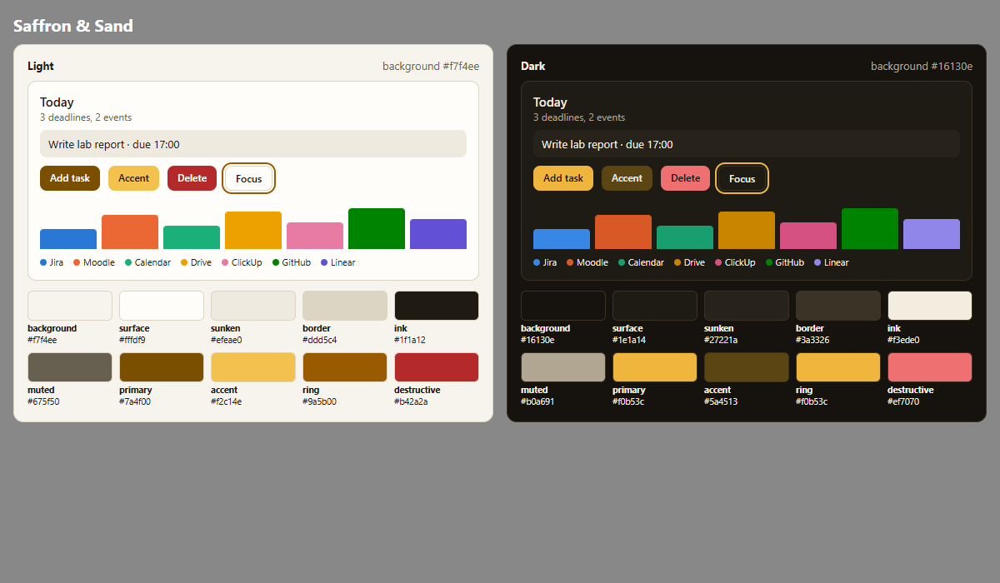
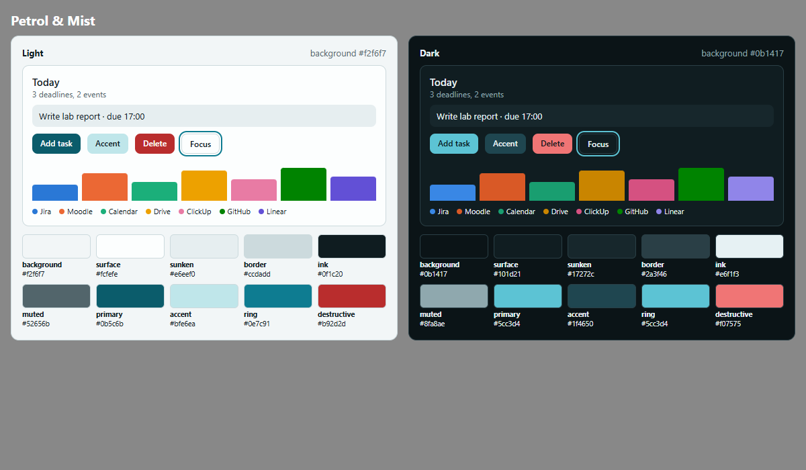
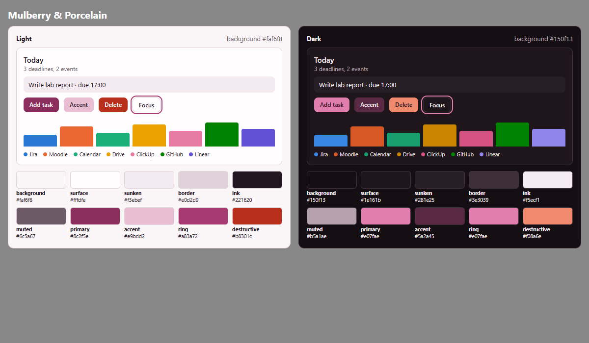

# Palette options (TODO E5)

**Decided: option 1, Saffron & Sand.** Shalev picked it on 2026-11-13 (TODO H10); it is applied in `client/src/index.css`, and [DESIGN.md](./DESIGN.md) has the tokens and the contrast measured on them. The rest of this page is the proposal as it was. At the time the UI was monochrome ink with colour used only for data; these three options give it a real brand palette. Each maps onto the existing token names (see the "Colour" section of [DESIGN.md](./DESIGN.md)), keeps the 7 `--color-source-*` / `--chart-1..7` data colours, and avoids every colour family Shalev has already shipped.

## 1. What he has already used

Captured 2026-11-13 from shalev396.com (CSS custom properties, headless Playwright) and the live project sites and GitHub repos behind it. The portfolio's 3D scene is a loader plus canvas, so the project list was taken from the linked repos. Screenshots: `.superpowers/sdd/2026-11-11-todolist-dashboard/screens/palette-research/` (6 files, git-ignored, not committed).

| Project                                                                     | Background                                                           | Primary / accent                                                                 | Gradient / data                                                                              | Family                                             |
| --------------------------------------------------------------------------- | -------------------------------------------------------------------- | -------------------------------------------------------------------------------- | -------------------------------------------------------------------------------------------- | -------------------------------------------------- |
| Portfolio (shalev396.com)                                                   | light oklch(99% .005 270); dark oklch(12% .02 270), hero #0d0a1a     | primary oklch(55% .22 285) violet (about #8b5cf6); accent oklch(60% .2 240) blue | gradient oklch(55% .24 262) to oklch(50% .26 293), blue to violet                            | violet / indigo / blue                             |
| Elytra (elytra.shalev396.com)                                               | same tokens as the portfolio                                         | violet primary, blue accent                                                      | blue to violet                                                                               | violet / indigo / blue                             |
| World Flow / WoltFlow                                                       | shadcn neutral: white / oklch(.145 0 0)                              | primary near-black (light), near-white (dark)                                    | shadcn default charts: orange, teal, deep blue, amber; dark adds indigo, green, purple, rose | black and white, plus default shadcn chart colours |
| Cloud Canvas (cloudcanvas.shalev396.com)                                    | #ffffff / #0f172a slate navy                                         | primary #059669 / #10b981 emerald; accent #10b981                                | #3b82f6 blue, #8b5cf6 violet, #f59e0b amber, #06b6d4 cyan, #dc2626 red                       | green on black / slate, touch of violet and blue   |
| Call Filter (offduty-call-filter.shalev396.com)                             | #ffffff / hsl(222 84% 5%) near-black navy                            | primary hsl(221 83% 53%) = #2563eb blue                                          | destructive hsl(0 84% 60%)                                                                   | blue on navy-black                                 |
| Red Alerts (red-alerts-mauve.vercel.app returned 404; values from the repo) | white / oklch(.145 0 0)                                              | primary oklch(.577 .245 27), about #dc2626 red; dark oklch(.637 .237 25)         | orange, teal, deep blue, amber charts                                                        | red on black / white                               |
| Mock Social Network, The Movie DB                                           | Social network deployment errored (500); TMDB is Netflix-style black | TMDB uses #46d369 green                                                          | n/a                                                                                          | black, red and green                               |

Families to avoid: **violet / indigo / blue (hue 220-300), emerald and green (150-165), red (0-30), black-and-white neutrals with shadcn chart orange/teal**. Also rejected for TodoList in DESIGN.md: cream and terracotta, black and acid green. Free ground: gold/ochre (~75), petrol (~195), mulberry (~335).

All three options keep a calm neutral base and use the brand hue only for primary actions, the accent wash and the focus ring, so "colour is data" still holds for content.

## 2. The options

Chart colours are the current validated set, unchanged in all three (the new surfaces are close in lightness to the old ones, so no adjustment was needed):

| Slot | Source          | Light   | Dark    |
| ---- | --------------- | ------- | ------- |
| 1    | Jira            | #2a78d6 | #3987e5 |
| 2    | Moodle          | #eb6834 | #d95926 |
| 3    | Google Calendar | #1baf7a | #199e70 |
| 4    | Google Drive    | #eda100 | #c98500 |
| 5    | ClickUp         | #e87ba4 | #d55181 |
| 6    | GitHub          | #008300 | #008300 |
| 7    | Linear          | #6250d6 | #9085e9 |

Status colours (good / warning / serious / critical) are unchanged. `--destructive-foreground` is #ffffff on the light destructive fill and #14161a on the dark one (6.0:1 to 7.4:1).

### Option 1: Saffron & Sand

Warm, studious: paper-and-ochre, like a well-used planner. Hue ~75 (gold/ochre) on warm stone neutrals.

| Token              | Maps to                                          | Light     | Dark      |
| ------------------ | ------------------------------------------------ | --------- | --------- |
| background         | `--background (--sidebar)`                       | `#f7f4ee` | `#16130e` |
| surface            | `--card / --popover`                             | `#fffdf9` | `#1e1a14` |
| sunken             | `--sunken (--secondary, --muted)`                | `#efeae0` | `#27221a` |
| border             | `--border / --input`                             | `#ddd5c4` | `#3a3326` |
| ink                | `--foreground`                                   | `#1f1a12` | `#f3ede0` |
| muted ink          | `--muted-foreground`                             | `#675f50` | `#b0a691` |
| primary            | `--primary (--sidebar-primary)`                  | `#7a4f00` | `#f0b53c` |
| primary-foreground | `--primary-foreground`                           | `#fffdf9` | `#1b1405` |
| accent             | `--accent (hover/selected wash, ink text on it)` | `#f2c14e` | `#5a4513` |
| focus ring         | `--ring`                                         | `#9a5b00` | `#f0b53c` |
| destructive        | `--destructive`                                  | `#b42a2a` | `#ef7070` |

Border is shown as a solid hex; in the app it stays a low-alpha overlay of the ink colour as today.

**Text and UI contrast (WCAG 2.x, computed)**

| Pair                                        | Light  | Dark   | Needs |
| ------------------------------------------- | ------ | ------ | ----- |
| ink on background                           | 15.7:1 | 15.9:1 | 4.5:1 |
| ink on surface                              | 17.0:1 | 14.8:1 | 4.5:1 |
| ink on sunken                               | 14.4:1 | 13.5:1 | 4.5:1 |
| muted on background                         | 5.7:1  | 7.7:1  | 4.5:1 |
| muted on surface                            | 6.2:1  | 7.2:1  | 4.5:1 |
| muted on sunken                             | 5.3:1  | 6.5:1  | 4.5:1 |
| primary-fg on primary                       | 7.0:1  | 9.9:1  | 4.5:1 |
| primary on background (links, text buttons) | 6.5:1  | 10.0:1 | 4.5:1 |
| ink on accent                               | 10.3:1 | 7.8:1  | 4.5:1 |
| ring on surface (focus, non-text)           | 5.3:1  | 9.4:1  | 3:1   |
| destructive on background                   | 5.8:1  | 6.4:1  | 4.5:1 |

All text pairs pass AA in both themes.

**Data colours: `validate_palette.js` (dataviz skill), run per theme on both the page and the card surface**

| Run                           | Lightness | Chroma | CVD adjacent                 | Normal-vision | Contrast vs 3:1                                                      |
| ----------------------------- | --------- | ------ | ---------------------------- | ------------- | -------------------------------------------------------------------- |
| light, on #f7f4ee and #fffdf9 | PASS      | PASS   | PASS (worst 9.1, tritan 5.8) | PASS (19.6)   | WARN: aqua, yellow, magenta (and orange on the page plane) under 3:1 |
| dark, on #16130e and #1e1a14  | PASS      | PASS   | PASS (worst 8.4)             | PASS (19.3)   | PASS, all 7 at 3:1 or more                                           |

The light WARN is the same one DESIGN.md already records, relieved by labelled legend chips and the chart data table. Nothing FAILs.

Chart slot 4 (Drive amber) sits near the primary hue family; primary is used on chrome only, and Drive marks always carry a label.

### Option 2: Petrol & Mist

Calm, focused: deep teal-blue-green on cool mist, like a quiet library. Hue ~195 (petrol) on cool mist neutrals.

| Token              | Maps to                                          | Light     | Dark      |
| ------------------ | ------------------------------------------------ | --------- | --------- |
| background         | `--background (--sidebar)`                       | `#f2f6f7` | `#0b1417` |
| surface            | `--card / --popover`                             | `#fcfefe` | `#101d21` |
| sunken             | `--sunken (--secondary, --muted)`                | `#e6eef0` | `#17272c` |
| border             | `--border / --input`                             | `#ccdadd` | `#2a3f46` |
| ink                | `--foreground`                                   | `#0f1c20` | `#e6f1f3` |
| muted ink          | `--muted-foreground`                             | `#52656b` | `#8fa8ae` |
| primary            | `--primary (--sidebar-primary)`                  | `#0b5c6b` | `#5cc3d4` |
| primary-foreground | `--primary-foreground`                           | `#ffffff` | `#06191d` |
| accent             | `--accent (hover/selected wash, ink text on it)` | `#bfe6ea` | `#1f4650` |
| focus ring         | `--ring`                                         | `#0e7c91` | `#5cc3d4` |
| destructive        | `--destructive`                                  | `#b92d2d` | `#f07575` |

Border is shown as a solid hex; in the app it stays a low-alpha overlay of the ink colour as today.

**Text and UI contrast (WCAG 2.x, computed)**

| Pair                                        | Light  | Dark   | Needs |
| ------------------------------------------- | ------ | ------ | ----- |
| ink on background                           | 16.0:1 | 16.2:1 | 4.5:1 |
| ink on surface                              | 17.2:1 | 15.0:1 | 4.5:1 |
| ink on sunken                               | 14.8:1 | 13.4:1 | 4.5:1 |
| muted on background                         | 5.6:1  | 7.4:1  | 4.5:1 |
| muted on surface                            | 6.0:1  | 6.9:1  | 4.5:1 |
| muted on sunken                             | 5.2:1  | 6.1:1  | 4.5:1 |
| primary-fg on primary                       | 7.6:1  | 8.8:1  | 4.5:1 |
| primary on background (links, text buttons) | 7.0:1  | 9.1:1  | 4.5:1 |
| ink on accent                               | 13.0:1 | 8.9:1  | 4.5:1 |
| ring on surface (focus, non-text)           | 4.8:1  | 8.4:1  | 3:1   |
| destructive on background                   | 5.6:1  | 6.7:1  | 4.5:1 |

All text pairs pass AA in both themes.

**Data colours: `validate_palette.js` (dataviz skill), run per theme on both the page and the card surface**

| Run                           | Lightness | Chroma | CVD adjacent                 | Normal-vision | Contrast vs 3:1                                                      |
| ----------------------------- | --------- | ------ | ---------------------------- | ------------- | -------------------------------------------------------------------- |
| light, on #f2f6f7 and #fcfefe | PASS      | PASS   | PASS (worst 9.1, tritan 5.8) | PASS (19.6)   | WARN: aqua, yellow, magenta (and orange on the page plane) under 3:1 |
| dark, on #0b1417 and #101d21  | PASS      | PASS   | PASS (worst 8.4)             | PASS (19.3)   | PASS, all 7 at 3:1 or more                                           |

The light WARN is the same one DESIGN.md already records, relieved by labelled legend chips and the chart data table. Nothing FAILs.

Petrol is nearest his green (Cloud Canvas, ~160) and blue (Call Filter, ~221) at about 30 degrees either side; it is desaturated and dark, so it reads as a different colour, but it is the closest of the three.

### Option 3: Mulberry & Porcelain

Composed, distinctive: berry on porcelain, editorial and a little warm. Hue ~335 (mulberry) on blush-tinted neutrals.

| Token              | Maps to                                          | Light     | Dark      |
| ------------------ | ------------------------------------------------ | --------- | --------- |
| background         | `--background (--sidebar)`                       | `#faf6f8` | `#150f13` |
| surface            | `--card / --popover`                             | `#fffdfe` | `#1e161b` |
| sunken             | `--sunken (--secondary, --muted)`                | `#f3ebef` | `#281e25` |
| border             | `--border / --input`                             | `#e0d2d9` | `#3e3039` |
| ink                | `--foreground`                                   | `#221620` | `#f5ecf1` |
| muted ink          | `--muted-foreground`                             | `#6c5a67` | `#b5a1ae` |
| primary            | `--primary (--sidebar-primary)`                  | `#8c2f5e` | `#e07fae` |
| primary-foreground | `--primary-foreground`                           | `#ffffff` | `#2a0c1b` |
| accent             | `--accent (hover/selected wash, ink text on it)` | `#e9bdd2` | `#5a2a45` |
| focus ring         | `--ring`                                         | `#a83a72` | `#e07fae` |
| destructive        | `--destructive`                                  | `#b8301c` | `#f08a6e` |

Border is shown as a solid hex; in the app it stays a low-alpha overlay of the ink colour as today.

**Text and UI contrast (WCAG 2.x, computed)**

| Pair                                        | Light  | Dark   | Needs |
| ------------------------------------------- | ------ | ------ | ----- |
| ink on background                           | 16.3:1 | 16.4:1 | 4.5:1 |
| ink on surface                              | 17.2:1 | 15.3:1 | 4.5:1 |
| ink on sunken                               | 14.9:1 | 13.9:1 | 4.5:1 |
| muted on background                         | 5.9:1  | 7.8:1  | 4.5:1 |
| muted on surface                            | 6.3:1  | 7.3:1  | 4.5:1 |
| muted on sunken                             | 5.4:1  | 6.7:1  | 4.5:1 |
| primary-fg on primary                       | 7.8:1  | 6.7:1  | 4.5:1 |
| primary on background (links, text buttons) | 7.3:1  | 7.0:1  | 4.5:1 |
| ink on accent                               | 10.5:1 | 9.8:1  | 4.5:1 |
| ring on surface (focus, non-text)           | 5.9:1  | 6.6:1  | 3:1   |
| destructive on background                   | 5.6:1  | 7.7:1  | 4.5:1 |

All text pairs pass AA in both themes.

**Data colours: `validate_palette.js` (dataviz skill), run per theme on both the page and the card surface**

| Run                           | Lightness | Chroma | CVD adjacent                 | Normal-vision | Contrast vs 3:1                                                      |
| ----------------------------- | --------- | ------ | ---------------------------- | ------------- | -------------------------------------------------------------------- |
| light, on #faf6f8 and #fffdfe | PASS      | PASS   | PASS (worst 9.1, tritan 5.8) | PASS (19.6)   | WARN: aqua, yellow, magenta (and orange on the page plane) under 3:1 |
| dark, on #150f13 and #1e161b  | PASS      | PASS   | PASS (worst 8.4)             | PASS (19.3)   | PASS, all 7 at 3:1 or more                                           |

The light WARN is the same one DESIGN.md already records, relieved by labelled legend chips and the chart data table. Nothing FAILs.

Destructive is red-orange (#b8301c light, #f08a6e dark) to stay apart from the berry primary; destructive always ships with an icon and a label.

## 3. Recommendation

**Option 1, Saffron & Sand.** It is the furthest from everything he has shipped (his work is all cool: violet, blue, green, plus red alerts), and its warm paper neutrals fit "calm dashboard for students and people who work" better than another tech blue. The deep ochre primary keeps buttons confident without competing with the 7 data colours, which are cool and saturated and so stand out against warm neutrals. Petrol is the safest but sits closest to his green and blue; Mulberry is the boldest but its primary sits near the red destructive and the ClickUp pink.

Contrast figures above are computed, so rerun the checks if any hex is changed during adoption.
