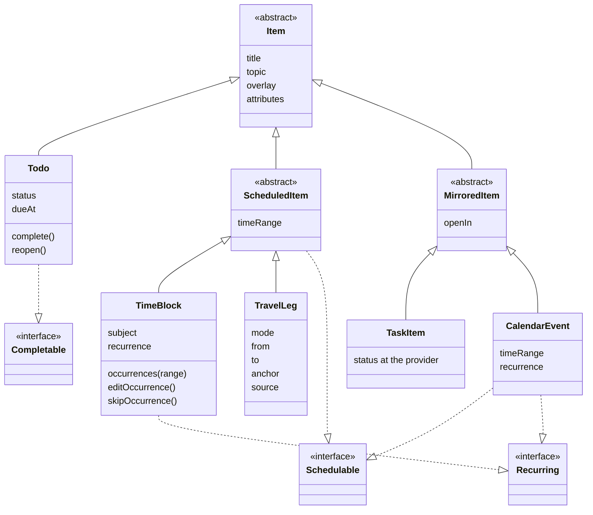

# Scheduled blocks (study time and other time you reserve): design

Status: approved by Shalev (2026-11-17). "Areas: painting time for a part of life" was added after his follow-up the same day.

## Why

Shalev fills his week with study time: "Sunday 13:00–17:00: math", "Tuesday 10:00–12:00: history". These aren't to-dos he ticks off. They are time he reserves, it's his own responsibility to use them, and reporting on them every week would be a hassle. Today TodoList only has to-dos with a status, and a repeating to-do can only be made as a Google Calendar event. He wants it in TodoList's own database, stored once: "one source of truth… but it's going to be repeating".

## Two kinds of to-dos (his decision)

|                        | **Markable to-do** (what exists today)    | **Scheduled block** (new)                         |
| ---------------------- | ----------------------------------------- | ------------------------------------------------- |
| Purpose                | Something to get done                     | Time that is reserved                             |
| Status                 | open → in progress → done (or cancelled)  | **None.** It just is; past blocks are simply past |
| Time                   | optional due date, optional start and end | **start and end** (required)                      |
| Repeats                | no                                        | **yes, optionally**: stored once as a series      |
| Counts as an open task | yes                                       | no                                                |
| Example                | "Submit calculus homework" (due Thursday) | "Study: Math", Sundays 13:00–17:00                |

Travel blocks (see the travel time design) are scheduled blocks that TodoList makes by itself.

## The class model

- **`Todo`** is the markable to-do: `Completable`, so it has a status and can be completed.
- **`ScheduledItem`** is the new abstract base for time that is reserved. It is `Schedulable` (it has a time range) and deliberately **not** `Completable`: the compiler forbids completing it.
  - **`TimeBlock`**: one he makes, optionally `Recurring`.
  - **`TravelLeg`**: one TodoList makes (travel time design).
- **`MirroredItem`** subclasses come from providers. A Google lecture is a `CalendarEvent`: scheduled and recurring, but owned by Google.
- `docs/design/CLASSES.md` gets the same diagram when this is built.

## One source of truth for repeating blocks

- **A repeating block is one record:** title, topic, subject, start and end of the first occurrence, and one repeat rule (RRULE, e.g. weekly on Sunday, until the end of the semester). Occurrences are **computed**, never copied.
- **Changing one occurrence** ("this Sunday 14:00–17:00 instead") stores a small exception on the series, keyed by that occurrence's original start. **Skipping one** stores a "skipped" exception. This is how Google Calendar does it, so the shapes stay familiar.
- **Edits ask which occurrences they apply to:** "This one" (an exception) or "All" (the series). "This and following" splits the series in two; that is my call for a later version, not the first.
- **One expansion on both sides.** The server and the client use the same expansion code: the client's `occurrences.ts`, shared with the server's `RecurrenceRule`. The clock, calendar, travel plan and MCP then agree on every occurrence.

## Subject

- A block names **what** he will study at the top level, e.g. Math or History, not the exact chapter.
- My call: reuse the existing **attributes** feature. A workspace attribute **"Subject"** (type `select`) holds the options. Typing a new subject in the block form adds it as an option.
- The block's title defaults to the subject ("Math"), and the topic defaults to Studies when the subject was first used there.
- Lists, filters and the logic builder can then filter and group by subject with no new machinery ("hours of Math this week").

## Creating and filling the week

- **Create form:** a choice at the top, "To-do (I'll tick it off)" or "Time block (reserve the time)".
  - The block form has start, end and length; fill any two and the third is computed.
  - It also has a subject, a topic, and **Repeat**: none, weekly on the chosen days, or custom; plus an end date, defaulting to none.
  - It offers the travel time option, like any timed item.
- **Week view:** dragging across a free slot in the calendar or timeline week view opens the block form with that time filled in.
- **MCP:** a `create_time_block` tool (with `recurrence`, `subject`, `topic`, `layer`), plus an `edit_time_block` tool with the same "this one / all" edits and skip (scope `items:write`). Agents such as Grok Bot can then lay out his study week, which is what he wants to move them to.

## How blocks show

- **Time views** (clock, calendar, timeline, agenda): drawn in the topic's colour family with the **Work** shade (topic colours design), so a lecture and the study block after it read as the same topic with a different shade. The title or subject is shown.
- **Task views** (lists, "open tasks", counts): not shown by default. They are time, not work.
- **Past occurrences** need no status; they are simply in the past.

## Decisions after review (my calls)

1. **Item kinds.**
   - Two new `ItemKind` values: `block` for `TimeBlock` and `travel` for `TravelLeg`.
   - `Item.classOf` reads them. A local item of kind `block` or `travel` is never a `Todo`.
   - `CalendarEvent` stays where it is, under `MirroredItem`. `ScheduledItem` is only TodoList's own reserved time.
   - The build starts with an **audit of every place that assumes "local = to-do"**: status filters, open-task counts, `list_today`, completion paths, MCP tools, charts. This is a step of its own.
2. **Where a repeat lives.** On the series record itself:
   - `recurrence`: the RRULE lines, the same shape as a `CalendarEvent`'s;
   - `exceptions[]`: `{ originalStart, startAt?, endAt?, skipped? }`.

   There are no child items. One record is the whole series.

3. **Time zone.** Rules expand on the wall clock in the **workspace's** time zone, exactly as Google series do today. "Sunday 13:00" stays 13:00 across daylight-saving changes.
4. **One expansion, shared.** The expansion becomes one pure module under `server/src/types/` (e.g. `recurrence/occurrences.ts`).
   - The client already imports runtime code from there through the `@api-types` alias (e.g. `errorCodes.ts`).
   - It handles both shapes: Google masters with exceptions, and local `recurrence` plus `exceptions[]`. The client's `occurrences.ts` becomes a thin caller.
   - The server needs the `rrule` dependency, as the client has.
   - Parity tests run the same cases on both sides.
5. **Subject is an attribute value, not a separate field.**
   - In the diagram, `subject` is an accessor over the item's "Subject" attribute.
   - A workspace "Subject" attribute (`select`) is created on first use when it doesn't exist.
   - The topic of a new block defaults to the page it is created from. Failing that, it takes the topic last used with that subject. No topic is assumed to exist.
6. **Visibility.** Time blocks follow the same visibility as TodoList's own to-dos. Travel legs are private to their member, which is a new branch in `ItemPolicy` by kind.
7. **Hidden from task views, by default.**
   - `ItemQuery` excludes `block` and `travel` by default for task-shaped results:
     - lists, open-task counts, deadlines, charts;
     - MCP `query_items`, search and `list_deadlines`.
   - Any query that names the kinds explicitly (the logic builder, or MCP with `kind`) gets them.
   - Time-shaped results always include them: the calendar, clock, timeline, agenda and workload blocks, and MCP `list_today` and `get_calendar`.

## Areas: painting time for a part of life (_Added 2026-11-17_)

Shalev: "I want to … paint … every time that I'm allocating to work … or to study or to personal project, but don't say exactly the task … it says studying in general, and then I can put blocks in it for studying certain stuff. These … can be repetitive."

- **An area is a time block with `layer: 'area'`** (a plain block has `layer: 'block'`). Same record, same one-record repeat, same "this one / all" edits. Class: `TimeArea extends TimeBlock`; `Item.classOf` picks it by the layer.
- **What it holds:** a general title ("Studying", "Work", "Side projects") and a topic. No subject is needed; one may be set.
- **How it shows:**
  - calendar and timeline: a band in the family's lightest tint (topic-colours "Area" role) behind everything, its label at the top; events, to-dos and blocks inside it draw on top as usual;
  - clock: a thin band on the ring's outer edge, under the item arcs;
  - agenda: a section header ("Studying 13:00–17:00") with the blocks and items inside it listed under it.
- **Blocks inside it:** dragging inside an area in the week view creates a block with the area's topic pre-filled. Nothing links the two records: an area is time, a block is a more specific use of that time. Overlap is expected and fine.
- **Not work:** like blocks, areas are hidden from task views and counts, have no status, and are never ticked.
- **Busy time:** areas are not busy time for agents by default (they are a plan, not a commitment); blocks inside them are. MCP `list_today` and `get_calendar` return areas with `layer: 'area'` so an agent can plan inside them ("put the Math block inside Studying").
- **Travel:** an area can carry travel like any timed item (e.g. "Work 9–17 at TLVTech, by car").
- **Create form:** the kind choice becomes three options: "To-do (I'll tick it off)", "Time block (reserve the time)", "Area (paint time for a part of life)".
- **MCP:** `create_time_block` takes `layer` (`block` by default).

**What I think (my recommendation, given as asked):** keep areas as a layer of the same block, not a third kind of thing. It's the same data (time, repeat, topic), so repeats, edits, travel and agents work on day one. Drawing areas behind everything keeps the week readable even when they overlap lectures. And putting blocks inside them stays a free choice, not a nesting rule, so he never has to fix a broken hierarchy.

## Non-goals (first version)

- "This and following" edits.
- Reporting on whether a block was used.
- Pushing blocks to Google Calendar. The existing push could include them later, off by default.

## Calls I made (for Shalev to check)

- The kind is chosen in the create form; existing to-dos stay markable and nothing migrates.
- Subject uses the attributes feature (a "Subject" select).
- "This one" and "All" edits only in the first version.
- Blocks are hidden from task lists and counts, and visible in time views and to agents.
